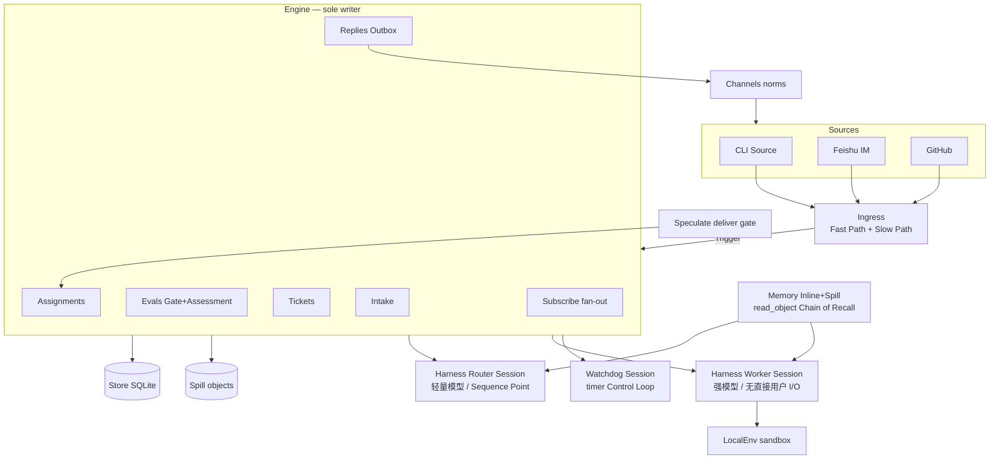

# ds-agent 完整可落地技术方案（M0–M11 + 常驻功能域）

> 独立 MIT 实现。自研最薄 Harness + 原型领域语义移植。**不依赖** DeepSeek Harness / Cordis。
>
> - 博客: https://mp.weixin.qq.com/s/zoS7GlReWPhfCjENGxXCdg
> - 原型语义参考: https://github.com/deepseek-ai/dsh-superagent-prototype
> - 公开仓名: `deepseek-super-agent` · CLI: `ds-agent` · 包名: `ds-agent`
> - 作者: LofiSu <163713803+LofiSu@users.noreply.github.com>
> - **免责声明：非官方 DeepSeek 产品；研究原型，非生产就绪。凭据永不进入模型上下文。**

本文档是并行 coding agents 的**只读契约**：改契约须先改本文再改代码。

## 0. 领域对齐（优先阅读）

本仓后续以《从零打造 Personal Agent（三）：从 DeepSeek Super-agent 看主动服务的设计模式》的领域模型为准；原先按另一篇博客写的 Router/Worker 词汇只保留为内部兼容标识。完整偏差清单与修正记录见 [`docs/DOMAIN_ALIGNMENT.md`](./docs/DOMAIN_ALIGNMENT.md)。

| 本仓标识 | 文章语义 | 约定 |
|---|---|---|
| `role='router'` | **Main Agent / Main Session** | 负责 Gate 之后的 Assessment、接单、路由与对外回复 |
| `role='worker'` | **Executor / Executor Session** | 在 Mandate 范围内执行 Assignment，向 Main Agent 报告 |
| `Evals` | **Eval**（Gate + Assessment → Decision） | 确定性 Gate 先行；无法确定时 `defer` 给 Main Agent |
| `Thread.subscriptions` + `Subscription` | **Subscription**（Ticket ↔ Thread 多对多） | 只传上下文、不增加授权；`contextOnly` 不唤醒 |
| `Ticket.threadKeys` | Subscription 的缓存视图 | 权威关系仍以 Ticket + Thread 记录为准 |
| `Assignments` | **Assignment**（Ticket ↔ Executor 实例） | 重试 = 同一 Ticket 上的新 Assignment |
| `Replies` / `outbox` | **Outbox** | 结果先入队；失败重试；幂等键去重 |
| `ticketStage` / `executionView` | **Panel / Execution** | 状态来自 Ticket 事实，不来自模型自述 |

**结论：** 领域写入仍只经 Engine；Harness 不持有领域规则；Panel 只读；Executor 不能 `reply/decide/receive`。

---

## 1. 目标 / 边界 / 免责

### 1.1 目标（四特质落地）

| 特质 | 博客含义 | ds-agent 落地 |
|------|----------|---------------|
| **Continuous** 连续 | 不因一轮工具阻塞丢失入站 | Harness async ReAct：`start()`/`stop()`；长工具 `{status:'started',jobId}`；完成作新 Session 事件 |
| **Efficient** 高效 | 吞吐与连续性折中；批处理；订阅旁路 | Ingress 两级过滤；Eval 同 Thread 批处理；Subscription fan-out bypass Router |
| **Proactive** 主动 | 静默试探后再交付 | Speculative Assignment + deliver gate；Watchdog 主动 nudge |
| **Persistent** 持久 | 状态可恢复；环境在机器上 | SQLite Session/领域 Store；Env 沙箱在本地；daemon 无会话状态（BYOM） |

### 1.2 五支柱 → 模块

| 支柱 | 博客节 | 主模块 |
|------|--------|--------|
| Dual-layer Router/Worker | §2 | M1 Harness + M3 Engine(Evals) |
| Event-driven Triggers | §3 | M4 Ingress + M5 Subscribe + M6 Memory + M7 Speculate |
| Human interaction | §4 | M1 Loop + M8 Channels |
| Compute/state/env 分离 | §5 | M2 Store + M9 Env + M1 Daemon |
| Watchdog Control Loop | §6 | M10 Watchdog |

### 1.3 边界

| 做 | 不做（M11 前） |
|----|----------------|
| 自研 thinnest Harness（Session 日志、async ReAct、OpenAI 兼容、角色工具、daemon） | 生产 Feishu IM Source + GitHub Source（禁止 fake IM / fake GitHub 作为验收） |
| 原型领域语义：Intake / Evals / Tickets / Assignments / Replies | Cordis 插件树、DSH Session API 兼容层 |
| SQLite + Spill、Watchdog Session、Speculative gate | Web Panel |
| BYOM `DS_AGENT_API_*`；`demo` / `test` 默认走 live 模型，Mock 仅限 fixture | 跨进程 A2A 传输 / 真多机 mesh（扩展 / 互操作；本进程内已常驻） |
| MIT OSS，`pnpm demo` 验收博客能力 | §7 实验指标（可选 M12，不挡开源） |

### 1.4 技术栈冻结

- Runtime: Node ≥ 22（`node:sqlite` 要求）· TypeScript · `pnpm`
- DB: `node:sqlite` 单文件 `<stateDir>/ds-agent.db`
- 测试: `vitest` · 默认 live 模型（`DS_AGENT_API_*`）；MockModel 仅用于 `DS_AGENT_ALLOW_MOCK_FIXTURE=1` 的离线 CI
- 无 `@deepseek-ai/dsh*`、无 `cordis`、无 `@cordisjs/*`

---

## 2. 总体架构（边界之后首先阅读）

### 2.1 分层文字图（职责清晰）

```
┌─ Channel 层 ─────────────────────────────────────────────────────────────┐
│  CLI / 真实 Feishu IM / 真实 GitHub（webhook+API）适配器                    │
│  入站：半结构化事件 → Trigger 形状                                        │
│  出站：Outbox 按信道规范（IM≤100词；GitHub 结构化高密度）                 │
└───────────────────────────────────┬───────────────────────────────────────┘
                                    ▼
┌─ Ingress 层 ─────────────────────────────────────────────────────────────┐
│  Fast Path：来源/群组/白名单等确定性过滤                                  │
│  Slow Path：Fast Path 先过；可选模型策略，失败回退 ruleClassify           │
│  Thread key 映射（IM topic / PR）                                         │
└───────────────────────────────────┬───────────────────────────────────────┘
                                    ▼
┌─ Domain Engine 层（唯一写领域聚合）──────────────────────────────────────┐
│  Intake → Eval(同 Thread 批处理 · Gate+Assessment) → Ticket/Mandate       │
│  Assignment · Subscription fan-out（bypass Eval）· Replies/Outbox         │
└───────────────────────────────────┬───────────────────────────────────────┘
                                    ▼
┌─ Harness 层（无领域规则；可注入）────────────────────────────────────────┐
│  Session 事件日志 · 异步 ReAct(start/stop) · Mock/HTTP 模型 · 工具注册    │
│  Router Session（Sequence Point）· Worker Session · Watchdog Session      │
└───────────────┬───────────────────────────────┬───────────────────────────┘
                ▼                               ▼
┌─ Store 层 ──────────────┐     ┌─ Env 层 ───────────────────────────────┐
│ SQLite Repositories     │     │ LocalEnv 沙箱 / BYOM daemon            │
│ Spill 对象存储          │     │ 无会话状态；只执行命令并回传结果       │
└─────────────────────────┘     └────────────────────────────────────────┘
```

### 2.2 组件如何连接

| 从 → 到 | 方式 | 约束 |
|---------|------|------|
| Channel → Ingress | 适配器产出 `Trigger` | Channel 不写 Store |
| Ingress → Engine | `Engine.receive(trigger)` | 过滤结果：`stored`/`duplicate`/`filtered` |
| Engine → Store | `Repositories` + Spill API | **仅 Engine** 写 Trigger/Thread/Decision/Ticket/Assignment |
| Engine → Harness | 启 Router/Worker Session；投递工具结果事件 | Harness 不含领域规则 |
| Worker → Env | bash / 文件工具经 LocalEnv | Env 不持久化 Session |
| Engine → Channel | Outbox：`acknowledgement`/`answer`/`result`/`attention` | 对外回复只经 Router |
| Watchdog → Engine/Harness | 定时 tick；nudge/fail stuck Worker | 独立 Session，外部 Control Loop |

### 2.3 主数据流（Source → … → Channel；并行 Watchdog）

```
Source event
  → Channel adapter（半结构化 → Trigger 形状）
  → Ingress Fast Path（source/group/whitelist 确定性过滤）
  → Ingress Slow Path（Fast Path 先过；可选模型策略，超时/异常回退 ruleClassify）
  → Thread key（IM topic / PR）
  → Engine.receive(trigger)
       → Intake：去重入库 Trigger + disposition；记入 Thread
       → Subscription fan-out
            · 人消息达 live Ticket → bypass=subscription（日志含 ticketId）→ 直达 Worker Input（跳过 Eval）
            · 否则入 primary Thread Eval 队列
  → Eval 队列 / 同 Thread 串行 batching（Router LLM 轮次中积压一并注入）
  → Gate（确定性）+ Assessment（Router Session）→ Decision
  → accept ⇒ 原子：Mandate + Ticket + Assignment + Subscriptions + ack Outbox
  → Worker Harness Session（强模型；无直接用户 I/O；经 LocalEnv）
  → report → DomainEventName 事件 → Router
  → Router Replies via Channel norms（IM≤100 words / GH 结构化）→ Outbox → Source
并行：Watchdog Control Loop（timer）
  → detect stuck / infra fault / goal drift → nudge 或 fail Assignment 或告警 Router
旁路：speculative Assignment → DeliverGate → deliver（可见）| discard（无出站）
异步：工具 `{status:'started',jobId}` → job 完成以 `JOB_DONE` prompt 触发下一 turn（不阻塞入站）
```

逐步说明：

1. **Source 事件** → Channel 适配器 → 不可变 `Trigger`。
2. **Ingress** Fast → Slow → **Thread key**。
3. **`Engine.receive`** → **Intake** 存 Trigger；**fan-out Subscriptions**；命中则 bypass Eval。
4. 否则 **Eval queue/batching** → **Gate+Assessment Decision**。
5. **Ticket+Mandate+Assignment** 原子创建 → **Worker Harness Session**。
6. **Report** → **Router Replies via Channel norms**。
7. 并行 **Watchdog Control Loop**；投机路径经 **deliver gate**。

### 2.4 架构图（mermaid）



### 2.5 职责分离 SoC 表（Harness / Engine / Store / Channels / Env / Watchdog / Ingress）

| 组件 | 做什么 | 不做什么 | 关键 ports / 文件 | 模块 |
|------|--------|----------|-------------------|------|
| **Channels** | 入站适配（CLI / 真实 Feishu / 真实 GitHub）→ Trigger；出站 ChannelNorms（IM≤100 words；GH 结构化）；Outbox 发到真实信道 | 写领域聚合；跑 LLM 循环 | `Outbox`, `ChannelNorms` · `src/channels/` | M8 |
| **Ingress** | Fast Path 确定性过滤；Slow Path 可选模型策略（超时/异常/非法输出回退确定性规则）；Thread key 映射；调用 `Engine.receive` | 写 Ticket；出站；持 Session | `Ingress.admit` · `src/ingress/` | M4 |
| **Engine** | **领域唯一写者**：Intake / Evals(Gate+Assessment) / Tickets / Assignments / Replies / Subscribe；同步命令+事务 | Node I/O；模型 HTTP；文件系统；Channel 协议细节 | `Engine`, `Repositories`, `Assessor`, `Executor`, `Outbox` · `src/core/` | M3+M5 |
| **Harness** | Session 事件日志；async ReAct `start/stop/runTurn`；角色工具；Mock/BYOM；daemon 调度；Router=Sequence Point；Worker 隔离；Watchdog Session 宿主 | 领域状态机；直接写 Channel；解释 Policy | `Harness`, `Tool`, `Model` · `src/harness/` | M1 |
| **Store** | SQLite Repositories + Spill 对象；atomic；session_event/job 持久化 | 业务 Decision；出站格式；跑工具 | `Repositories`, `SpillStore` · `src/store/` | M2 |
| **Env** | LocalEnv 沙箱目录/进程；prepare；大输出 Spill；sanitize **凭据值永不进上下文**；daemon 的「手」 | 持 Session 状态；写 Ticket | `LocalEnv` · `src/env/` | M9 |
| **Watchdog** | 外部 Control Loop；timer；基建故障 + 任务进度/目标漂移；nudge/fail；NL prompts/rules | 创建 Ticket；替 Router 做 Assessment；直写出站 | `Watchdog.tick` · `src/watchdog/` | M10 |

横切（仍服从上表写者规则）：**Memory**（M6 Inline+Spill/`read_object`）只读图+Spill；**Speculate**（M7 DeliverGate）只改 speculative 可见性，生命周期仍经 Engine。

### 2.6 Ports-only 连接约束

| Port | 提供者 | 消费者 | 规则 |
|------|--------|--------|------|
| `Engine.receive` / 命令 API | Engine | Ingress、RouterPorts | 同步+事务；非法 `UserError`。Worker/Watchdog 调用 `receive` 直接拒绝 |
| `RouterPorts` | Engine | Router session 工具 | `receive` / `decide` / `reply` / `subscribe`。出站只在这里 |
| `WorkerPorts` | Engine | Worker session 工具 | `report` / `subscribe` / `handback`。**无** `reply` / `decide` / `receive` |
| `WatchdogPorts` | Engine | Watchdog session 工具 | `fail`。**无** `reply` / `decide` / `receive` |
| `Repositories` + `SpillStore` | Store | Engine（写）、Memory/Harness（读或追加 session 表） | Trigger/Thread/Decision/Ticket/Assignment **仅 Engine 写** |
| `Assessor` | Router Harness 适配 | Engine.Evals | `request` → 稍后 `Engine.decide`（仅 RouterPorts） |
| `Executor` | Worker Harness 适配 | Engine.Assignments | `start/deliver/stop` 只入队；回调 past-tense |
| `Outbox` | Channels adapter | Engine.Replies | Router 拥有出站；Worker 禁止直写 Channel |
| `LocalEnv` | Env | Worker tools | 凭据值永不进 tool result / prompt |
| `DeliverGate` | Speculate | Runtime / Assignments | gate 前对外不可见 |
| `Watchdog.tick` | Watchdog | Daemon | 只经 Engine/Harness ports 行动 |

### 2.7 职责一句话（速查）

- **Ingress**：两级过滤 + Thread key；Fast Path 白名单；Slow Path 可选模型策略，失败回退确定性规则。
- **Engine**：唯一写 Trigger/Thread/Decision/Ticket/Assignment/Subscription；同步命令 + 事务。
- **Harness Router**：Sequence Point；批处理 Trigger；轻模型；理想无 bash；出站归 Router。
- **Harness Worker**：隔离执行；强模型；只向 Router 报告；可订阅 Thread；Subagent 对 Router 不透明。
- **Store / Spill**：持久状态；大对象外置；Inline = summary + spillIds。
- **Env**：留在机器；轻量 daemon 不持 Session 状态；BYOM。
- **Watchdog**：外部 Control Loop；定时；基建故障 + 任务漂移；NL prompts/rules 可维护。
- **Channels**：入站 Source 适配 + 出站 Norms；不写领域。

---

## 3. 博客技术 → 模块 / 任务矩阵（全量）

| # | 博客技术点 | 节 | 模块 / 域 | 具体任务 / 文件 |
|---|------------|----|------|-----------------|
| T01 | Continuous：不阻塞入站 | §1/§4.1 | M1 | `loop.ts`：`runTurn` 非阻塞；工具 `started`→job |
| T02 | Efficient：吞吐 vs 连续折中 | §2 | M1+M3 | Router 批处理窗口；Eval 同 Thread batch |
| T03 | Proactive：静默试探 | §3.4 | M7 | silent Assignment + `DeliverGate` |
| T04 | Persistent：状态可恢复 | §5 | M2+M1 | SQLite + `SessionJournal`；`Runtime.resume` 从 Store 续跑 |
| T05 | Dual-layer Router/Worker | §2 | M1+M3 | `Role = 'router'\|'worker'\|'watchdog'`；分角色 tools/models；分层 prompt stack（identity→persona→instructions→owner→team→reach→rules→memory→style→long-tasks→role；`PERSONA.md`/`AGENTS.md`/`USER.md`） |
| T06 | Router = Sequence Point | §2 | M1 | Router tools 默认无 bash（`tools.ts` 的 `roles` 白名单）；批 Triggers 进一轮 |
| T07 | Router 轻模型 | §2 | M1 | `models.router`（`roleModelsFromEnv`）默认小模型 / Mock |
| T08 | Trigger batching during LLM round | §2 | M3+M1 | `Evals.evaluateDue` 合并同 Thread 积压；Router turn 开始时 drain inbox |
| T09 | Future Router sharding / multi-filter | §2/§8 | 扩展 | `[x]` `RouterShardRegistry`（Runtime 常驻；`DS_AGENT_SHARDS` / `routerShards` 配置；每 shard 一轮 Router） |
| T10 | Worker 隔离 / 最强模型 | §2 | M1+M9 | Worker Session + LocalEnv；`models.worker` |
| T11 | Worker 无直接用户 I/O | §2 | M8+M3 | Outbound 仅经 `RouterPorts.reply`；WorkerPorts 无 `reply`/`decide`/`receive`（类型 + 运行时） |
| T12 | Worker 向 Router 报告 | §2 | M3 | `Assignments.report` → DomainEventName 事件 → Router inbox |
| T13 | Workers subscribe Threads | §2/§3.2 | M5 | `Subscription` 多对多；fan-out |
| T14 | Worker 内 Subagent/Team 对 Router 不透明 | §2 | M1 | Worker 可 spawn 子 job（Store `jobs` 表）；Router 只见 Assignment 报告 |
| T15 | 个人助手多话题 → 多 Worker / 一 UI | §2 | M3+M11 | 同 chat Thread 多 Ticket；CLI 列 Tickets |
| T16 | Fast Path 过滤（source/group/whitelist） | §3.1 | M4 | `ingress/filter.ts` `fastPath` 确定性规则 |
| T17 | Slow Path policy classifier | §3.1 | M4 | `[x]` `ingress/filter.ts` 确定性 Fast Path；`ingress/policy.ts` 可选 `SemanticPolicy`（`DS_AGENT_SLOW_PATH=model`），`PolicyClassifier` 超时/异常/非法输出回退规则；`Runtime.ingestAsync` 供真实频道循环使用，同步 `ingest` 与 A2A 入站保持纯规则 |
| T18 | Thread = 事件流 | §3.2 | M0+M2 | `Thread` + `trigger_thread` 表 |
| T19 | Subscribe Fast Path bypass Router | §3.2 | M5 | 人消息达 Ticket → `bypass=subscription`；日志含 ticketId |
| T20 | 多对多 Worker↔Thread | §3.2 | M5 | Subscriptions on Thread；`followForContext` |
| T21 | Worker unsubscribe / handback | §3.2 | M5 | `markUnrelated` / `handback` → 回 Eval |
| T22 | Router 仍观察全局 | §3.2 | M3 | Intake 记 disposition；`Runtime.start()` 常驻 Router Session，`observe.*` 事件入 journal，assessment 读取 `routerSession` |
| T23 | Inline & Spill 上下文缓存 | §3.3 | M6 | `inlineOrSpill(text, put, refs)`：窗口内保留 text/summary + spill id；refs 作为独立字段注入 task 并随 spill 持久化 |
| T24 | Locality：ID+summary → neighbors → spill truncate+continue | §3.3 | M6 | `read_object` 分页 + `refs`；对象句柄 `kind:id` 可继续展开 |
| T25 | Chain of Recall（Trigger/Thread/Worker Session 对象图） | §3.3 | M6 | `graph.ts` 对象句柄 + spill `refs` 列；`readObjectFor` 逐跳解析并重新校验 ACL |
| T26 | Speculative：静默 Assignment | §3.4 | M7 | `speculate:true` 创建 Assignment；对外不可见 |
| T27 | Deliver only if valuable else discard | §3.4 | M7 | `deliverGate.evaluate(report)` → deliver \| discard |
| T28 | 例：silent reproduce-and-fix | §3.4 | M7+M11 | demo 场景：静默跑测，有价值才 reply |
| T29 | Async ReAct start/stop | §4.1 | M1 | `Harness.launch` / `resume` / `deliver` 入队 turn；非 `run()` 阻塞 |
| T30 | Started ack | §4.1 | M1+M3 | 工具/Assignment `started` → 立即 ack 事件 |
| T31 | Completion as new session event | §4.1 | M1 | job 完成 → `JOB_DONE` prompt → 下一 turn |
| T32 | Duplex | §4.1 | M1 | 入站事件与工具结果并行入队 |
| T33 | IM ≤100 words / 低打断 | §4.2 | M8 | `channels/norms.ts` `imMaxWords=100` |
| T34 | GitHub 结构化高密度 | §4.2 | M8 | `formatGithub` 模板 |
| T35 | Router owns outbound | §4.2 | M3+M8 | Worker 禁直写 Channel；仅 `orchestrator_reply` 类经 Router |
| T36 | Stateless compute + durable Session DB | §5.1 | M1+M2 | 计算进程可杀；Session/领域在 SQLite |
| T37 | Env stays on machine | §5.2 | M9 | LocalEnv workdir 在 stateDir |
| T38 | Lightweight daemon 无 session state | §5.2 | M1 | `daemon.ts` 只调度；状态在 Store |
| T39 | BYOM | §5.2 | M1 | `HttpOpenAIModel` + `DS_AGENT_API_*` |
| T40 | Brain/hands；间歇设备 | §5.2 | M9+M1 | brain=Harness/Model；hands=Env；断线后 Store 续 |
| T41 | Watchdog Session = 外部 Control Loop | §6 | M10 | 独立 `Role='watchdog'` Session |
| T42 | Timer-driven | §6 | M10 | `setInterval` / due tick 表 |
| T43 | Infra faults + task progress / goal drift | §6 | M10 | health + stalled Assignment + NL drift check |
| T44 | NL maintainability prompts/rules | §6 | M10 | `prompts/watchdog.md`；规则 YAML/JSON |
| T45 | §7 实验指标 | §7 | M12 | counters + optional `curveSamples` / `summarizeCurve`（T45） |
| T46 | §8 Router sharding | §8 | 扩展 | 同 T09；registry 常驻 Runtime |
| T47 | §8 Worker mesh | §8 | 扩展 | `[~]` 本地 `WorkerMeshRegistry`（容量/队列）+ `RemoteMeshRegistry`/`MeshInbox`（A2A HMAC 传输、心跳、上限、loopback 默认拒绝；`src/harness/remote-node.ts`）。无默认 Runtime 监听器，远程 dispatch 接线仍属 operator-gated |
| T48 | §8 Long-term memory | §8 | 长期记忆 | `[~]` `SpillBackedLongTermMemory`（Runtime 常驻；终止 Ticket 写一条；保留期/同票去重/ADR-010 词法+标签一跳召回已实现）。语义/embedding 召回与跨月实测仍未实现 |
| T49 | §8 Product UX without Session | §8 | 产品层 | `[x]` `LifecycleBus` 常驻读取模型 + 只读 loopback UI（`src/ui/server.ts`、`src/cli/ui.ts`、`ds-agent ui`；必需 token、GET-only、生命周期事件白名单、speculative 隐藏、SSE 背压）。远程多进程面板/多用户账号仍为外部边界 |
| T50 | §8 A2A | §8 | 互操作 | `[x]` `A2ARouter` + 本地 transport + HMAC-SHA256 HTTP transport（±60s、nonce 重放缓存、32B 密钥、64KiB/128KiB 上限、deadline），`runtime.sendA2A`；远程 mesh handler 已实现但默认不监听，暴露需 operator 决策 |
| T51 | §8 Security/privacy；credential never in context | §8 | M0+M9 | Env 变量描述可进 prompt；**值永不**；vault 外置 |

---

## 4. 历史设计草案（非冻结接口）

> **状态：历史设计草图，不是当前 API 契约。** 本节记录 M0–M11 开工前的接口设想，代码已按演进后的形状落地。文中 `SessionRole`、`Assignment.status` / `AssignmentStatus`、`Harness.start/stop`、`SessionEvent`、`TurnResult` 等名字在实现中并不存在；不要据此实现或 review 代码。需要以代码为准的契约见下表与 [`docs/MODULES.md`](docs/MODULES.md)。

### 4.1 当前契约（as shipped）

| 契约 | 代码位置 | 实际形状 |
|------|----------|----------|
| `Role` | `src/shared/types.ts:1` | `'router' \| 'worker' \| 'watchdog'`；没有 `SessionRole`。 |
| `Strength` | `src/shared/types.ts:5` | `'explicit' \| 'inferred' \| 'maybe'`（含 `maybe`）。 |
| `Assignment.state` | `src/shared/types.ts:128`（字段 :130） | `'pending' \| 'running' \| 'ended'`；没有 `Assignment.status`/`AssignmentStatus`。另有 `workerSessionId?`、`node?`、`startedAt?`、`endedAt?`、内联 `report?`。 |
| `ReceiveResult` / `DecisionKind` | `src/shared/types.ts:3` / `:7` | `'stored' \| 'duplicate' \| 'filtered'`；`'accept' \| 'ignore' \| 'stop' \| 'unavailable'`。 |
| `TriggerTrust` | `src/shared/types.ts:57` | ingress 持有的事实（`spillId`、`strength`、`filterText`、`shards`）；绝不从 `trigger.meta` 读取。 |
| `Trigger` / `Thread` / `Mandate` / `Assignment` / `Ticket` / `Decision` | `src/shared/types.ts:29` / `:72` / `:94` / `:128` / `:173` / `:191` | 领域文档形状；`Ticket` 内联 `assignments`，没有独立 `Report`/`ReportKind` 导出。 |
| `DomainEventName` | `src/shared/events.ts:1` | 见下方事件名清单；没有 `DomainEvents`，也没有 `thread.unsubscribed`。 |
| `RouterPorts` / `WorkerPorts` / `WatchdogPorts` | `src/shared/ports.ts:49` / `:65` / `:81` | `reply(ticketId, text, purpose)`、`decide(...): Decision`；Worker/Watchdog 端口在类型和 Proxy 运行时都没有 `reply`/`decide`/`receive`（调用抛 `worker cannot reply` 等）。 |
| `Harness` | `src/harness/loop.ts:39` | `armRouter(shard?)` :57 · `launch(ticket)` :65 · `deliver(ticketId, trigger, spillId?)` :170 · `resume(ticket)` :195 · `scheduleJob({id, sessionId, ticketId})` :287 · `routerTurn(prompt)` :336 · `watchdogTurn()` :354 · `drain()` :364 · `jobsSettled()` :375。没有 `ensureSession`/`start`/`stop`/`runTurn` 方法。 |
| `runTurn(input)` | `src/harness/loop.ts:450` | 独立 async 函数，接收 `{model, tools, journal, log, metrics, redact, session, prompt, maxSteps?, pause?}`，返回 `Promise<void>`（没有 `TurnResult`）。 |
| `Daemon` | `src/harness/daemon.ts:4` | `start()` :14 · `stop()` :43；构造为 `new Daemon(watchdog, log, machines?)`。 |
| `SessionJournal` | `src/harness/session.ts:25` | 会话日志；session id 由 `routerSessionId(shard)` :20 / `workerSessionId(ticketId)` :15 生成。 |
| `ToolRegistry` / `ToolContext` | `src/harness/tools.ts:67` / `:21` | 按 `Role` 过滤 `specsFor(role)`；工具以 `roles: Role[]` 声明可用角色，没有独立 roles 文件。 |
| `Model` | `src/harness/model.ts:41` | `MockModel` :86、`HttpOpenAI` :156、`createModelFromEnv` :252。 |
| `Engine` | `src/core/engine.ts:26` | 唯一领域写入口；Runtime 通过 `bindRolePorts(engine)`（`src/core/role-ports.ts`）切出三套端口。 |
| `ChannelNorms` | `src/channels/norms.ts` | `format(source, kind, text)` 仅实现 `formatGithub`（及 IM 100 词）；**没有 email 信道/来源，也没有 `formatEmail`；email 不在范围内**（适配器需扩展 ingress 与 norms）。 |

**事件名（`DomainEventName`）**：`trigger.received` · `eval.started` · `decision.recorded` · `ticket.created` · `ticket.paused` · `ticket.resumed` · `ticket.ended` · `assignment.started` · `assignment.ended` · `thread.subscribed` · `trigger.requeued` · `subscription.removed` · `collab.guidance` · `collab.guidance_injected` · `collab.delivery_held` · `collab.reply_held` · `collab.report_held` · `speculate.delivered` · `speculate.discarded` · `watchdog.nudge` · `watchdog.fail` · `assignment.placed`。

以下为**原始草案**（仅用于追溯设计意图，不是实现依据）：

```ts
/** Roles — dual-layer + watchdog */
export type SessionRole = 'router' | 'worker' | 'watchdog'

export interface ActorRef { source: string; id: string }
export interface ThreadRef { source: string; id: string }
export interface ChannelRef {
  source: string
  thread: string
  address: Record<string, string>
}

export const threadKey = (ref: ThreadRef): string => `${ref.source}:${ref.id}`

export interface Trigger {
  id: string
  source: string
  threads: ThreadRef[]          // threads[0] = primary (Eval host)
  actor: ActorRef
  human: boolean
  addressed?: 'mention' | 'direct'
  at: string                    // ISO
  text: string
  channel?: ChannelRef
  url?: string
  meta: Record<string, unknown> // untrusted; core never interprets
}

export type Strength = 'explicit' | 'inferred'
export type DecisionKind = 'accept' | 'stop' | 'ignore' | 'unavailable'
export type AssignmentStatus = 'pending' | 'running' | 'ended'
export type ReportKind =
  | 'progress' | 'waiting' | 'ready' | 'blocked' | 'failed' | 'dropped'

export interface Mandate {
  policyVersion: string
  scope: string
  strength: Strength
  rules: string[]
  sender: ActorRef
  basis: MandateBasis
}

export type MandateBasis =
  | { via: 'addressed' }
  | { via: 'followup' }
  | { via: 'admission'; observation?: boolean; row?: string }
  | { via: 'bot' }

export interface Ticket {
  id: string
  title: string
  mandate: Mandate
  channels: ChannelRef[]
  assignments: Assignment[]
  inputs: Input[]
  follows: { thread: string; own: boolean; closed?: { at: string; outcome: string } }[]
  ended?: { at: string; by: string; reason: string; outcome: string }
  speculative?: boolean         // true → hidden until deliver gate
}

export interface Assignment {
  id: string
  ticketId: string
  status: AssignmentStatus
  sessionId: string             // worker-<ticketId>
  speculative?: boolean
  report?: Report
  startedAt?: string
  endedAt?: string
}

export interface Report {
  kind: ReportKind
  summary: string
  question?: string             // attention
  at: string
  meta?: Record<string, unknown>
}

export interface Input {
  id: string
  kind: 'trigger' | 'policy' | 'resume' | 'text' | 'recovery'
  triggerId?: string
  human?: boolean
  text?: string
  deliveredAt?: string
  readAt?: string
}

export interface Thread {
  key: string                   // source:id
  source: string
  id: string
  subscriptions: Subscription[]
  queuedTriggerIds: string[]
  eval?: Evaluation
  decisions: string[]
  meta: Record<string, unknown>
}

export interface Subscription {
  ticketId: string
  contextOnly?: boolean         // followForContext
}

export interface Evaluation {
  id: string
  threadKey: string
  triggerIds: string[]
  primaryTriggerId: string
  strength: Strength
  deliveredAt?: string
  deadlineAt?: string
}

export interface Decision {
  id: string
  evalId: string
  threadKey: string
  kind: DecisionKind
  reasons: Reason[]
  ticketId?: string
  at: string
}

export interface Reason {
  code: string
  values?: Record<string, string>
  triggerId?: string
}

/** Inline context cache entry */
export interface InlineRef {
  summary: string
  spillIds: string[]
  objectKind: 'trigger' | 'thread' | 'session' | 'report' | 'blob'
  objectId: string
}

/** Spill object store */
export interface SpillStore {
  put(data: string | Uint8Array | object): Promise<string /* id */>
  get(id: string): Promise<unknown>
  exists(id: string): Promise<boolean>
}

/** Engine sole entry for Sources */
export type ReceiveResult = 'stored' | 'duplicate' | 'filtered'

export interface Engine {
  receive(trigger: Trigger): ReceiveResult
  evaluateDue(): void
  decide(triggerId: string, outcome: AssessmentOutcome): void
  // Ticket lifecycle
  stopTicket(ticketId: string, reason?: string): void
  retryTicket(ticketId: string): void
  // Executor callbacks
  assignmentStarted(ticketId: string, assignmentId: string): void
  inputsDelivered(ticketId: string, assignmentId: string, inputIds: string[]): void
  report(ticketId: string, report: Report): void
  assignmentInterrupted(ticketId: string, assignmentId: string): void
  // Subscribe
  markUnrelated(ticketId: string, thread: string, reason: string): void
  followForContext(ticketId: string, thread: string): void
  handback(ticketId: string, triggerId: string, reason: string): { queued: boolean }
  unsubscribe(thread: string): void
  // Outbound (Router owns)
  reply(req: ReplyRequest): void
}

export type AssessmentOutcome =
  | { kind: 'ignore'; reason: string | Reason }
  | { kind: 'unavailable'; reason: string | Reason }
  | {
      kind: 'accept'
      title: string
      scope: string
      reason: string | Reason
      acknowledgement?: string
      rules?: string[]
      name?: string
      note?: string
      speculative?: boolean
    }
  | { kind: 'stop'; ticketId: string; reason: string | Reason }

export interface ReplyRequest {
  id: string
  channel: ChannelRef
  text: string
  kind: 'acknowledgement' | 'answer' | 'result' | 'attention'
  ticketId?: string
}

/** Harness */
export interface SessionEvent {
  id: string
  sessionId: string
  role: 'system' | 'user' | 'assistant' | 'tool' | 'job'
  at: string
  content?: string
  toolName?: string
  toolCallId?: string
  jobId?: string
  status?: 'started' | 'completed' | 'failed'
  spillIds?: string[]
}

export type ToolResult =
  | { ok: true; content: unknown }
  | { ok: false; error: string }
  | { status: 'started'; jobId: string }   // async — MUST NOT block turn

export interface Tool {
  name: string
  description: string
  parameters: object            // JSON Schema
  roles: SessionRole[]
  execute(args: unknown, ctx: ToolContext): Promise<ToolResult>
}

/** Tool-facing slices. A worker context must not be given `Engine`. */
export interface RouterPorts {
  receive(trigger: Trigger): ReceiveResult
  decide(triggerId: string, outcome: AssessmentOutcome): void
  reply(req: ReplyRequest): void
  subscribe(ticketId: string, threadKey: string): void
}

export interface WorkerPorts {
  report(ticketId: string, report: Report): void
  subscribe(ticketId: string, threadKey: string): void
  handback(ticketId: string, triggerId: string, reason: string): { queued: boolean }
  // no reply, decide, or receive
}

export interface WatchdogPorts {
  fail(ticketId: string, reason: string): void
  // no reply, decide, or receive
}

export type ToolContext =
  | { sessionId: string; role: 'router'; ports: RouterPorts; spill: SpillStore; env?: LocalEnv }
  | { sessionId: string; role: 'worker'; ports: WorkerPorts; spill: SpillStore; env?: LocalEnv }
  | { sessionId: string; role: 'watchdog'; ports: WatchdogPorts; spill: SpillStore; env?: LocalEnv }

export interface TurnResult {
  sessionId: string
  finished: boolean
  pendingJobs: string[]
  eventsAppended: number
}

export interface Harness {
  ensureSession(sessionId: string, role: SessionRole): void
  start(sessionId: string): void          // begin duplex loop (non-blocking)
  stop(sessionId: string): void
  runTurn(sessionId: string): Promise<TurnResult>
  appendEvent(event: Omit<SessionEvent, 'id' | 'at'>): void
  injectJobResult(jobId: string, result: unknown): void
}

/** Memory / Chain of Recall */
export interface MemoryApi {
  inline(kind: InlineRef['objectKind'], id: string, summary: string, body: unknown): Promise<InlineRef>
  read_object(id: string, opts?: { offset?: number; limit?: number }): Promise<{
    summary: string
    content?: unknown
    truncated?: boolean
    nextOffset?: number
    neighbors?: InlineRef[]
  }>
}

/** Speculative deliver gate */
export interface DeliverGate {
  /** Called after speculative Assignment reports ready/failed/dropped. */
  evaluate(input: {
    ticket: Ticket
    report: Report
  }): 'deliver' | 'discard'
}

/** Channels norms */
export interface ChannelNorms {
  format(source: string, kind: ReplyRequest['kind'], text: string): string
  // im: ≤100 words; github: structured dense
}

/** Env — hands on the machine */
export interface LocalEnv {
  rootDir: string
  prepare(ticketId: string, shortName: string): Promise<{ dir: string }>
  exec(ticketId: string, cmd: string, opts?: { timeoutMs?: number }): Promise<{
    code: number
    stdout: string
    stderr: string
    spillId?: string            // large output spilled
  }>
  // NEVER inject credential values into model context — only names/descriptions
}

/** Watchdog */
export interface Watchdog {
  tick(): Promise<void>
  // detects: stuck workers, infra faults, goal drift (NL)
  // actions: nudge (inject SessionEvent) | fail Assignment | alert Router
}

/** Ingress */
export interface Ingress {
  admit(raw: RawEvent): Promise<ReceiveResult | 'slow-pending'>
}

export interface RawEvent {
  source: string
  payload: unknown
}
```

**验收探针（硬要求）**

```ts
// fan-out log line MUST match:
/bypass=subscription.*ticketId=/
// speculative: public list excludes speculative tickets until deliver
// credential: prompt assembly asserts no env value substrings
// worker: WorkerPorts has no reply/decide/receive; calling them throws `worker cannot reply`
```

---

## 5. M0–M11 模块详案

### M0 — shared（Wave A 先合）

| 项 | 内容 |
|----|------|
| Path | `src/shared/` |
| Files | `types.ts`, `ports.ts`, `errors.ts`, `events.ts`, `log.ts`, `boundary.ts`, `index.ts` |
| Data | 上节当前契约中的类型；`USER_ERRORS`；`DomainEventName` 联合 |
| Tests | `test/ports.test.ts`（角色端口；`threadKey` 见 `test/subscription.test.ts`） |
| Accept | 可被 M1/M2/M8/M9 import；无 Node I/O |
| Deps | — |
| Wave | A（先行） |

`DomainEventName` 的完整清单以 `src/shared/events.ts` 为准（含 `ticket.paused`/`ticket.resumed`、`subscription.removed`、`collab.*`、`assignment.placed` 等；没有 `thread.unsubscribed`）。

---

### M1 — harness（Wave A）

| 项 | 内容 |
|----|------|
| Path | `src/harness/` |
| Files | `session.ts`, `loop.ts`, `model.ts`, `providers.ts`, `tools.ts`, `daemon.ts`, `team.ts`, `machines.ts`, `mesh.ts`, `index.ts` |
| Data | `JournalEntry` 追加日志；`jobs`/`sessions` 表由 Store 持久化 |
| Interfaces | `Harness`/`HarnessOptions`, `runTurn`, `ToolRegistry`/`ToolContext`, `Model`；没有 `ToolResult`/`TurnResult` |
| Models | `MockModel`（脚本化 tool_calls）；`HttpOpenAI`；`createModelFromEnv` / `roleModelsFromEnv`（`DS_AGENT_API_*`） |
| Roles | 无独立 roles 文件；`tools.ts` 用 `roles: Role[]` 声明：Router 无 bash，Worker 有 `bash`/`read_object`/`report_to_router`，Watchdog 仅 nudge/fail |
| Async ReAct | `Harness.launch/resume` 入队 turn；`start_job` 工具返回 `{ status: 'started', jobId }` → `Harness.scheduleJob` → turn 结束；job 完成后以 `JOB_DONE` / `TEAM_MEMBER_DONE` prompt 触发下一 `runTurn` |
| Daemon | `start()`/`stop()` 定时唤醒 Watchdog；不持有 Session 状态；机器离线时 brain 仍从 Store 继续（`tick`/`onMachineResume`） |
| Tests | `test/job.test.ts`、`test/ports.test.ts`、`test/daemon-machines.test.ts` |
| Accept | 单测：长工具不阻塞；completion 成新事件；Router 工具集无 bash |
| Deps | M0 |
| Wave | A |

---

### M2 — store（Wave A）

| 项 | 内容 |
|----|------|
| Path | `src/store/` |
| Files | `sqlite.ts`, `schema.ts`, `spill.ts`, `index.ts` |
| Schema | tables: `id_seq`, `documents`, `spills`, `spill_grants`, `jobs`, `sessions`, `messages`, `replies`, `outbox`, `subscriptions`, `artifacts`, `events` |
| Spill | SQLite blob（`Store.putSpill`/`getSpill`）+ `spill_grants` 权限行；`spillPort(store)` 适配 `SpillPort` |
| Repos | 无独立 `Repositories` 层；`Store`（`sqlite.ts`）直接提供文档/事件/Job/Session/Spill API |
| Tests | `test/spill.test.ts`、`test/runtime-integration.test.ts` |
| Accept | 进程重启后 Ticket/Session 可读 |
| Deps | M0 |
| Wave | A |

---

### M3 — engine（Wave B）

| 项 | 内容 |
|----|------|
| Path | `src/core/` |
| Files | `engine.ts`, `intake.ts`, `evals.ts`, `tickets.ts`, `assignments.ts`, `replies.ts`, `subscribe.ts`, `stage.ts`, `reasons.ts`, `assessment.ts`, `collab.ts`, `host.ts`, `lifecycle.ts`, `model.ts`, `role-ports.ts`, `session-role.ts`, `index.ts` |
| Parts | Intake → Evals → Tickets → Assignments → Replies（依赖单向） |
| Gate | 确定性：白名单 actor / addressed / admission table |
| Assessment | 经 Assessor port → Router Session（Mock 可直接 decide） |
| Batching | 同 Thread 串行 Eval；积压 Triggers 一批 |
| Speculative hook | accept 可带 `speculative:true` → Ticket 隐藏 |
| Tests | 移植原型核心场景：receive/fan-out/accept/report/stop/resume（in-memory repos） |
| Accept | Engine.receive 幂等；accept 原子创建 Mandate+Ticket+Assignment+Subscriptions+ack |
| Deps | M0, M2 |
| Wave | B |

---

### M4 — ingress（Wave C）

| 项 | 内容 |
|----|------|
| Path | `src/ingress/` |
| Files | `filter.ts`, `batch.ts`, `shards.ts`, `thread.ts`, `index.ts` |
| Fast Path | `filter.ts` 的 `fastPath(trigger)`：source allow、group/chat allow、actor whitelist、drop bot-self |
| Slow Path | 同文件的 `ruleClassify` / `filterTrigger`：确定性规则 + 可选 `SemanticModel`（Mock 可跳过） |
| Thread keys | `thread.ts`：`threadKey` / `parseThreadKey`；每 Source 映射 `im:chatId` · `github:issue:n` · `cli:session` |
| Tests | 噪声丢弃；白名单通过；slow-path mock |
| Accept | demo 噪声 Trigger → `filtered` |
| Deps | M0, M3 |
| Wave | C |

---

### M5 — subscribe（Wave C）

| 项 | 内容 |
|----|------|
| Path | `src/core/subscribe.ts`（+ Intake 调用） |
| Files | `subscribe.ts`；改 `intake.ts` |
| Behavior | 多对多 Ticket↔Thread；人消息达 live Ticket → **bypass Eval**；日志 `bypass=subscription ticketId=…`；ended+未 stop → resume；contextOnly 不授 follow-up；handback / unsubscribe |
| Tests | fan-out 探针；handback 回 Eval；contextOnly 不 resume |
| Accept | 日志硬探针；第二路并行 Worker 可订阅另一 Thread |
| Deps | M3 |
| Wave | C |

---

### M6 — memory（Wave C）

| 项 | 内容 |
|----|------|
| Path | `src/memory/` |
| Files | `acl.ts`, `graph.ts`, `recall.ts`, `long-term.ts`, `index.ts` |
| Inline | `recall.ts` 的 `inlineOrSpill`：窗口内保持 text/summary + spill id；`refs` 作为独立字段注入 Router/Worker task，并写入 spill |
| Locality | `read_object`（`tools.ts`）+ `acl.ts`：`read_object` 接受 spill id 或 `kind:id` 句柄，分页 200 字符，返回 `refs` 供下一跳 |
| Chain of Recall | `graph.ts` 为 Trigger/Thread/Ticket/Decision/Session/Channel/Actor 生成稳定句柄；`refsForTrigger`/`refsForTicket`/`refsForDecision` 写进对象和 spill；`readObjectFor` 逐跳解析并重新校验 reader ticket 的 Thread 关系 |
| Router global memory | `long-term.ts` 的 `rememberDecision`：每个 accept/ignore/stop/unavailable Decision 一条 `kind=decision` 记忆；Router 注入 `recentDecisions` + `forThreads`，Worker 注入 `forThreads` + 词法召回 |
| Resident Router Session | `Runtime.start()` 为每个 shard 建立常驻 Session；`armRouter` 持久化 `sessions` 行与 `session.started`/`session.resumed`；`routerObserve` 记录 Trigger/Decision/Ticket/assessment 事件；`routerExclusive` 串行化 assessment 与 Router turn；assessment 读取 `routerHistory` |
| Long-range memory | Ticket/Decision 为 hot（默认 1000 条 / 90 天）；被 prune 的条目折叠为 Thread digest（cold，默认 200 条 / 3650 天），`query({tier:'cold'})` 可召回 |
| Tools | 注册 `read_object` 给 router+worker；返回 `{text, truncated, nextOffset, refs}` |
| Tests | `test/spill.test.ts`、`test/memory-graph.test.ts`、`test/long-term-memory.test.ts`、`test/memory-recall-eval.test.ts`、`test/router-resident.test.ts` |
| Accept | demo Spill + read_object；trigger→thread→ticket 多跳可走通；常驻 Router 跨 Ticket 可见 |
| Deps | M1, M2 |
| Wave | C |

---

### M7 — speculate（Wave C）

| 项 | 内容 |
|----|------|
| Path | `src/speculate/` |
| Files | `gate.ts`, `silent.ts`, `index.ts` |
| Silent | `createSilentAssignment(ticket)`：不发 Channel ack；Ticket.`speculative=true` |
| Gate | 默认启发式：`ready` 且 summary 含价值信号 → deliver；`dropped`/`failed` → discard；可换 NL（Router 一票） |
| Deliver | 清 speculative 标志；Outbox result；事件 `speculate.delivered` |
| Discard | end Ticket；无对外消息；`speculate.discarded` |
| Tests | gate 前列表不可见；通过后可见；丢弃无 outbox |
| Accept | demo silent reproduce-and-fix |
| Deps | M3, M1 |
| Wave | C |

---

### M8 — channels（Wave A）

| 项 | 内容 |
|----|------|
| Path | `src/channels/` |
| Files | `norms.ts`, `cli.ts`, `feishu.ts`, `github-source.ts`, `github.ts`, `im.ts`, `outbox-adapter.ts`, `a2a.ts`, `index.ts`（禁止 fake-* 验收路径） |
| Norms | IM：≤100 words、低打断、合并进度；GitHub：结构化（标题/清单/链接）；CLI：纯文本 |
| Real sources | Feishu event webhook + GitHub webhook/API；demo 必须走真实信道 |
| Tests | im 截断到 100 words；github 格式含 headings |
| Accept | Router 出站；Worker 无 Channel 写权限；Worker 调用 reply/decide/receive 在类型与运行时都被拒绝 |
| Deps | M0 |
| Wave | A |

---

### M9 — env（Wave A）

| 项 | 内容 |
|----|------|
| Path | `src/env/` |
| Files | `local-env.ts`, `sanitize.ts`, `seccomp.ts`, `vault.ts`, `index.ts` |
| LocalEnv | `<home>/workspaces/<workerId>/`；speculative 写入 `<home>/workspaces/speculative/`；`exec` 捕获输出，超限截断 |
| Sanitize | **凭据值永不进 tool result 正文**（红线替换）；描述可进 prompt |
| Prepare | 无 prepare 脚本钩子；`LocalEnv` 构造时按需建目录 |
| Tests | exec echo；大输出 spill；sanitize 屏蔽 |
| Accept | Worker 经 Env 跑命令；重启目录仍在 |
| Deps | M0 |
| Wave | A |

---

### M10 — watchdog（Wave C）

| 项 | 内容 |
|----|------|
| Path | `src/watchdog/` |
| Files | `watchdog.ts`, `health.ts`, `rules.ts`, `rules.json`, `index.ts` |
| Timer | `Watchdog` 由 `Daemon` 按 `intervalMs` 驱动；Runtime 默认 15s（`RuntimeOptions.watchdogIntervalMs`） |
| Detect | `stuckAssignments` / `stuckSessions` / `driftAssignments`：卡住、job 连续失败 N 次、规则标记的 scope 漂移 |
| Actions | `nudge` 写入 Session journal；`fail` 走 Engine report；不直接对外发言 |
| Session | 默认规则引擎；需要时可用 `Harness.watchdogTurn()` 跑独立 `Role='watchdog'` turn |
| Tests | 卡住 Worker 被 nudge；三次后 fail |
| Accept | demo Watchdog tick |
| Deps | M1, M3 |
| Wave | C |

---

### M11 — cli + demo（Wave D）

| 项 | 内容 |
|----|------|
| Path | `src/cli/` · `src/runtime.ts` · `prompts/` · `README.md` |
| Files | `src/cli/main.ts`（入口 `pnpm ds-agent`）、`src/runtime.ts` 装配、`src/cli/demo.ts`、`src/cli/demos/*`、`src/cli/bakeoff.ts` |
| CLI | `init` · `chat` · `tasks` · `health` · `metrics` · `memory` · `a2a` · `status` · `team`/`teams` · `pause` · `intervene` · `resume` · `collab` · `emit im\|github` · `demo` |
| Prompts | 只有 `prompts/watchdog.md`；Router/Worker 的 system prompt 由 `harness/model.ts` 的 `systemPrompt(role)` 内联生成 |
| Accept | 见 §7 清单全绿；`pnpm test && pnpm demo` |
| Deps | all |
| Wave | D |

---

## 6. Wave A–D 并行日程

```
Wave A  ──┬── M0 shared (merge first, block others until green)
          ├── M1 harness
          ├── M2 store
          ├── M8 channels
          └── M9 env

Wave B  ──── M3 engine          (needs M0+M2 ports)

Wave C  ──┬── M4 ingress
          ├── M5 subscribe
          ├── M6 memory
          ├── M7 speculate
          └── M10 watchdog

Wave D  ──── M11 cli-demo       (wire Runtime + pnpm demo)
```

**并行 agent 约定**

1. 只改本模块 path；共享类型只在 M0 改（先 PR 计划）。
2. 依赖未合入时用 `src/shared/ports.ts` 接口 + 内存 fake。
3. 每模块自带 vitest；Wave 末 `pnpm test` 全绿再进下一 Wave。
4. 禁止引入 `@deepseek-ai/*` / `cordis`。

---

## 7. `pnpm demo` 验收清单（映射博客）

```bash
pnpm install && pnpm test && pnpm demo
```

| # | 验收项 | 博客映射 |
|---|--------|----------|
| D1 | 噪声被 Fast/Slow Path 丢掉（`filtered`） | §3.1 T16–T17 |
| D2 | 可行动 IM → Ticket → Worker Assignment | §2/§3 T05–T12 |
| D3 | 同 Thread 后续人消息日志含 `bypass=subscription` + `ticketId=` | §3.2 T19 |
| D4 | 第二路并行 Worker 可起（另一 Ticket/Thread） | §2 T15 / §3.2 T20 |
| D5 | Spill 写入 + `read_object` 链式召回 | §3.3 T23–T25 |
| D6 | Speculative Assignment 在 gate 前对外不可见；通过后可见；丢弃无出站 | §3.4 T26–T28 |
| D7 | Watchdog tick 能 nudge/fail 卡住的 Worker | §6 T41–T44 |
| D8 | 进程重启后 Store 持久化恢复 Session/Ticket | §5 T36–T40 |
| D9 | Feishu 出站 ≤100 words；GitHub 真实评论结构化 | §4.2 T33–T35 |
| D10 | 长工具 `started` 不阻塞；完成作新事件 | §4.1 T29–T32 |
| D11 | Router 工具集无 bash；出站经 Router | §2 T06 / §4.2 T35 |
| D12 | **无** `@deepseek-ai/dsh*` / `cordis` 依赖 | 边界 |
| D13 | 凭据值不出现在 Session 事件/prompt 装配 | §8 T51 |

---

## 8. 原型缺口补全（我们必须自研的）

原型（Cordis/DSH）已有厚领域 Engine，但相对博客仍缺或薄。ds-agent **发明**如下落地设计：

| 缺口 | 博客 | 我们的设计 | 文件 |
|------|------|------------|------|
| 真双 Router/Worker Session（非 DSH preset） | §2 | 自研 `Role` + 分角色 model/tools/prompts；Router=Sequence Point | `harness/loop.ts`, `harness/model.ts`, `harness/tools.ts` |
| Async start/stop ReAct | §4.1 | `Harness.launch/resume` + `start_job` 返回 `{status:'started'}` + `Harness.scheduleJob` 完成回注 | `harness/loop.ts`, `harness/tools.ts` |
| Spill + Chain of Recall 工具 | §3.3 | `SpillStore` + `read_object` + InlineRef 图 | `store/spill.ts`, `memory/*` |
| Speculative deliver gate | §3.4 | `Ticket.speculative` + `DeliverGate` + 静默 Assignment | `speculate/*` |
| Multi-channel reply norms | §4.2 | `ChannelNorms`；IM 100 words；GH 结构化；Router 独占 Outbox | `channels/norms.ts` |
| BYOM daemon（无会话状态） | §5.2 | `HttpOpenAIModel` + `daemon.ts` 只调度；状态全在 SQLite | `harness/model.ts`, `daemon.ts` |
| Watchdog Session | §6 | 独立 role + timer + detect/nudge/fail | `watchdog/*` |
| Fast/Slow ingress | §3.1 | `filter.ts` 的 `fastPath` 确定性规则 + `ruleClassify` 语义规则 | `ingress/filter.ts` |
| Batching into Router turn | §2 | Eval 批 + Router inbox drain at turn start | `core/evals.ts`, `harness/loop.ts` |
| 无 Cordis 装配 | — | `src/runtime.ts` 显式 DI 组合根 | `src/runtime.ts` |
| Real Feishu + GitHub Sources | 边界 | Feishu/Lark + GitHub webhook/API；CLI 仅运维 | `channels/*` |

---

## 9. 功能域：评测与指标、扩展、长期记忆、产品层、互操作、安全与隐私（Runtime 常驻服务）

以下功能域按所属 M 模块常驻装配：Runtime 每次启动都会构造这些服务，不再有 `DS_AGENT_PHASE2` / `RuntimeOptions.phase2` 总开关。编号沿用 §3 任务矩阵（T45–T51），不另设一套 ID。

| ID | 功能域 | 项 | 说明 | 实现 / 接口 |
|----|--------|----|------|--------------|
| T45 | 评测与指标 | §7 实验指标 | 计数 + optional latency curveSamples | `<stateDir>/metrics.json` · `ds-agent metrics` · `summarizeCurve` |
| T46 | 扩展 | Router sharding / multi-filter | registry 常驻 Runtime；`DS_AGENT_SHARDS` / `RuntimeOptions.routerShards` 配置，默认 shard 始终存在 | `RouterShardRegistry` |
| T47 | 扩展 | Worker mesh | capacity registry 常驻 Runtime；`DS_AGENT_MESH_CAPACITY` / `RuntimeOptions.meshCapacity` | `WorkerMeshRegistry` |
| T48 | 长期记忆 | Long-term memory | Spill-backed LTM 常驻 Runtime；终态 Ticket + 每个 Decision 写一条；hot/cold 两层：hot 按标题/标签召回，cold 为 Thread digest 跨月保留 | `SpillBackedLongTermMemory` |
| T49 | 产品层 | Product UX without Session | 无会话读取模型 `LifecycleBus` 常驻 Runtime；只读 loopback UI 在本仓（`src/ui/server.ts`、`ds-agent ui`）；远程面板/多用户外置 | `core/lifecycle.ts` |
| T50 | 互操作 | A2A | envelope router 常驻 Runtime；`runtime.sendA2A`；HMAC-SHA256 HTTP transport 已实现（`a2a-auth.ts`/`a2a-http.ts`），默认不监听 | `A2ARouter` |
| T51 | 安全与隐私 | Security/privacy 深化 | 凭据托管、沙箱 seccomp、审计 | allowlist + redact 已落地；vault / seccomp 仍外置 |

---

## 10. 仓库布局（与 tracked tree 一致）

以下按 `git ls-files` 的实际模块归类；文件清单以仓库为准，模块边界说明见 [`docs/MODULES.md`](docs/MODULES.md)。

```
deepseek-super-agent/
  package.json                 # name: ds-agent; scripts 直接跑 tsx，没有 bin/dist 产物
  LICENSE                      # MIT
  README.md
  pnpm-lock.yaml
  tsconfig.json
  vitest.config.ts
  prompts/
    watchdog.md
  src/
    shared/                    # M0
      types.ts
      ports.ts
      errors.ts
      events.ts
      log.ts
      boundary.ts
      index.ts
    harness/                   # M1
      loop.ts
      session.ts
      model.ts
      providers.ts
      tools.ts
      daemon.ts
      team.ts
      machines.ts
      mesh.ts
      index.ts
    store/                     # M2
      sqlite.ts
      schema.ts
      spill.ts
      index.ts
    core/                      # M3 + M5
      engine.ts
      intake.ts
      evals.ts
      tickets.ts
      assignments.ts
      replies.ts
      subscribe.ts
      stage.ts
      reasons.ts
      assessment.ts
      policy.ts
      panel.ts
      collab.ts
      host.ts
      lifecycle.ts
      model.ts
      role-ports.ts
      session-role.ts
      index.ts
    ingress/                   # M4
      filter.ts
      batch.ts
      shards.ts
      thread.ts
      index.ts
    memory/                    # M6
      acl.ts
      graph.ts
      recall.ts
      long-term.ts
      index.ts
    speculate/                 # M7
      gate.ts
      silent.ts
      index.ts
    channels/                  # M8
      norms.ts
      cli.ts                   # ops only; not demo acceptance
      feishu.ts
      github-source.ts
      github.ts
      im.ts
      outbox-adapter.ts
      a2a.ts
      index.ts
    env/                       # M9
      local-env.ts
      sanitize.ts
      seccomp.ts
      vault.ts
      index.ts
    watchdog/                  # M10
      watchdog.ts
      health.ts
      rules.ts
      rules.json
      index.ts
    metrics/                   # 常驻功能域（T45）
      metrics.ts
      curve.ts
      bakeoff.ts
      batching-bench.ts
      index.ts
    runtime.ts                 # composition root
    index.ts                   # public exports
    cli/                       # M11
      main.ts
      demo.ts
      bakeoff.ts
      demos/
        run.ts
        lib.ts
        parallel.ts
        spill-memory.ts
        watchdog.ts
        feishu-smoke.ts
  test/                        # flat vitest files
    *.test.ts
    fixtures.ts
    scripted-model.ts
    setup-live.ts
```

---

## 附录 A — Runtime 装配顺序

组合根是 `src/runtime.ts` 的 `Runtime.create(opts)`（`RuntimeOptions`）；以下为示意顺序，实际以该文件为准：

1. `new Store(home)`、`new Metrics(home)`、`new LocalEnv(<home>/workspaces)`、`new SessionJournal(<home>/sessions)`。
2. 常驻服务：`RouterShardRegistry`、`WorkerMeshRegistry`、`SpillBackedLongTermMemory`、`LifecycleBus`、`A2ARouter`。
3. `new Engine(host)`，再用 `bindRolePorts(engine)` 切出 Router/Worker/Watchdog 端口。
4. `ToolRegistry` → `Harness`（`launch`/`deliver`/`resume`/`scheduleJob`/`routerTurn`）→ `Watchdog` → `Daemon`。
5. 最后构造 `Runtime`，统一暴露 `receive`/`resume`/`sendA2A` 等入口。

## 附录 B — 决策记录

| | 自研最薄 Harness（本方案） | 继续 fork DSH 原型 |
|--|---------------------------|-------------------|
| 两小时可演示面 | 领域能力 + Mock 全路径 | 「挂在 DSH 上」更快，Cordis 负担重 |
| 依赖 | 无 DSH | 强依赖 DeepSeek Harness |
| 博客缺口 | 本计划 §8 全部自研补齐 | 仍缺 Spill/Speculate/Watchdog Session 等 |
| 推荐 | **采用** | 仅当必须证明 DSH 兼容 |

---

*设计/路线图文档；当前 API 以 `src/` 与 `docs/MODULES.md` 为准 · LofiSu · MIT*


---

## 博客全文逐条覆盖审计

对照 https://mp.weixin.qq.com/s/zoS7GlReWPhfCjENGxXCdg （抓取日与开源同周）。

| 文章块 | 覆盖任务 | README 勾选 | 代码落点 | 缺口 |
|--------|----------|-------------|----------|------|
| §1 四特质 | T01–T04 | 有 | Harness/Engine/Store/Speculate | — |
| §2 双层 + Router 批处理 + Worker | T05–T15 | 有 | harness + core | T09 sharding 已接线；T14/T15 部分（多话题 UX 由只读 UI 覆盖） |
| §3.1 Fast/Slow | T16–T17 | 有 | ingress | Fast Path 确定性；Slow Path 可选模型策略（`DS_AGENT_SLOW_PATH=model`），超时/异常回退确定性规则 |
| §3.2 订阅直通 | T18–T22 | 有 | subscribe + demo | T21 handback 弱 |
| §3.3 Inline/Spill/链式召回 | T23–T25 | 有 | memory + spill + read_object + graph refs | 多跳对象图已落地（Trigger/Thread/Ticket/Decision） |
| §3.4 投机 | T26–T28 | 有 | speculate + deliver | — |
| §4.1 异步 ReAct | T29–T32 | 有 | loop/jobs | — |
| §4.2 信道规范 | T33–T35 | 有 | channels/norms | 无 email 信道/来源，也未实现 `formatEmail`；email 不在范围内（适配器需扩展 ingress 与 norms） |
| §5 存算/环境 | T36–T40 | 有 | store/env/daemon/BYOM | 真跨机 daemon 弱 |
| §6 Watchdog | T41–T44 | 有 | watchdog | NL 改规则未齐 |
| §7 实验 | T45 | 计数已做；端到端曲线未做 | `metrics/` | 压测曲线仍可选 |
| §8 未决 | T46–T51 + mid-task collab + T14 Team | T51 白名单+脱敏；中途 pause/intervene/resume（#31）；Team persist+CLI+e2e（#34） | `env/sanitize.ts` · `core/collab.ts` · `harness/team.ts` | vault/seccomp 仍外置 |

**结论：** §2–§6 工程点均已进入 T 矩阵与 README 清单。§7 计数 + optional curveSamples、§8 vault/seccomp 与扩展域服务（T09/T46–T50）已落地；这些服务现在由 Runtime 默认路径常驻装配（`runtime.routerShards` / `workerMesh` / `longTermMemory` / `lifecycle` / `a2aRouter`），不再有 `DS_AGENT_PHASE2` 或 `RuntimeOptions.phase2` 总开关。
