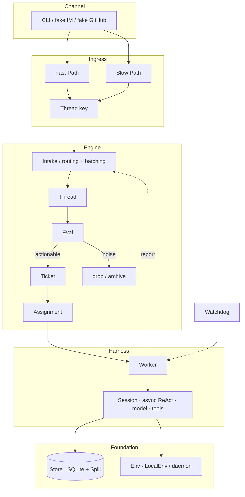

# deepseek-super-agent

English | [简体中文](README.zh-CN.md)

CLI: `ds-agent`. License: MIT.

Thin TypeScript runtime. Custom Harness below. Domain engine on top.

Inspired by DeepSeek's public article and prototype. Independent implementation. No DeepSeek Harness, Cordis, or `@deepseek-ai/dsh*`.

Author: LofiSu. Co-written with Grokbot (CoderBot).

[Inspiration](#inspiration) · [Features](#features) · [Architecture](#architecture) · [Quick start](#quick-start) · [Demo](#demo) · [Models](#models) · [Credits](#credits) · [License](#license)

## What this is

Two layers.

- **Harness.** Session log, async ReAct loop, OpenAI-compatible calls, tools by role, daemon.
- **Engine.** Intake → Eval → Ticket → Assignment → Reply. Domain writes stay in the Engine.

## Inspiration

| Source | Link | Used for |
|--------|------|----------|
| WeChat article | [Super-agent 设计探索](https://mp.weixin.qq.com/s/zoS7GlReWPhfCjENGxXCdg) | §2–§6: dual Router/Worker, Trigger, async tools, multi-channel, state vs environment, Watchdog |
| Official prototype | [deepseek-ai/dsh-superagent-prototype](https://github.com/deepseek-ai/dsh-superagent-prototype) | Trigger → Eval → Ticket → Assignment. The Harness is ours. |

## Features

Checked against [Super-agent 设计探索](https://mp.weixin.qq.com/s/zoS7GlReWPhfCjENGxXCdg), one item at a time. Status follows this repo, `pnpm demo`, and `pnpm test`. Task list: [PLAN.md](./PLAN.md) (T01–T51). Where the plan and the code diverge: [docs/REVIEW.md](./docs/REVIEW.md).

`[x]` done and covered. `[~]` partial. `[ ]` not done. Phase-2 counts as not done.

### §1 Four traits

- [x] **Continuous.** IM and GitHub-style channels share one domain state. Sessions stay inside the runtime. (Harness Session + Engine Thread/Ticket)
- [x] **Efficient.** Workers run in parallel. The Router batches Triggers waiting on the same Thread (`evals` + harness inbox).
- [x] **Proactive.** Triggers drive the loop. Speculative Assignment, then a deliver gate (`speculate/`).
- [x] **Persistent.** SQLite. A restart can resume (`store/` plus the demo restart check).

### §2 Dual Router / Worker

- [x] **Continuity vs throughput.** Two layers. The Router talks and dispatches. Workers execute alone (`SessionRole`).
- [x] **Router is the sequence point.** Inbound goes through the Engine. Outbound goes through Router/Outbox.
- [x] **Router stays light.** Workers hold the execution tools. The Router tool set is smaller.
- [x] **Small model on the Router.** `roleModels.router`. Workers can use a stronger model.
- [x] **Trigger batching.** Under load, same-Thread Triggers fold into the next Eval. Demo and tests cover it.
- [ ] **Router sharding / multi-layer filter.** Article §2/§8. Phase-2 (PLAN T09).
- [x] **Isolated Worker context.** Each Worker has its own Session and the full tool set.
- [x] **Workers report upward.** `report` goes to the Router. The Router sends the reply. A worker session holds `WorkerPorts`, not the Engine, and cannot `reply` or `decide`.
- [x] **Worker ↔ Thread subscriptions.** Many-to-many, via `subscribe` and fan-out.
- [~] **Subagent / Team inside a Worker.** Async jobs exist. A full Team topology does not (T14).
- [~] **One UI, many topics.** Several Tickets can exist at once. There is no product shell yet (T15).

### §3 Event-driven

- [x] **Triggers.** Semi-structured events from IM / GitHub-style sources.
- [x] **Fast Path.** Deterministic source and noise rules (`ingress/filter`).
- [x] **Slow Path.** Semantic or policy filter. It can call a model. Rules can stand in.
- [x] **Thread.** One topic or PR. One event stream. Thread key.
- [x] **Already subscribed.** Straight to the Worker. Log line `bypass=subscription` plus `ticketId`.
- [x] **Not subscribed.** Cold start: Intake → Eval → Ticket.
- [x] **Unsubscribe / hand back.** `handback` drops the subscription and requeues the trigger for Eval (T21).
- [x] **Router still sees every Trigger.** Intake records them.
- [x] **Inline.** Short summaries stay in context (`memory/recall`).
- [x] **Spill.** Long content is stored out of band, with an id (`store/spill`).
- [x] **Locality.** IDs and summaries first. Expand on demand (`read_object`).
- [x] **Chain of Recall.** Pull a spill id or object ref when needed (minimal T25).
- [x] **Speculative work.** A background Assignment can run first.
- [x] **Deliver gate.** `deliver=true`, or the result is dropped. The demo checks this.

### §4 Talking to people

- [x] **Async ReAct.** `start` returns at once. The foreground does not wait.
- [x] **Started notice.** A job-started log event.
- [x] **Completion comes back.** The result is a new Session event on the Worker.
- [x] **Duplex.** New input still arrives while a job runs.
- [x] **IM norms.** Short replies. Low interruption (`channels/norms`, with a word cap).
- [x] **GitHub-style output.** Structured text from the GitHub channel formatter.
- [x] **Only the Router speaks outward.** Workers cannot write a channel directly.

### §5 Compute, state, environment

- [x] **Stateless compute.** Session and domain state live in SQLite.
- [x] **Env stays on the machine.** Sandbox directory via `LocalEnv`.
- [x] **Daemon holds no session.** `daemon.ts` schedules the Watchdog and similar work.
- [x] **BYOM.** OpenAI-compatible `DS_AGENT_API_*` and provider key presets (`resolveLiveApi`).
- [~] **Machines that come and go.** The Store can resume. A real cross-machine daemon is not done (T40, partial).

### §6 Watchdog

- [x] **Outside control loop.** `watchdog` role.
- [x] **Timer.** Daemon interval tick.
- [x] **Stuck work.** Nudge or fail. Watchdog tools, plus the demo tick.
- [~] **Infra faults and goal drift, in plain language.** Nudge/fail plus `prompts/watchdog.md` and `src/watchdog/rules.json` thresholds. Full health probes still thin (T43–T44).

### §7 Experiments

Article evals. They do not block the release.

- [x] **Runtime counters.** Ingress admit/drop, eval accept, bypass fan-out, speculative deliver/discard, watchdog nudge/fail, model latency. `ds-agent metrics` reads `<stateDir>/metrics.json`.
- [ ] **Dual layer vs one Session.** Phase-2 / optional M12 (T45).
- [ ] **Router batching stress curves.** Phase-2 (T45).

### §8 Left open

Kept out of M11.

- [ ] Router scale-out / Worker-direct topology (§8.1)
- [ ] Memory that spans months (§8.1)
- [ ] A product shell that is not a Session (§8.2)
- [ ] Mid-task collaboration with a person (§8.2)
- [ ] A2A across instances (§8.3)
- [~] **Credentials stay out of tool output.** Bash stdout, file reads, tool results, and prompts. LocalEnv allowlist plus `[redacted]`. Vault and seccomp are still open (§8.4, T51).

### Modules M0–M11

| Module | Article | Status |
|--------|---------|--------|
| M0 shared | types / ports | [x] |
| M1 Harness | §2 / §4.1 / §5 | [x] |
| M2 Store | §5.1 / §3.3 Spill | [x] |
| M3 Engine | §2 / §3 Eval, Ticket, Assignment | [x] |
| M4 Ingress | §3.1 | [x] |
| M5 Subscribe | §3.2 | [x] |
| M6 Memory | §3.3 | [x] |
| M7 Speculate | §3.4 | [x] |
| M8 Channels | §4.2 | [x] |
| M9 Env | §5.2 | [x] |
| M10 Watchdog | §6 | [x] |
| M11 CLI demo | acceptance script | [x] `pnpm demo` |

## Architecture

A Channel enters Ingress, then the Engine. The Engine routes and batches, then runs Thread → Eval → Ticket → Assignment. Harness runs the Worker Session. Store and Env are underneath. Watchdog stays outside that path.



Text flow:

```
Channel ──► Ingress (Fast/Slow → Thread key)
              │
              ▼
           Engine.receive
              │  routing / batching
              ▼
           Thread ──► Eval ──► Ticket ──► Assignment
                         │                    │
                         └─ drop              ▼
                                        Harness Worker
                                              │
                    Store ◄───────────────────┤
                    Env   ◄───────────────────┘
                              Watchdog → stuck Workers
```

A subscribed Thread uses `bypass=subscription`. It skips Router Eval and goes to the Worker already on that Thread.

| Layer | Job |
|-------|-----|
| Channel | inbound adapters, outbound shape |
| Ingress | Fast / Slow Path → Thread key |
| Engine | routing and batching, Thread, Eval, Ticket, Assignment |
| Harness | session, async ReAct, model, tools, daemon |
| Store | SQLite, Spill, `read_object` |
| Env | sandbox directory and process |
| Watchdog | stuck Workers |

## Quick start

Node.js 22+. See `engines` in [package.json](./package.json). The store uses `node:sqlite`. Install [pnpm](https://pnpm.io/).

```bash
pnpm install
pnpm test
pnpm demo
```

`pnpm test` stays offline. It pins MockModel.

`pnpm demo` uses MockModel when no key is set, and the log says so. A provider key, or both `DS_AGENT_API_BASE` and `DS_AGENT_API_KEY`, selects HttpOpenAI. Setting only one of that pair exits with an error.

Live demo for DeepSeek V4.1 Flash. The API name is `deepseek-flash`. Set `DS_AGENT_API_*`:

```bash
export DS_AGENT_API_BASE=https://api.deepseek.com
export DS_AGENT_API_KEY=sk-...
export DS_AGENT_API_MODEL=deepseek-flash
pnpm demo
pnpm ds-agent chat "fix the login timeout"
```

Omit `DS_AGENT_API_MODEL` on that pair and the client sends `deepseek-chat`. `DEEPSEEK_API_KEY` alone defaults to `deepseek-flash`.

`DS_AGENT_API_BASE` can be any OpenAI-compatible URL. A local [Magpie](https://github.com/yetone/magpie) gateway is allowed. Use the gateway token as the key (often `magpie` on this machine), and Magpie's model id.

```bash
export DS_AGENT_API_BASE=http://127.0.0.1:3425/v1
export DS_AGENT_API_KEY=magpie
export DS_AGENT_API_MODEL=deepseek/deepseek-flash
pnpm demo
```

[GitHub Actions](./.github/workflows/ci.yml) runs `pnpm typecheck` and `pnpm test` on pushes to `main` and on pull requests. The demo job runs when `DEEPSEEK_API_KEY` or `DS_AGENT_API_KEY` is set as a secret, and then calls the live model.

State lives in `DS_AGENT_HOME`, or in `./.ds-agent` (SQLite).

```bash
pnpm ds-agent tasks
pnpm ds-agent status
pnpm ds-agent metrics
pnpm ds-agent emit im --thread bug-login --text "login still 500"
pnpm ds-agent emit github --pr 42 --text "CI failed on auth test"
```

## Demo

`pnpm demo` injects fake IM and GitHub events. It checks noise filtering, Ticket → Worker, `bypass=subscription`, Spill + `read_object`, the speculative deliver gate, Watchdog, and restart persistence.

With no key the run uses MockModel and prints that. With a live API it uses HttpOpenAI and skips the scripted Mock proofs.

```bash
export DS_AGENT_API_BASE=https://api.deepseek.com
export DS_AGENT_API_KEY=sk-...
export DS_AGENT_API_MODEL=deepseek-flash
pnpm demo
```

`pnpm test:live` runs that path when a key is already in the environment.

## Models

Both `DS_AGENT_API_BASE` and `DS_AGENT_API_KEY` win over the presets below. Omit the model and that pair sends `deepseek-chat`. For V4.1 Flash, set `deepseek-flash`.

| Variable | Meaning |
|----------|---------|
| `DS_AGENT_API_BASE` | OpenAI-compatible base. DeepSeek: `https://api.deepseek.com`. Local Magpie: `http://127.0.0.1:3425/v1`. |
| `DS_AGENT_API_KEY` | API key. On Magpie, this is the gateway token, not the DeepSeek key. |
| `DS_AGENT_API_MODEL` | Model id. `deepseek-flash` is DeepSeek V4.1 Flash. On Magpie use `deepseek/deepseek-flash`. |

A provider key alone fills in the base and default model. The first matching row wins. `DS_AGENT_PROVIDER` picks one. Aliases: `xai`/`grok`, `moonshot`/`kimi`, `zhipu`/`glm`, `gemini`/`google`, `anthropic`/`claude`.

| Provider | Environment variable | OpenAI-compatible base | Default model |
|----------|----------------------|------------------------|---------------|
| DeepSeek | `DEEPSEEK_API_KEY` | `https://api.deepseek.com` | `deepseek-flash` |
| OpenAI | `OPENAI_API_KEY` | `https://api.openai.com/v1` | `gpt-4o-mini` |
| OpenRouter | `OPENROUTER_API_KEY` | `https://openrouter.ai/api/v1` | `deepseek/deepseek-chat` |
| xAI / Grok | `XAI_API_KEY` or `GROK_API_KEY` | `https://api.x.ai/v1` | `grok-4.7` |
| Moonshot / Kimi | `MOONSHOT_API_KEY` or `KIMI_API_KEY` | `https://api.moonshot.cn/v1` | `kimi-k3.1-pro` |
| Zhipu / GLM | `ZHIPU_API_KEY` or `GLM_API_KEY` | `https://open.bigmodel.cn/api/paas/v4` | `glm-5.3` |
| Gemini | `GEMINI_API_KEY` or `GOOGLE_API_KEY` | `https://generativelanguage.googleapis.com/v1beta/openai` | `gemini-3.8-flash` |
| Anthropic | `ANTHROPIC_API_KEY` | `https://api.anthropic.com/v1` | `claude-opus-5-5` |

`HttpOpenAI` posts to `{base}/chat/completions` with `Authorization: Bearer`. Moonshot's international base is `https://api.moonshot.ai/v1`. Zhipu's overseas base is `https://api.z.ai/api/paas/v4`. Set those with `DS_AGENT_API_BASE` and `DS_AGENT_API_KEY`.

`pnpm ds-agent chat` calls `createModelFromEnv()`. With no key, that path uses MockModel. `requireLiveModelFromEnv()` throws when nothing is configured.

Use a small model for the Router and Watchdog. Use a stronger one for the Worker. The table is one model for the process.

## Credits

Author: LofiSu. Co-written with Grokbot (CoderBot).

## License

[MIT](./LICENSE)

- [WeChat article](https://mp.weixin.qq.com/s/zoS7GlReWPhfCjENGxXCdg)
- [Official prototype](https://github.com/deepseek-ai/dsh-superagent-prototype)
