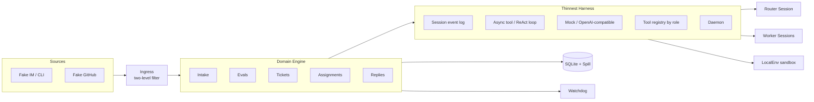

# deepseek-super-agent

Open-source DeepSeek Super-agent style multi-agent framework with a thin harness — Router/Worker, triggers, Watchdog (LoomLab; not an official DeepSeek product).

**ds-agent** (CLI: `ds-agent`) is a LoomLab MIT open-source Super-agent: a **self-built thinnest Harness** (session event log, async tool / ReAct loop, OpenAI-compatible model calls, role-based tool registry, daemon) plus a **domain engine** inspired by the [DeepSeek Super-agent design blog](https://mp.weixin.qq.com/s/zoS7GlReWPhfCjENGxXCdg) and the [dsh-superagent-prototype](https://github.com/deepseek-ai/dsh-superagent-prototype). It does **not** depend on DeepSeek Harness / Cordis. Ideal for learning multi-agent routing, event-driven Triggers, and harness design.

> **Disclaimer:** Not an official DeepSeek product. Research / educational prototype — not production-ready. Names and ideas reference public DeepSeek Super-agent materials; implementation and packaging are independent LoomLab work under MIT.

## Sources & inspiration

We **built on public materials as inspiration**, with an independent LoomLab implementation — **not a copy** of DeepSeek Harness / Cordis, and **not** an official DeepSeek product.

| Source | Link | How we use it |
|--------|------|----------------|
| **WeChat design article** | [Super-agent 设计探索：迈向更自主的 Agent 系统](https://mp.weixin.qq.com/s/zoS7GlReWPhfCjENGxXCdg) | Architecture goals (§2–§6): dual Router/Worker, Triggers, async ReAct, channels, compute/state/env split, Watchdog |
| **Official prototype** | [deepseek-ai/dsh-superagent-prototype](https://github.com/deepseek-ai/dsh-superagent-prototype) | Domain vocabulary & Engine semantics (Trigger → Eval → Ticket → Assignment); we reimplement on our own thin Harness |

**Our stack:** self-built thinnest Harness + domain engine in TypeScript (`ds-agent` CLI). No `@deepseek-ai/dsh*` dependency.

---

## Features (mapped to the blog)

Checklist against [Super-agent 设计探索：迈向更自主的 Agent 系统](https://mp.weixin.qq.com/s/zoS7GlReWPhfCjENGxXCdg):

- [x] **Continuous dual-layer Router / Worker** — resident Router for interaction & dispatch; isolated Worker sessions for concurrent tasks (blog §2)
- [x] **Efficient parallel workers + async ReAct** — non-blocking `start()` / job completion events so the front loop stays duplex (blog §2.2, §4.1)
- [x] **Proactive Triggers + two-level filtering** — Fast Path programmatic noise cut, Slow Path semantic / policy gate (blog §3.1)
- [x] **Persistent SQLite state** — session & domain state survive process restart (blog §5.1)
- [x] **Thread subscription fan-out** — subscribed Thread events bypass Router Eval straight to the Ticket / Worker (blog §3.2)
- [x] **Inline / Spill Chain of Recall** — summaries + spill IDs in-context; `read_object(id)` for multi-hop recall (blog §3.3)
- [x] **Speculative execution** — silent Assignments; visible only after a deliver gate (blog §3.4)
- [x] **Multi-channel norms** — CLI / fake IM / fake GitHub adapters with channel-specific reply style (blog §4.2)
- [x] **Compute / state / env separation** — Store vs LocalEnv sandbox; Agent loop not tied to one machine lifecycle (blog §5)
- [x] **BYOM (Bring Your Own Machine / Model)** — OpenAI-compatible HTTP via `DS_AGENT_API_*`; daemon for env side (blog §5.2)
- [x] **Watchdog** — external control loop Session that nudges or fails stuck Workers (blog §6)

Default demo path uses **MockModel** so you can prove the above without an API key.

---

## Architecture

Thinnest Harness (injectable loop + ports) + domain Engine (Intake / Evals / Tickets / Assignments / Replies). No Cordis plugin tree.

### Layers (separation of concerns)

```
┌─ Channel layer ────── CLI / fake IM / fake GitHub adapters (reply norms) ─┐
│         ▼                                                                  │
│  Ingress ── Fast Path (deterministic) + Slow Path (LLM policy)             │
│         ▼                                                                  │
│  Domain Engine ── Intake → Eval (batch) → Ticket/Mandate → Assignment      │
│         │              └─ Subscription fan-out (bypass Eval)               │
│         ▼                                                                  │
│  Harness ── Session log · async ReAct (start/stop) · Mock/HTTP model       │
│         │    Router Session (dispatch) · Worker Sessions · Watchdog Session│
│         ▼                                                                  │
│  Store ── SQLite repositories + Spill object store                         │
│  Env ── LocalEnv sandbox / BYOM daemon (no durable session state)          │
└────────────────────────────────────────────────────────────────────────────┘
```

**Data flow:** Source event → Ingress filter → `Engine.receive` → Intake (dedupe, Thread, fan-out) → Eval queue/batching (Gate + Assessment) → Ticket + first Assignment → Worker Harness Session → report → Router Outbox via Channel norms. Watchdog runs as an external Control Loop Session.



| Layer | Responsibility |
|-------|----------------|
| **Ingress** | Channel noise + policy/scope filter; Thread key mapping |
| **Engine** | Sole writer of Trigger / Thread / Decision / Ticket / Assignment |
| **Harness** | Session log, async loop, model client, tools, daemon |
| **Store** | SQLite repositories + Spill object store |
| **Env** | Sandbox workdir / process — separated from durable state |
| **Watchdog** | Timer-driven Session: stuck Worker → nudge / fail |

---

## Quick start

Requires Node.js 20+ and [pnpm](https://pnpm.io/).

```bash
pnpm install
pnpm demo      # scripted scenario; MockModel by default
pnpm start     # long-running daemon / CLI ingress
```

Useful companions:

```bash
pnpm test
pnpm ds-agent --help   # after link / package bin
```

---

## What the demo proves

`pnpm demo` walks a synthetic IM + GitHub-style event stream. Logs / assertions should show:

1. Noise Triggers dropped by two-level filtering  
2. Actionable IM → Ticket → Worker Assignment  
3. Same-Thread human follow-up with `bypass=subscription` (+ `ticketId`) — fan-out without re-Eval  
4. A second parallel Worker can start  
5. Spill write + `read_object` chained recall  
6. Speculative Assignment invisible until deliver gate passes  
7. Watchdog tick can nudge / fail a stuck Worker  
8. Store persistence across process restart  
9. **No** `@deepseek-ai/dsh*` dependency  

---

## Model configuration

| Variable | Role |
|----------|------|
| `DS_AGENT_API_BASE` | OpenAI-compatible API base URL (e.g. `https://api.openai.com/v1`, DeepSeek, Groq, …) |
| `DS_AGENT_API_KEY` | API key |
| `DS_AGENT_API_MODEL` | Optional default model id |

**Defaults:** if base/key are unset, the runtime uses **`MockModel`** — deterministic tool turns for demos and tests.

**Slots (recommended):**

- **Router** — lightweight / fast model (dispatch, batching, short replies)  
- **Worker** — strong model (code / long tool use)  
- **Watchdog** — lightweight model is enough for progress checks  

Point Router and Worker at different model ids via config or env when using a real provider; BYOM means any OpenAI-compatible endpoint works.

Example:

```bash
export DS_AGENT_API_BASE=https://api.deepseek.com/v1
export DS_AGENT_API_KEY=sk-...
export DS_AGENT_API_MODEL=deepseek-chat
pnpm start
```

---

## Project layout (high level)

```
deepseek-super-agent / ds-agent
  src/shared/     types & ports
  src/harness/    session, loop, model, tools, daemon
  src/store/      SQLite + Spill
  src/core/       Engine (Intake … Replies) + subscribe fan-out
  src/ingress/    two-level filter
  src/memory/     Inline / Spill Chain of Recall
  src/speculate/  silent Assignment + deliver gate
  src/channels/   CLI / fake IM / fake GitHub
  src/env/        LocalEnv sandbox
  src/watchdog/   external control loop
  src/cli/        CLI + assembly
  scripts/demo.ts
```

---

## License

[MIT](./LICENSE)

Copyright (c) LoomLab contributors.

---

## Disclaimer

**deepseek-super-agent / ds-agent is not affiliated with, endorsed by, or an official product of DeepSeek.** It reimplements Super-agent *ideas* described in public writing and the open `dsh-superagent-prototype` for education and experimentation. Use at your own risk; do not treat this as production infrastructure.

References:

- Blog: [Super-agent 设计探索](https://mp.weixin.qq.com/s/zoS7GlReWPhfCjENGxXCdg)  
- Prototype: [deepseek-ai/dsh-superagent-prototype](https://github.com/deepseek-ai/dsh-superagent-prototype)  
