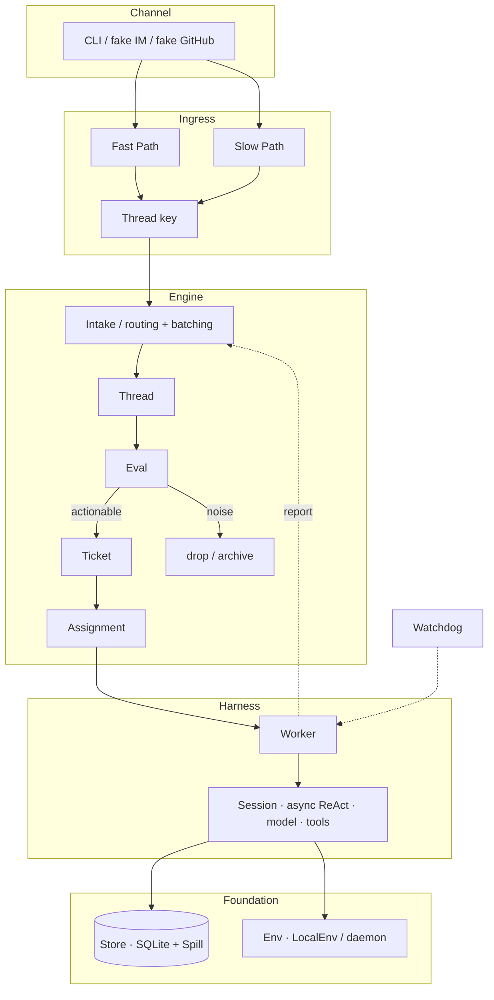

# deepseek-super-agent

English | [简体中文](README.zh-CN.md)

CLI: `ds-agent` · MIT

A thin TypeScript runtime in the spirit of the public Super-agent article: a custom Harness underneath, a domain engine on top.

Inspired by DeepSeek's public article and prototype; implemented independently. No DeepSeek Harness / Cordis, and no `@deepseek-ai/dsh*`.

LofiSu × Grokbot (CoderBot).

[Inspiration](#inspiration) · [Features](#features) · [Architecture](#architecture) · [Quick start](#quick-start) · [Demo](#demo) · [Models](#models) · [Credits](#credits) · [License](#license)

## What this is

`ds-agent` has two layers:

- **Harness** — session event log, async ReAct loop, OpenAI-compatible calls, tools registered by role, daemon.
- **Engine** — Intake → Eval → Ticket → Assignment → Reply. Domain state is written only here.

## Inspiration

| Source | Link | Used for |
|--------|------|----------|
| WeChat article | [Super-agent 设计探索](https://mp.weixin.qq.com/s/zoS7GlReWPhfCjENGxXCdg) | §2–§6: dual Router/Worker, Trigger, async tools, multi-channel, state vs environment, Watchdog |
| Official prototype | [deepseek-ai/dsh-superagent-prototype](https://github.com/deepseek-ai/dsh-superagent-prototype) | Trigger → Eval → Ticket → Assignment; the Harness is ours |

## Features

Mapped **point by point** to [Super-agent 设计探索](https://mp.weixin.qq.com/s/zoS7GlReWPhfCjENGxXCdg). Status follows this repo plus `pnpm demo` / `pnpm test`. Full task matrix: [PLAN.md](./PLAN.md) (T01–T51). Where that plan and the running code diverge: [docs/REVIEW.md](./docs/REVIEW.md).

Legend: `[x]` implemented and covered by the demo or tests · `[~]` skeleton or partial · `[ ]` not done (including Phase-2)

### §1 Four traits

- [x] **Continuous** — one domain state across IM / GitHub-style channels; the user does not manage Sessions (Harness Session + Engine Thread/Ticket)
- [x] **Efficient** — parallel Workers; the Router batches Triggers queued on the same Thread (`evals` + harness inbox)
- [x] **Proactive** — Trigger-driven; speculative Assignment + deliver gate (`speculate/`)
- [x] **Persistent** — SQLite; recoverable after process restart (`store/` + demo restart assertion)

### §2 Dual Router / Worker

- [x] **Continuity vs throughput → dual split** — Router owns interaction and dispatch; Workers execute in isolation (`SessionRole`)
- [x] **Router = global sequence point / coordination / memory entry** — inbound through the Engine; outbound through Router/Outbox
- [x] **Router does not do the heavy work** — Workers hold execution tools; the Router tool set is narrower
- [x] **Router can use a lightweight model** — `roleModels.router` / Mock; Workers can use a stronger model
- [x] **Trigger batching (folded into the next turn under load)** — same-Thread Eval batch; covered by demo/tests
- [ ] **Router horizontal split / multi-layer filter** — article §2/§8; Phase-2 (PLAN T09)
- [x] **Worker context isolation + full execution tools** — separate Worker Session
- [x] **Workers do not reply to people directly** — via `report` → Router, then outbound
- [x] **Worker ↔ Thread subscription (many-to-many)** — `subscribe` + fan-out
- [~] **In-Worker Subagent / Team opaque to the Router** — async jobs exist; not a full Team topology (T14)
- [~] **One UI, many topics → many Workers** — multiple Tickets can coexist; no product shell yet (T15)

### §3 Event-driven

- [x] **Semi-structured environment events = Triggers** — IM / GitHub-style Sources
- [x] **Fast Path programmatic filter** — deterministic source/noise rules (`ingress/filter`)
- [x] **Slow Path semantic/policy filter** — can follow a model policy; the Mock path can skip or stay on rules
- [x] **Thread = event stream for one topic or PR** — Thread key
- [x] **Subscribed → straight to the Worker (bypass Router Eval)** — log `bypass=subscription` + `ticketId`
- [x] **Unsubscribed → Router/Eval cold start** — Intake → Eval → Ticket
- [~] **Worker unsubscribe / hand back to the Router** — direction is in PLAN; the demo does not stress it (T21)
- [x] **Router can still observe every Trigger** — Intake bookkeeping
- [x] **Inline: summaries in context** — `memory/recall`
- [x] **Spill: long content stored out of band + id** — `store/spill`
- [x] **Locality: IDs and summaries first, expand on demand** — `read_object`
- [x] **Chain of Recall** — pull a spillId or object ref on demand (minimal T25)
- [x] **Speculative execution runs in the background first** — speculative Assignment
- [x] **Deliver only if it is valuable; otherwise drop it quietly** — `deliver=true` gate; checked by the demo

### §4 Human interaction

- [x] **Async ReAct: `start` returns immediately** — harness loop / async job
- [x] **Started notification** — job-started log/event
- [x] **Completion returns as a new Session event** — completion is fed back to the Worker
- [x] **Full duplex: new input still arrives while a job runs** — inbound and job completion enqueue together
- [x] **IM low-interrupt / short-reply norms** — `channels/norms` (including a word cap)
- [x] **Structured output on async channels such as GitHub** — GitHub channel formatter
- [x] **Only the Router speaks outward** — Workers cannot write a channel directly

### §5 Compute / state / environment

- [x] **Compute can be stateless; Session and domain live in the DB** — SQLite Store
- [x] **Execution environment stays on the machine (sandbox directory)** — `LocalEnv`
- [x] **The daemon does not hold session state** — `daemon.ts` only schedules the Watchdog and similar work
- [x] **BYOM: OpenAI-compatible `DS_AGENT_API_*` and provider key presets** — `resolveLiveApi`
- [~] **Intermittent devices / multi-machine handoff** — the Store can resume; a real cross-machine daemon is not done (T40, partial)

### §6 Watchdog

- [x] **External control-loop Session** — `watchdog` role
- [x] **Timer-driven** — daemon interval tick
- [x] **Nudge / fail stuck work** — watchdog tools + demo tick
- [~] **Natural-language maintenance for infra faults and goal drift** — nudge/fail exist; full health checks and YAML rule edits are not in yet (T43–T44)

### §7 Experiments (article evals; do not block the open-source release)

- [x] **Runtime counters** — ingress admit/drop, eval accept, bypass fan-out, speculative deliver/discard, watchdog nudge/fail, model latency (`ds-agent metrics`, `<stateDir>/metrics.json`)
- [ ] **End-to-end dual layer vs single Session** — Phase-2 / optional M12 (T45)
- [ ] **Router batching stress curves** — Phase-2 (T45)

### §8 Open questions (explicitly out of M11)

- [ ] Router scale-out / Worker-direct topology (§8.1)
- [ ] Long-horizon memory across months (§8.1)
- [ ] A product shell that is not a Session (§8.2)
- [ ] Mid-task human collaboration UX (§8.2)
- [ ] A2A across instances (§8.3)
- [~] Credential values stay out of bash stdout, file reads, tool results, and prompts (LocalEnv allowlist + `[redacted]`). Vault / seccomp still open (§8.4 T51)

### Modules M0–M11

| Module | Article | Status |
|--------|---------|--------|
| M0 shared | types / ports | [x] |
| M1 Harness | §2 / §4.1 / §5 | [x] |
| M2 Store | §5.1 / §3.3 Spill | [x] |
| M3 Engine | §2 / §3 Eval · Ticket · Assignment | [x] |
| M4 Ingress | §3.1 | [x] |
| M5 Subscribe | §3.2 | [x] |
| M6 Memory | §3.3 | [x] |
| M7 Speculate | §3.4 | [x] |
| M8 Channels | §4.2 | [x] |
| M9 Env | §5.2 | [x] |
| M10 Watchdog | §6 | [x] |
| M11 CLI demo | acceptance script | [x] `pnpm demo` |

## Architecture

Layers: an outer **Channel** enters **Ingress**, then **Engine** (routing / batching → Thread → Eval → Ticket → Assignment). **Harness** runs the Worker Session. **Store** (state / Spill) and **Env** (sandbox / process) sit underneath. **Watchdog** hangs off the side.



Text flow:

```
Channel ──► Ingress (Fast/Slow → Thread key)
              │
              ▼
           Engine.receive
              │  routing / batching
              ▼
           Thread ──► Eval ──► Ticket ──► Assignment
                         │                    │
                         └─ drop              ▼
                                        Harness Worker
                                              │
                    Store ◄───────────────────┤
                    Env   ◄───────────────────┘
                              Watchdog → stuck Workers
```

A Thread that is already subscribed uses `bypass=subscription` and skips Router Eval, going straight to the existing Worker.

| Layer | Job |
|-------|-----|
| Channel | inbound adapters, outbound shape |
| Ingress | Fast / Slow Path → Thread key |
| Engine | routing/batching, Thread, Eval, Ticket, Assignment |
| Harness | session, async ReAct, model, tools, daemon |
| Store | SQLite, Spill, `read_object` |
| Env | sandbox directory and process |
| Watchdog | stuck Workers |

## Quick start

Node.js 22+ (see `engines` in [package.json](./package.json)), [pnpm](https://pnpm.io/).

```bash
pnpm install
pnpm demo          # MockModel when no key is set, and the log says so
pnpm test          # offline; unit tests pin MockModel
pnpm test:live     # live integration tests when a key is set
pnpm ds-agent chat "fix the login timeout"
```

A provider key, or both `DS_AGENT_API_BASE` and `DS_AGENT_API_KEY`, selects `HttpOpenAI`. With no key, `pnpm demo` uses MockModel and prints that. Setting only one of `DS_AGENT_API_BASE` or `DS_AGENT_API_KEY` exits with an error.

```bash
export DS_AGENT_API_BASE=https://api.deepseek.com
export DS_AGENT_API_KEY=sk-...
export DS_AGENT_API_MODEL=deepseek-chat   # optional; omitted model stays deepseek-chat

# or one provider key (see Models):
#   DEEPSEEK_API_KEY, OPENAI_API_KEY, OPENROUTER_API_KEY,
#   XAI_API_KEY / GROK_API_KEY, MOONSHOT_API_KEY / KIMI_API_KEY,
#   ZHIPU_API_KEY / GLM_API_KEY, GEMINI_API_KEY / GOOGLE_API_KEY,
#   ANTHROPIC_API_KEY
# DS_AGENT_PROVIDER picks one when several keys are set.

pnpm demo          # HttpOpenAI; scripted Mock proofs are relaxed
```

[GitHub Actions](./.github/workflows/ci.yml) runs `pnpm typecheck` and `pnpm test` on pushes to `main` and on pull requests. The demo job runs only when `DEEPSEEK_API_KEY` or `DS_AGENT_API_KEY` is set as a secret, and then calls the live model.

State lives in `DS_AGENT_HOME`, or in `./.ds-agent` (SQLite).

```bash
pnpm ds-agent tasks
pnpm ds-agent status
pnpm ds-agent emit im --thread bug-login --text "login still 500"
pnpm ds-agent emit github --pr 42 --text "CI failed on auth test"
```

## Demo

`pnpm demo` feeds fake IM / GitHub events. With no key it uses **MockModel** (offline) and prints that choice. The checks cover noise filtering, Ticket → Worker, `bypass=subscription`, Spill + `read_object`, the speculative deliver gate, Watchdog, and restart persistence. A live run skips the scripted offline proofs.

```bash
export DS_AGENT_API_BASE=https://api.deepseek.com
export DS_AGENT_API_KEY=sk-...
export DS_AGENT_API_MODEL=deepseek-chat   # optional; omitted model stays deepseek-chat
pnpm demo
```

A single provider key (for example `DEEPSEEK_API_KEY`) also selects HttpOpenAI. With no key, demo uses MockModel and prints that. Setting only `DS_AGENT_API_BASE` or only `DS_AGENT_API_KEY` exits with an error.

## Models

When both `DS_AGENT_API_BASE` and `DS_AGENT_API_KEY` are set, they win over the table below. The model name stays `deepseek-chat` unless you set one. A provider key alone makes `resolveLiveApi` fill in the base and default model. `DS_AGENT_API_MODEL` (or `DS_AGENT_MODEL`) overrides that default. If several keys are set, the first row with a key wins. `DS_AGENT_PROVIDER` picks one (`xai`/`grok`, `moonshot`/`kimi`, `zhipu`/`glm`, `gemini`/`google`, `anthropic`/`claude` are aliases).

Default model ids follow each vendor's current docs example. Override any of them with `DS_AGENT_API_MODEL`.

| Provider | Environment variable | OpenAI-compatible base | Default model |
|----------|----------------------|------------------------|---------------|
| DeepSeek | `DEEPSEEK_API_KEY` | `https://api.deepseek.com` | `deepseek-flash` |
| OpenAI | `OPENAI_API_KEY` | `https://api.openai.com/v1` | `gpt-4o-mini` |
| OpenRouter | `OPENROUTER_API_KEY` | `https://openrouter.ai/api/v1` | `deepseek/deepseek-chat` |
| xAI / Grok | `XAI_API_KEY` or `GROK_API_KEY` | `https://api.x.ai/v1` | `grok-4.7` |
| Moonshot / Kimi | `MOONSHOT_API_KEY` or `KIMI_API_KEY` | `https://api.moonshot.cn/v1` | `kimi-k3.1-pro` |
| Zhipu / GLM | `ZHIPU_API_KEY` or `GLM_API_KEY` | `https://open.bigmodel.cn/api/paas/v4` | `glm-5.3` |
| Gemini | `GEMINI_API_KEY` or `GOOGLE_API_KEY` | `https://generativelanguage.googleapis.com/v1beta/openai` | `gemini-3.8-flash` |
| Anthropic | `ANTHROPIC_API_KEY` | `https://api.anthropic.com/v1` | `claude-opus-5-5` |

The Gemini and Anthropic rows are the OpenAI-compatible bases from those vendors' docs (Gemini's is beta; Anthropic's compatibility layer serves Chat Completions). `HttpOpenAI` still posts to `/chat/completions` with `Authorization: Bearer`.

Moonshot's international base is `https://api.moonshot.ai/v1`. Zhipu's overseas base is `https://api.z.ai/api/paas/v4`. Set those with `DS_AGENT_API_BASE` and `DS_AGENT_API_KEY`.

With `DS_AGENT_PROVIDER` set, that provider's own key is used when present; otherwise `DS_AGENT_API_KEY` is used. `requireLiveModelFromEnv()` throws when no live API is configured and never returns MockModel.

Use a lightweight model for the Router and Watchdog, and a stronger one for the Worker. The table is one process-wide model.

`pnpm demo` uses MockModel only when no key is set, and it prints that. `pnpm test` pins MockModel so a developer key cannot send the suite onto the network. `createModelFromEnv()` returns MockModel when nothing is configured, and `HttpOpenAI` when a live API resolves. A half-set `DS_AGENT_API_BASE` / `DS_AGENT_API_KEY` pair throws instead of falling through to MockModel.

## Credits

LofiSu × Grokbot (CoderBot).

## License

[MIT](./LICENSE)

- [WeChat article](https://mp.weixin.qq.com/s/zoS7GlReWPhfCjENGxXCdg)
- [Official prototype](https://github.com/deepseek-ai/dsh-superagent-prototype)
