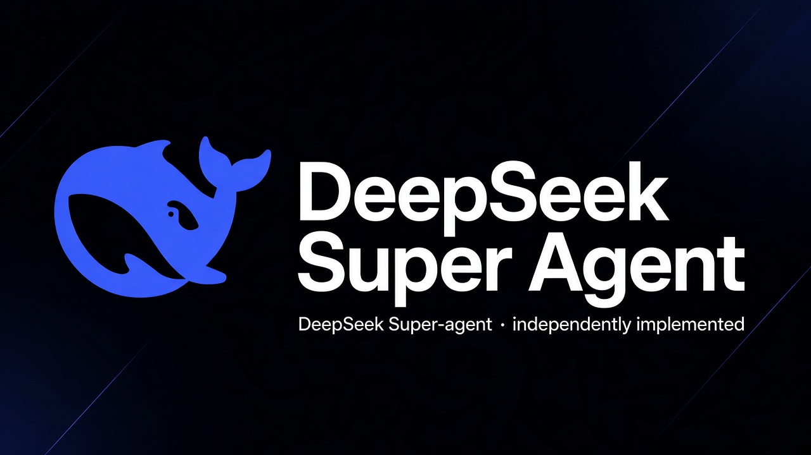
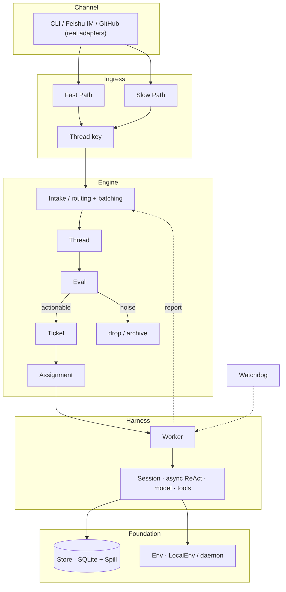

<div align="center">
  
</div>

# 🤖 deepseek-super-agent

English | [简体中文](README.zh-CN.md)

[](./package.json)
[](./package.json)
[](./LICENSE)
[](#contributing)

**An independent, MIT-licensed super-agent harness in TypeScript.**

A thin async ReAct runtime at the bottom. A proactive domain engine on top:
**Router / Worker**, **Triggers**, **Threads**, **Eval**, **Tickets**, **Assignments**, and a **Watchdog**.

[Documentation](docs/index.md) · [Quick start](#quick-start) · [Core features](#core-features) · [Architecture](#architecture) · [Safety](docs/safety.md) · [Modules](docs/MODULES.md) · [Demo](#demo-real-channels)

> [!NOTE]
> This is **not** an official DeepSeek product. It is an independent implementation inspired by DeepSeek's public Super-agent article and prototype. It does not ship, wrap, or depend on DeepSeek Harness, Cordis, or any `@deepseek-ai/dsh*` package.

---

## Table of Contents

- [One-line setup for coding agents](#one-line-setup-for-coding-agents)
- [Quick start](#quick-start)
- [What this is](#what-this-is)
- [Core features](#core-features)
  - [Proactive by construction](#proactive-by-construction)
  - [Two roles, one sequence point](#two-roles-one-sequence-point)
  - [Context that scales](#context-that-scales)
  - [Work that outlives a turn](#work-that-outlives-a-turn)
  - [The owner stays in control](#the-owner-stays-in-control)
  - [Channels](#channels)
  - [Sandboxed execution](#sandboxed-execution)
  - [Observability](#observability)
  - [Extension domains](#extension-domains)
- [Architecture](#architecture)
- [Configuration](#configuration)
  - [Models](#models)
  - [Runtime settings](#runtime-settings)
  - [MCP servers](#mcp-servers)
- [Demo (real channels)](#demo-real-channels)
- [Safety and deployment](#safety-and-deployment)
- [Status](#status)
- [Documentation](#documentation)
- [Contributing](#contributing)
- [Credits](#credits)
- [License](#license)

## One-line setup for coding agents

If you use Claude Code, Codex, Cursor, or another coding agent, hand it this sentence:

```text
Clone https://github.com/LofiSu/deepseek-super-agent, run pnpm install, then run
pnpm typecheck and pnpm lint. Read README.md and docs/install.md. Stop before
pnpm test or pnpm demo so I can supply model credentials and a writable GitHub repo.
```

The agent should stop with the exact commands you still need to run, rather than guessing a provider or writing to a repository on your behalf.

## Quick start

Requires **Node.js 22+** (the store uses `node:sqlite`) and [pnpm](https://pnpm.io/).

```bash
git clone https://github.com/LofiSu/deepseek-super-agent.git
cd deepseek-super-agent
pnpm install

pnpm typecheck
pnpm lint
```

The repository is not published to npm. `package.json` keeps a `build` script and a `bin` entry for packaging, but day-to-day use is `pnpm ds-agent ...` from the checkout.

### Configure a model

`ds-agent` speaks any OpenAI-compatible API. Point it at DeepSeek directly:

```bash
export DS_AGENT_API_BASE=https://api.deepseek.com
export DS_AGENT_API_KEY=sk-...
export DS_AGENT_API_MODEL=deepseek-flash
```

Or set a single provider key and let the presets fill in the base URL and default model (see [Models](#models)). A half-set `DS_AGENT_API_BASE` / `DS_AGENT_API_KEY` pair fails instead of falling back silently.

### Run it

```bash
pnpm ds-agent init                              # create the SQLite store in ./.ds-agent
pnpm ds-agent chat "fix the login timeout"
pnpm ds-agent tasks                             # tickets and their stage
pnpm ds-agent panel                             # Panel · Execution
```

State lives in `DS_AGENT_HOME`, or in `./.ds-agent` when unset. `pnpm ds-agent serve` runs the daemon and Watchdog timer over persisted state; it starts no inbound channel loop. To inspect the read model in a browser:

```bash
DS_AGENT_UI_TOKEN="$(openssl rand -hex 16)" pnpm ds-agent ui
```

The dashboard is read-only, binds to loopback, and requires a token of at least 16 characters. See [docs/UI.md](docs/UI.md).

### Tests and the live demo

`pnpm test` and `pnpm demo` use a live model; MockModel is forbidden on those paths. If `DS_AGENT_API_*` is unset, the `test` script fills a local Magpie default (`http://127.0.0.1:3425/v1`, key `magpie`, model `workbuddy/deepseek-v4.1-flash`), so it needs that gateway running. For a no-key fixture run, use:

```bash
pnpm test:coverage     # offline fixture suite; no model key required
```

`pnpm demo` is the real-channel acceptance path. It needs `gh` auth and creates real GitHub issues and comments in `DS_AGENT_GH_REPO`:

```bash
gh auth login
export DS_AGENT_GH_REPO=your-account/your-writable-repo
pnpm demo
```

Read [Demo (real channels)](#demo-real-channels) before running it.

## What this is

Most agent frameworks give you a loop: messages in, tool calls out, repeat. That loop is necessary, but it is not an operating model. A personal agent also needs to notice inbound work, decide what matters, keep state across restarts, run long jobs without blocking the conversation, and recover when something gets stuck.

This repository implements that operating model in two layers:

- **Harness.** A session event log, an async ReAct loop, OpenAI-compatible model calls, tools registered by role, and a daemon.
- **Engine.** Intake → Eval (Gate + Assessment) → Mandate/Ticket → Assignment → Outbox. Domain writes stay in the Engine.

The Router is the sequence point: it talks to people, batches triggers, and dispatches work. Workers execute in isolated sessions. Triggers drive the loop. The Watchdog lives outside the control path and nudges or fails stuck work.

The design vocabulary follows [从零打造 Personal Agent（三）](https://my.feishu.cn/docx/YtDVdzfxdobjAkxKZiIcl5Emnth): the `router` role is the **Main Agent / Main Session**, the `worker` role is the **Executor**, and a `Subscription` is a context-only Ticket ↔ Thread relation that grants no extra authority. Deviations and corrections are recorded in [docs/DOMAIN_ALIGNMENT.md](docs/DOMAIN_ALIGNMENT.md).

## Core features

### Proactive by construction

Channels emit semi-structured **Triggers** into Ingress. A deterministic **Fast Path** applies source and noise rules; an optional model-based **Slow Path** (`DS_AGENT_SLOW_PATH=model`) refines the decision, with a deterministic rule fallback on timeout, error, or invalid output. The default is rules-only.

Each topic or pull request becomes a **Thread**. The Router batches triggers waiting on the same Thread, **Eval** separates noise from actionable work, and actionable input becomes a **Ticket** and an **Assignment**. A speculative Assignment can start before delivery, and a **deliver gate** drops results that are not worth sending. Restarts resume from SQLite; the demo includes a restart check.

### Two roles, one sequence point

- **Router** keeps continuity, talks to the owner, and dispatches. It stays light and can run a smaller model.
- **Worker** executes alone with the full tool set, in its own session.
- Workers report upward. A Worker session holds `WorkerPorts`, not the Engine, so it cannot `reply` or `decide`; only the Router writes to a channel.
- A Thread that already has a Worker is served directly (`bypass=subscription`), skipping Router Eval.
- A Worker can spawn a **team**: async member jobs report `TEAM_MEMBER_DONE` and the parent aggregates one report. Team rows persist in SQLite and are inspectable offline with `ds-agent team` / `ds-agent teams`.
- A Worker can delegate one self-contained task to a configured local CLI agent — Claude Code, Codex, OpenCode, Hermes, or a custom command — through `delegate_agent`. There is no shell, the cwd is the Worker workspace, and timeout, output size, and environment are bounded. See [docs/LOCAL_AGENTS.md](docs/LOCAL_AGENTS.md).

### Context that scales

Short summaries stay inline. Long content is **spilled** out of band with an id, and tools receive typed `kind:id` handles first. `read_object` expands one hop at a time, which gives the model a **Chain of Recall** instead of a context dump. See [docs/MODULES.md](docs/MODULES.md).

Long-term memory keeps hot tickets and Router decisions (1000 entries / 90 days) plus cold Thread digests (200 / 3650 days). Recall is hybrid: lexical search, one tag hop, and an optional `EmbeddingPort`. The default offline `HashedEmbedding` works without a model; `DS_AGENT_SEMANTIC_RECALL=0` disables the semantic arm, and `DS_AGENT_EMBEDDING_FLOOR` sets its cosine floor (default `0.35`, clamped to 0–1). Month-scale behavior is not yet measured, so T48 stays partial; the dated measurement protocol and its offline fixture smoke are in [docs/T48_MONTH_SCALE_PROTOCOL.md](docs/T48_MONTH_SCALE_PROTOCOL.md).

### Work that outlives a turn

`start_job` returns `{status:'started', jobId}` immediately and ends the turn. The harness enqueues the next turn when the job finishes as a `JOB_DONE` prompt, and the foreground keeps accepting new input meanwhile. This is async ReAct, not a long-blocking tool call.

For mid-task collaboration, the CLI exposes `pause`, `intervene`, `resume`, and `collab`, backed by a durable `Ticket.collaboration`. The harness and Watchdog honor a pause.

### The owner stays in control

- **Approvals.** A Worker can call `request_approval` with an exact outward action instead of performing it. The ticket holds; the Router asks; `ds-agent approve` / `ds-agent deny` records the decision and resumes through the normal path. The model may request, never decide, and chat text is not consent. See [docs/APPROVALS.md](docs/APPROVALS.md).
- **Routines.** `routines.json` schedules a prompt every N minutes, or once per UTC day at a chosen time and weekdays, on a chosen channel and thread. The daemon fires a missed slot once after a gap, not per missed interval. Routines pass through normal ingress and rules; the model cannot create or edit one. See [docs/ROUTINES.md](docs/ROUTINES.md).
- **Skills.** An owner-authored `skills/<id>/SKILL.md` adds a playbook without a code change. The prompt carries only an id and description index (capped at 2000 characters); `read_skill` loads the body on demand. A skill cannot grant a tool or widen a role. See [docs/SKILLS.md](docs/SKILLS.md).
- **Prompt stack.** Identity, owner voice, standing instructions, owner context, team, skills, reach, rules, memory guidance, style, and the role contract are assembled in dependency order. `PERSONA.md`, `AGENTS.md`, and `USER.md` in the agent home refine the editable layers. `ds-agent prompt --layers` shows every layer and its source. See [docs/PROMPTS.md](docs/PROMPTS.md).

### Channels

CLI, GitHub-style sources, Feishu, iMessage, A2A, and a local OpenAI-compatible gateway.

- **GitHub** uses the machine's `gh` login. The real demo creates and reads issues and posts comments through `gh api`.
- **Feishu** polls exactly one chat per process, stores its cursor in SQLite, and never sends during preflight. Inbound delivery is polling only; webhooks and long-connection delivery are not implemented. See [docs/REAL_CHANNELS.md](docs/REAL_CHANNELS.md).
- **iMessage** is a two-way channel for a dedicated Apple ID: inbound reads `~/Library/Messages/chat.db` read-only (`is_from_me = 0` only), outbound goes through Messages.app via `osascript`. It needs macOS Full Disk Access and Automation permission. See [docs/IMESSAGE.md](docs/IMESSAGE.md).
- `serve --imessage --feishu` runs both inbound loops over one Runtime and SQLite store. Both configurations are validated before startup; a missing item fails before any network or database access.
- Run `ds-agent channels check` first. It needs no model, opens no SQLite, and sends nothing.

### Sandboxed execution

Every Worker `bash` call is wrapped: `sandbox-exec` on macOS, `bwrap` on Linux. A missing wrapper is a hard error; there is no plain-bash fallback. By default the wrapper confines writes to the workspace and denies network unless the policy allows it. The child gets an allowlisted environment, secret-named values are redacted, and `FileVault.describe()` returns names only.

> [!WARNING]
> The default wrapper confines writes and network, but **not reads**. On macOS `file-read*` is broad and on Linux the wrapper uses `--ro-bind / /`, so a Worker can still read `<stateDir>/ds-agent.db`. Set `DS_AGENT_SANDBOX_READ_ISOLATION=1` (or `true` / `strict`) to opt into strict read confinement, or put the process in a container. Host vault and seccomp policy remain external. Details: [docs/safety.md](docs/safety.md).

### Observability

- `ds-agent tasks` — tickets and their stage.
- `ds-agent panel` — Panel · Execution, with Mandate, Executor Session, directory, report, and Outbox delivery counts.
- `ds-agent health` — store, vault mode, machines, Watchdog.
- `ds-agent metrics` — counters for ingress, Eval, bypass fan-out, speculative deliver/discard, Watchdog nudge/fail, and model latency.
- `ds-agent memory` — recent long-term memory entries.
- `ds-agent ui` — read-only, token-gated loopback dashboard with tickets, threads, Outbox metadata, health, metrics, and sanitized lifecycle events.

### Extension domains

These services are always constructed by `Runtime.create`; there is no opt-in feature flag. They live inside their owning M module:

- **Router shards** (`DS_AGENT_SHARDS`, `RuntimeOptions.routerShards`) — the default shard always exists.
- **Worker mesh** (`DS_AGENT_MESH_CAPACITY`, `DS_AGENT_MESH_QUEUE`) — logical placement by least-loaded node, with a bounded FIFO wait queue.
- **Long-term memory** — hot tickets, decisions, and cold Thread digests.
- **Lifecycle events** — a read model for panels and CLI views.
- **A2A** (`DS_AGENT_INSTANCE_ID`) — authenticated HMAC-SHA256 HTTP transport.

See [docs/MODULES.md](docs/MODULES.md) for the full reference.

## Architecture

A Channel enters Ingress, then the Engine. The Engine routes and batches, then runs Thread → Eval → Ticket → Assignment. The Harness runs the Worker Session. Store and Env sit underneath. The Watchdog stays outside that path.



Text flow:

```text
Channel ──► Ingress (Fast/Slow → Thread key)
              │
              ▼
           Engine.receive
              │  routing / batching
              ▼
           Thread ──► Eval ──► Ticket ──► Assignment
                         │                    │
                         └─ drop              ▼
                                        Harness Worker
                                              │
                    Store ◄───────────────────┤
                    Env   ◄───────────────────┘
                              Watchdog → stuck Workers
```

A subscribed Thread uses `bypass=subscription`. It skips Router Eval and goes straight to the Worker already on that Thread.

| Layer | Job |
|-------|-----|
| Channel | inbound adapters, outbound shape |
| Ingress | Fast / Slow Path → Thread key |
| Engine | routing and batching, Thread, Eval, Ticket, Assignment |
| Harness | session, async ReAct, model, tools, daemon |
| Store | SQLite, Spill, `read_object` |
| Env | sandbox directory and process |
| Watchdog | stuck Workers |

## Configuration

### Models

Both `DS_AGENT_API_BASE` and `DS_AGENT_API_KEY` win over the presets below. Omit the model and that pair sends `deepseek-chat`. For V4.1 Flash, set `deepseek-flash`.

| Variable | Meaning |
|----------|---------|
| `DS_AGENT_API_BASE` | OpenAI-compatible base. DeepSeek: `https://api.deepseek.com`. Local Magpie: `http://127.0.0.1:3425/v1`. |
| `DS_AGENT_API_KEY` | API key. On Magpie, this is the gateway token, not a DeepSeek key. |
| `DS_AGENT_API_MODEL` | Model id. `deepseek-flash` is DeepSeek V4.1 Flash. On Magpie use `deepseek/deepseek-flash`. |

A provider key alone fills in the base and default model. The first matching row wins; `DS_AGENT_PROVIDER` picks one explicitly. Aliases: `xai` / `grok`, `moonshot` / `kimi`, `zhipu` / `glm`, `gemini` / `google`, `anthropic` / `claude`.

| Provider | Environment variable | OpenAI-compatible base | Default model |
|----------|----------------------|------------------------|---------------|
| DeepSeek | `DEEPSEEK_API_KEY` | `https://api.deepseek.com` | `deepseek-flash` |
| OpenAI | `OPENAI_API_KEY` | `https://api.openai.com/v1` | `gpt-4o-mini` |
| OpenRouter | `OPENROUTER_API_KEY` | `https://openrouter.ai/api/v1` | `deepseek/deepseek-chat` |
| xAI / Grok | `XAI_API_KEY` or `GROK_API_KEY` | `https://api.x.ai/v1` | `grok-4.7` |
| Moonshot / Kimi | `MOONSHOT_API_KEY` or `KIMI_API_KEY` | `https://api.moonshot.cn/v1` | `kimi-k3.1-pro` |
| Zhipu / GLM | `ZHIPU_API_KEY` or `GLM_API_KEY` | `https://open.bigmodel.cn/api/paas/v4` | `glm-5.3` |
| Gemini | `GEMINI_API_KEY` or `GOOGLE_API_KEY` | `https://generativelanguage.googleapis.com/v1beta/openai` | `gemini-3.8-flash` |
| Anthropic | `ANTHROPIC_API_KEY` | `https://api.anthropic.com/v1` | `claude-opus-5-5` |

`HttpOpenAI` posts to `{base}/chat/completions` with `Authorization: Bearer`. Moonshot's international base is `https://api.moonshot.ai/v1`; Zhipu's overseas base is `https://api.z.ai/api/paas/v4`. Set those with `DS_AGENT_API_BASE` and `DS_AGENT_API_KEY`.

Use a small model for the Router and Watchdog and a stronger one for Workers. The table above configures one model for the process; role-level overrides come from `roleModelsFromEnv`.

### Runtime settings

| Variable | Default | Purpose |
|----------|---------|---------|
| `DS_AGENT_HOME` | `./.ds-agent` | State directory (SQLite, metrics, gateway token). |
| `DS_AGENT_GH_REPO` | `LofiSu/deepseek-super-agent` | Repository the GitHub demo writes to. |
| `DS_AGENT_SLOW_PATH` | rules only | Set to `model` to enable the model-based ingress policy. |
| `DS_AGENT_SHARDS` | one default shard | Router shard JSON. |
| `DS_AGENT_MESH_CAPACITY` | in-process default | Maximum concurrent Worker nodes. |
| `DS_AGENT_MESH_QUEUE` | `100` | Bounded FIFO wait list when every node is full. |
| `DS_AGENT_INSTANCE_ID` | unset | Local A2A address and mesh node id. |
| `DS_AGENT_SEMANTIC_RECALL` | on | Set to `0` to disable embedding recall. |
| `DS_AGENT_EMBEDDING_FLOOR` | `0.35` | Cosine similarity floor for semantic recall, clamped to 0–1. |
| `DS_AGENT_SANDBOX_READ_ISOLATION` | off | `1` / `true` / `strict` for strict read confinement. |
| `DS_AGENT_UI_TOKEN` | unset | Bearer token for `ds-agent ui`, minimum 16 characters. |

### MCP servers

Workers can call tools from external Model Context Protocol servers configured
as data. The Router and the Watchdog never see them.

```bash
export DS_AGENT_MCP_SERVERS='[
  {"name":"krene","command":"/absolute/path/to/krene-mcp","args":["serve"],"timeoutMs":120000}
]'
```

- `name` matches `[A-Za-z0-9_-]`, starts with a letter or digit, is at most 32
  characters, is unique, and contains no `__` (that is the namespace
  separator). `command` is a non-empty executable (`/absolute/path` is safest
  because the child inherits the current working directory). `args` defaults
  to `[]`, `env` to `{}`, and `timeoutMs` to `120000`.
- Tools appear to Workers as `mcp__<server>__<tool>`. Text stays text;
  image/resource payloads are written to `<DS_AGENT_HOME>/mcp/<server>/` and
  referenced by path. A result whose JSON text exceeds 65,536 characters
  (UTF-16 code units) goes to spill and returns `{ spillId, bytes, preview }`;
  `bytes` is the UTF-8 byte length of the spilled body.
- The child process inherits only `PATH`, `HOME`, `LANG`, `TZ`, `HTTP_PROXY`,
  `HTTPS_PROXY`, and `NO_PROXY`, plus the server's own `env`. On non-Windows
  hosts the MCP SDK also adds its own safe defaults (`HOME`, `LOGNAME`, `PATH`,
  `SHELL`, `TERM`, `USER`); on Windows it additionally inherits variables such
  as `APPDATA`, `USERPROFILE`, and `PROGRAMFILES`. Put credentials in `env`,
  not in your shell. Secret-named `env` values of at least 8 characters (for
  example `KRENE_TOKEN`) join the redaction list; shorter values are left as-is.
- Unreadable configuration is logged as
  `[mcp] DS_AGENT_MCP_SERVERS ignored: ...` and ignored. A server whose
  connection attempt rejects increments `mcp.connect_error` and is omitted. A
  server still not connected when the shared listing deadline expires is
  skipped with `reason=not-connected` and does not increment the counter. The
  runtime and the other servers keep working.

`RuntimeOptions.mcpServers` accepts the same array when embedding the runtime.

## Demo (real channels)

`pnpm demo` is the acceptance path and uses real channels only:

| Scenario | Real inbound Source | Real outbound Outbox |
|----------|---------------------|----------------------|
| `01-parallel-github` | three real GitHub issues pulled via `gh api` | one issue comment per ticket |
| `02-spill-github` | one real issue body + two real comments | Router replies as issue comments |
| `03-watchdog-github` | one real issue pulled via `gh api` | acknowledgement issue comment |

Each run creates fresh issues on `DS_AGENT_GH_REPO` (default `LofiSu/deepseek-super-agent`), waits for the live model, posts real comments, then re-reads those comments from the GitHub API as proof. Logs and JSON proofs land in `/tmp/ds-agent-live-e2e-logs/demos/`.

```bash
export DS_AGENT_API_BASE=http://127.0.0.1:3425/v1
export DS_AGENT_API_KEY=magpie
export DS_AGENT_API_MODEL=workbuddy/deepseek-v4.1-flash
export DS_AGENT_GH_REPO=LofiSu/deepseek-super-agent
gh auth login

pnpm demo                              # all three scenarios
pnpm demo -- --only watchdog           # one scenario
DS_AGENT_GH_KEEP=1 pnpm demo           # keep the real issues open
```

Closing the issues is best-effort. The close runs after each scenario's main work; a failed close is ignored, and a throw or an early return before the close leaves issues open. Check afterwards for open issues labeled `ds-agent-demo`. `DS_AGENT_GH_KEEP=1` skips the close on purpose.

`pnpm demo:local` runs the in-memory fixture baseline for channel smoke checks, not the acceptance path; it still uses a live model. `pnpm demo:feishu` exercises the real Feishu message API when `FEISHU_APP_ID`, `FEISHU_APP_SECRET`, and `FEISHU_CHAT_ID` are set. `pnpm test:live` runs the live-model tests when a key is already in the environment.

## Safety and deployment

This is a local harness. With a model key it calls a model; with `gh` or Feishu configured, the Router can post outward. Treat it as a tool running with your credentials.

- **Keys stay in the environment.** Never commit them or paste them into an issue or chat.
- **The demo writes real data.** `pnpm demo` creates GitHub issues and comments in `DS_AGENT_GH_REPO`. Point it at a repository you can write to before running it.
- **The UI is loopback-only** and requires a token. Keep `--host` on a loopback address unless you have added authentication and network controls in front of it.
- **Outward actions can be held for approval.** Use `request_approval` in Worker instructions when an action is hard to reverse. The model cannot approve its own request.
- **Sandbox limits are real.** Default confinement covers writes and network, not reads. Add strict read isolation or a container boundary for untrusted work.
- **Only the Router speaks outward.** Workers report upward; they cannot write a channel directly.

Full details: [docs/safety.md](docs/safety.md), [docs/SECURITY.md](docs/SECURITY.md), and the channel-specific pages.

## Status

The core modules are implemented and covered by the test suite. The full task matrix is [PLAN.md](PLAN.md) (T01–T51); where the plan and the code diverge is recorded in [docs/REVIEW.md](docs/REVIEW.md).

| Module | Scope | Status |
|--------|-------|--------|
| M0 shared | types / ports | Shipped |
| M1 Harness | §2 / §4.1 / §5 | Shipped |
| M2 Store | §5.1 / §3.3 Spill | Shipped |
| M3 Engine | §2 / §3 Eval, Ticket, Assignment | Shipped |
| M4 Ingress | §3.1 | Shipped |
| M5 Subscribe | §3.2 | Shipped |
| M6 Memory | §3.3 | Shipped |
| M7 Speculate | §3.4 | Shipped |
| M8 Channels | §4.2 | Shipped |
| M9 Env | §5.2 | Shipped |
| M10 Watchdog | §6 | Shipped |
| M11 CLI demo | acceptance script | Shipped — `pnpm demo` |

Partial and owner-gated areas, stated plainly:

- **Router scale-out** — the shard registry is always wired and the default shard exists, but there is no multi-process scale-out claim.
- **Worker mesh** — placement is logical within this process; a remote transport exists, starts no listener, and is not yet connected to the local placement queue.
- **Long-term memory** — hot/cold tiers and hybrid recall work; calendar-month behavior is bounded, not measured across real months.
- **A2A** — HMAC-SHA256 HTTP transport is implemented; cross-host exposure and remote dispatch remain operator-gated.
- **Watchdog drift checks** — nudge/fail, rules, and read-only `ds-agent health` work; deeper natural-language goal-drift checks are still thin.
- **Latency bake-off** — one dated local dual-layer versus single-session run is recorded in [docs/BAKEOFF.md](docs/BAKEOFF.md); it is a single sample, not a benchmark.

## Documentation

| Page | What it covers |
|------|----------------|
| [docs/index.md](docs/index.md) | Documentation home. |
| [docs/install.md](docs/install.md) | Install, model setup, first run. |
| [docs/architecture.md](docs/architecture.md) | Architecture in prose. |
| [docs/MODULES.md](docs/MODULES.md) | M0–M11 module reference. |
| [docs/safety.md](docs/safety.md) | Keys, demo writes, tool text, sandbox limits. |
| [docs/SECURITY.md](docs/SECURITY.md) | Security model and reporting. |
| [docs/REAL_CHANNELS.md](docs/REAL_CHANNELS.md) | GitHub, Feishu, and channel setup. |
| [docs/GATEWAY.md](docs/GATEWAY.md) | Local OpenAI-compatible gateway. |
| [docs/IMESSAGE.md](docs/IMESSAGE.md) | macOS iMessage channel. |
| [docs/LOCAL_AGENTS.md](docs/LOCAL_AGENTS.md) | Delegating to local CLI agents. |
| [docs/SKILLS.md](docs/SKILLS.md) | Owner-authored skills. |
| [docs/ROUTINES.md](docs/ROUTINES.md) | Scheduled routines. |
| [docs/APPROVALS.md](docs/APPROVALS.md) | Approval holds for outward actions. |
| [docs/PROMPTS.md](docs/PROMPTS.md) | The layered system-prompt stack. |
| [docs/UI.md](docs/UI.md) | The read-only dashboard. |
| [docs/ROADMAP.md](docs/ROADMAP.md) | Roadmap and current gaps. |

Chinese pages live under [docs/zh/](docs/zh/index.md).

## Contributing

This is an **owner-only repository**: only LofiSu contributes, and external pull requests are not accepted. Bug reports and design questions are welcome through GitHub Issues.

If you are working in this repository, keep `main` green:

```bash
pnpm typecheck
pnpm lint
pnpm test
```

- Branch off current `main`; never commit directly to `main`.
- One concern per pull request. Never force-push a shared branch.
- Live suites are explicit: `pnpm test:live`, `pnpm test:demo:real`, `pnpm demo`.
- Name features by what they do and by the M0–M11 module boundary — not by phased milestones.
- Secrets and runtime state never enter the repository.

## Credits

The shape of this project comes from DeepSeek's public writing and prototype. The code is an independent implementation.

| Source | Link | What it informed |
|--------|------|------------------|
| WeChat article | [Super-agent 设计探索](https://mp.weixin.qq.com/s/zoS7GlReWPhfCjENGxXCdg) | §2–§6: dual Router/Worker, Triggers, async tools, multi-channel, state vs environment, Watchdog |
| Official prototype | [deepseek-ai/dsh-superagent-prototype](https://github.com/deepseek-ai/dsh-superagent-prototype) | Trigger → Eval → Ticket → Assignment |
| Personal Agent (3) | [从 DeepSeek Super-agent 看主动服务的设计模式](https://my.feishu.cn/docx/YtDVdzfxdobjAkxKZiIcl5Emnth) | Main Agent / Executor, context-only Subscription, Mandate, Panel · Execution |

Author: **LofiSu**. Co-written with Grokbot (CoderBot).

Built on Node.js, TypeScript, `node:sqlite`, `tsx`, and Vitest — no agent framework dependency.

## License

[MIT](./LICENSE)

[](https://star-history.com/#LofiSu/deepseek-super-agent&Date)
