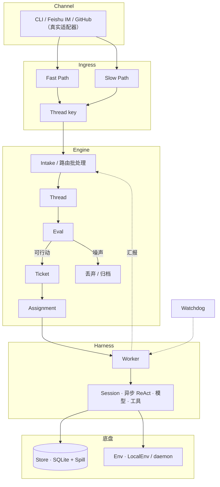

<div align="center">
  
</div>

# 🤖 deepseek-super-agent

[English](README.md) | 简体中文

[](./package.json)
[](./package.json)
[](./LICENSE)
[](#参与贡献)

**一个独立实现、MIT 许可的 TypeScript super-agent harness。**

底层是轻量的异步 ReAct 运行时，上层是主动式领域引擎：
**Router / Worker**、**Trigger**、**Thread**、**Eval**、**Ticket**、**Assignment**，以及 **Watchdog**。

[文档](docs/zh/index.md) · [快速开始](#快速开始) · [核心能力](#核心能力) · [架构](#架构) · [安全](docs/zh/safety.md) · [模块](docs/MODULES.md) · [Demo](#demo真实信道)

> [!NOTE]
> 本项目**不是** DeepSeek 官方产品。它是对 DeepSeek 公开 Super-agent 文章与原型的一次独立实现，不包含、不封装、也不依赖 DeepSeek Harness、Cordis 或任何 `@deepseek-ai/dsh*` 包。

---

## 目录

- [给编码 Agent 的一句话安装](#给编码-agent-的一句话安装)
- [快速开始](#快速开始)
- [这是什么](#这是什么)
- [核心能力](#核心能力)
  - [天生主动](#天生主动)
  - [两个角色，一个序点](#两个角色一个序点)
  - [可伸缩的上下文](#可伸缩的上下文)
  - [能跨轮次的工作](#能跨轮次的工作)
  - [主控权始终在主人手里](#主控权始终在主人手里)
  - [信道](#信道)
  - [沙箱执行](#沙箱执行)
  - [可观测性](#可观测性)
  - [扩展域](#扩展域)
- [架构](#架构)
- [配置](#配置)
  - [模型](#模型)
  - [运行时设置](#运行时设置)
  - [MCP 服务器](#mcp-服务器)
- [Demo（真实信道）](#demo真实信道)
- [安全与部署](#安全与部署)
- [当前状态](#当前状态)
- [文档](#文档)
- [参与贡献](#参与贡献)
- [致谢](#致谢)
- [许可](#许可)

## 给编码 Agent 的一句话安装

如果你用 Claude Code、Codex、Cursor 或其他编码 Agent，可以直接把这句话交给它：

```text
克隆 https://github.com/LofiSu/deepseek-super-agent，执行 pnpm install，然后运行
pnpm typecheck 和 pnpm lint。阅读 README.md 与 docs/install.md。在 pnpm test 或
pnpm demo 之前停下来，等我提供模型凭据和可写的 GitHub 仓库。
```

它应当在需要你补充配置时停下并列出还缺什么，而不是替你猜厂商或往你的仓库里写数据。

## 快速开始

需要 **Node.js 22+**（存储层使用 `node:sqlite`）和 [pnpm](https://pnpm.io/)。

```bash
git clone https://github.com/LofiSu/deepseek-super-agent.git
cd deepseek-super-agent
pnpm install

pnpm typecheck
pnpm lint
```

本仓库没有发布到 npm。`package.json` 保留了用于打包的 `build` 脚本和 `bin` 入口，但日常使用是在仓库里运行 `pnpm ds-agent ...`。

### 配置模型

`ds-agent` 支持任意 OpenAI 兼容 API。直连 DeepSeek：

```bash
export DS_AGENT_API_BASE=https://api.deepseek.com
export DS_AGENT_API_KEY=sk-...
export DS_AGENT_API_MODEL=deepseek-flash
```

也可以只设一把厂商 Key，由预设补全 Base 和默认模型（见[模型](#模型)）。`DS_AGENT_API_BASE` / `DS_AGENT_API_KEY` 只设其中一个会直接报错，不会静默回退。

### 跑起来

```bash
pnpm ds-agent init                              # 在 ./.ds-agent 创建 SQLite 存储
pnpm ds-agent chat "fix the login timeout"
pnpm ds-agent tasks                             # 查看 Ticket 及其阶段
pnpm ds-agent panel                             # Panel · Execution
```

状态目录是 `DS_AGENT_HOME`，未设置时为 `./.ds-agent`。`pnpm ds-agent serve` 会在持久化状态上运行 daemon 与 Watchdog 定时器，不启动入站信道轮询。要在浏览器里看只读面板：

```bash
DS_AGENT_UI_TOKEN="$(openssl rand -hex 16)" pnpm ds-agent ui
```

面板只读、只绑定 loopback，token 至少 16 个字符。详见 [docs/UI.md](docs/UI.md)。

### 测试与真实 Demo

`pnpm test` 与 `pnpm demo` 都使用真实模型，这两条路径禁止 MockModel。如果没有设置 `DS_AGENT_API_*`，`test` 脚本会填入本机 Magpie 默认值（`http://127.0.0.1:3425/v1`、密钥 `magpie`、模型 `workbuddy/deepseek-v4.1-flash`），因此需要该网关在运行。不需要模型 Key 的离线 fixture 套件是：

```bash
pnpm test:coverage     # 离线 fixture 套件，不需要模型 Key
```

`pnpm demo` 是真实信道验收路径，需要 `gh` 登录，并会在 `DS_AGENT_GH_REPO` 创建真实 GitHub issue 和 comment：

```bash
gh auth login
export DS_AGENT_GH_REPO=your-account/your-writable-repo
pnpm demo
```

运行前请先读 [Demo（真实信道）](#demo真实信道)。

## 这是什么

多数 Agent 框架只给你一个循环：消息进来，工具调用出去，如此往复。这个循环是必要的，但它还不是一套运行模型。一个个人 Agent 还需要感知入站工作、判断什么值得做、跨重启保存状态、在不阻塞对话的情况下跑长任务，并在某一步卡住时恢复。

本仓库用两层实现这套运行模型：

- **Harness**：Session 事件日志、异步 ReAct 循环、OpenAI 兼容模型调用、按角色注册工具，以及 daemon。
- **Engine**：Intake → Eval（Gate + Assessment）→ Mandate/Ticket → Assignment → Outbox。领域状态只在 Engine 写入。

Router 是全局序点：它负责对话、批处理 Trigger 和分派。Worker 在隔离的 Session 里执行。Trigger 驱动整个循环。Watchdog 位于控制路径之外，负责提醒或判失败。

领域命名以[《从零打造 Personal Agent（三）》](https://my.feishu.cn/docx/YtDVdzfxdobjAkxKZiIcl5Emnth)为准：`router` 角色是 **Main Agent / Main Session**，`worker` 角色是 **Executor**，`Subscription` 只是 Ticket ↔ Thread 的上下文关系，不增加任何授权。偏差与修正记录见 [docs/DOMAIN_ALIGNMENT.md](docs/DOMAIN_ALIGNMENT.md)。

## 核心能力

### 天生主动

信道把半结构化的 **Trigger** 送进 Ingress。确定性的 **Fast Path** 先做来源与噪声规则；可选的模型 **Slow Path**（`DS_AGENT_SLOW_PATH=model`）再做语义判断，超时、异常或输出非法时回退到确定性规则。默认只走规则。

同一话题或 PR 归为一个 **Thread**。Router 会把等待同一 Thread 的 Trigger 合并批处理，**Eval** 区分噪声与可行动项，可行动项变成 **Ticket** 和 **Assignment**。投机 Assignment 可以在交付前先跑，**deliver gate** 会丢弃不值得发送的结果。重启后从 SQLite 恢复，demo 里有重启断言。

### 两个角色，一个序点

- **Router** 保持连续性、与主人对话、负责分派；它保持轻量，可以跑更小的模型。
- **Worker** 在自己的 Session 里独立执行，拥有完整工具集。
- Worker 只向上汇报。Worker Session 持有的是 `WorkerPorts`，不是 Engine，因此不能 `reply` 或 `decide`；对外说话只由 Router 完成。
- 已有 Worker 的 Thread 直接命中（`bypass=subscription`），跳过 Router Eval。
- Worker 可以组建 **team**：异步成员任务完成后发 `TEAM_MEMBER_DONE`，父任务汇总成一份报告。team 记录持久化在 SQLite，可用 `ds-agent team` / `ds-agent teams` 离线查看。
- Worker 可以通过 `delegate_agent` 把一个自包含任务交给已配置的本地 CLI Agent——Claude Code、Codex、OpenCode、Hermes 或自定义命令。不经过 shell，cwd 是 Worker 工作区，超时、输出大小和环境变量都有边界。详见 [docs/LOCAL_AGENTS.md](docs/LOCAL_AGENTS.md)。

### 可伸缩的上下文

短摘要留在上下文里。长内容带 id **外置（Spill）**，工具先拿到类型化的 `kind:id` 句柄。`read_object` 每次只展开一跳，于是模型得到的是一条 **Chain of Recall**，而不是一次性灌满的上下文。详见 [docs/MODULES.md](docs/MODULES.md)。

长期记忆保存 hot Ticket 与 Router Decision（1000 条 / 90 天），以及 cold Thread digest（200 条 / 3650 天）。召回是混合式的：词法检索、一跳标签，以及可选的 `EmbeddingPort`。默认的离线 `HashedEmbedding` 不需要模型；`DS_AGENT_SEMANTIC_RECALL=0` 可关闭语义召回，`DS_AGENT_EMBEDDING_FLOOR` 设置余弦下限（默认 `0.35`，限制在 0–1）。自然月尺度尚未实测，T48 仍为 partial；测量协议与离线 fixture smoke 见 [docs/T48_MONTH_SCALE_PROTOCOL.md](docs/T48_MONTH_SCALE_PROTOCOL.md)。

### 能跨轮次的工作

`start_job` 立即返回 `{status:'started', jobId}` 并结束本轮。任务完成后，Harness 以 `JOB_DONE` prompt 再入队下一轮；前台在这期间继续接收新输入。这是异步 ReAct，不是阻塞式的长工具调用。

中途协作方面，CLI 提供 `pause`、`intervene`、`resume`、`collab`，底层是持久化的 `Ticket.collaboration`。Harness 与 Watchdog 都尊重 pause。

### 主控权始终在主人手里

- **审批**：Worker 可以调用 `request_approval`，提交一个精确的外发动作并暂停执行，而不是直接做。Ticket 挂起，Router 询问主人，`ds-agent approve` / `ds-agent deny` 记录决定并走正常路径恢复。模型只能申请、不能决定；聊天里说“可以”不构成批准。详见 [docs/APPROVALS.md](docs/APPROVALS.md)。
- **Routines**：`routines.json` 按每 N 分钟，或在指定 UTC 时间和星期几每天一次，在指定信道和 Thread 投递一条 prompt。长时间停机后只补一次，不回放每个错过的时段。Routine 走正常 ingress 与规则；模型不能创建或修改。详见 [docs/ROUTINES.md](docs/ROUTINES.md)。
- **技能**：主人在 `skills/<id>/SKILL.md` 写一份操作手册，无需改代码。Prompt 只带 id 与描述索引（上限 2000 字符），`read_skill` 按需加载正文。技能不能授予工具或扩大角色权限。详见 [docs/SKILLS.md](docs/SKILLS.md)。
- **Prompt Stack**：身份、主人声音、常驻指令、主人资料、团队、技能、渠道、规则、记忆指引、表达风格、角色契约按依赖顺序装配。agent home 里的 `PERSONA.md`、`AGENTS.md`、`USER.md` 用于微调可编辑层。`ds-agent prompt --layers` 显示每一层及其来源。详见 [docs/PROMPTS.md](docs/PROMPTS.md)。

### 信道

CLI、GitHub 风格来源、Feishu、iMessage、A2A，以及本地 OpenAI 兼容网关。

- **GitHub** 使用本机 `gh` 登录。真实 demo 通过 `gh api` 创建、读取 issue 并发布 comment。
- **Feishu** 每个进程只轮询一个会话，cursor 存在 SQLite，预检阶段绝不发送。入站仅支持轮询；webhook 与长连接投递尚未实现。详见 [docs/REAL_CHANNELS.md](docs/REAL_CHANNELS.md)。
- **iMessage** 是面向专用 Apple ID 的双向信道：入站只读 `~/Library/Messages/chat.db`（仅 `is_from_me = 0`），出站经 Messages.app 的 `osascript`。需要 macOS 完全磁盘访问权限与自动化权限。详见 [docs/IMESSAGE.md](docs/IMESSAGE.md)。
- `serve --imessage --feishu` 会在同一个 Runtime 和 SQLite 存储上同时跑两个入站循环。启动前会校验两份配置；缺项时在打开任何网络或数据库之前失败。
- 先运行 `ds-agent channels check`。它不需要模型、不打开 SQLite，也不发送任何消息。

### 沙箱执行

每次 Worker 的 `bash` 调用都会被包进沙箱：macOS 用 `sandbox-exec`，Linux 用 `bwrap`。wrapper 不存在就直接硬错误，不会退回普通 bash。默认情况下 wrapper 限制写入范围，并在策略未放行时拒绝网络。子进程只拿到白名单环境变量，名字像密钥的值会被脱敏，`FileVault.describe()` 只返回名字。

> [!WARNING]
> 默认 wrapper 限制写入与网络，但**不限制读取**。macOS 的 `file-read*` 范围较宽，Linux 使用 `--ro-bind / /`，因此 Worker 仍能读到 `<stateDir>/ds-agent.db`。需要严格读隔离时，设置 `DS_AGENT_SANDBOX_READ_ISOLATION=1`（或 `true` / `strict`），或把进程放进容器。宿主级 vault 与 seccomp 策略仍在本仓之外。详见 [docs/zh/safety.md](docs/zh/safety.md)。

### 可观测性

- `ds-agent tasks`：Ticket 及其阶段。
- `ds-agent panel`：Panel · Execution，含 Mandate、Executor Session、目录、报告与 Outbox 投递计数。
- `ds-agent health`：存储、vault 模式、机器、Watchdog。
- `ds-agent metrics`：Ingress、Eval、订阅 bypass fan-out、投机 deliver/discard、Watchdog nudge/fail、模型延迟等计数。
- `ds-agent memory`：最近的长期记忆条目。
- `ds-agent ui`：只读、必需 token 的 loopback 面板，展示 Ticket、Thread、Outbox 元数据、健康、指标和脱敏后的生命周期事件。

### 扩展域

这些服务由 `Runtime.create` 每次装配，没有总开关；它们属于各自的 M 模块：

- **Router 分片**（`DS_AGENT_SHARDS`、`RuntimeOptions.routerShards`）：默认 shard 始终存在。
- **Worker mesh**（`DS_AGENT_MESH_CAPACITY`、`DS_AGENT_MESH_QUEUE`）：按最少负载做逻辑放置，节点全满时进入有界 FIFO 队列。
- **长期记忆**：hot Ticket、Decision 与 cold Thread digest。
- **生命周期事件**：供面板和 CLI 读取的 read model。
- **A2A**（`DS_AGENT_INSTANCE_ID`）：HMAC-SHA256 认证的 HTTP transport。

完整参考见 [docs/MODULES.md](docs/MODULES.md)。

## 架构

外层 **Channel** 进入 **Ingress**，再进入 **Engine**（路由 / 批处理 → Thread → Eval → Ticket → Assignment），由 **Harness** 运行 Worker Session。底层是 **Store**（SQLite + Spill）与 **Env**（沙箱 / 进程）。**Watchdog** 挂在这条路径之外。



事件流（文字版）：

```text
Channel ──► Ingress (Fast/Slow → Thread key)
              │
              ▼
           Engine.receive
              │  路由 / 批处理
              ▼
           Thread ──► Eval ──► Ticket ──► Assignment
                         │                    │
                         └─ 丢弃              ▼
                                        Harness Worker
                                              │
                    Store ◄───────────────────┤
                    Env   ◄───────────────────┘
                              Watchdog ─► 卡住的 Worker
```

同一 Thread 已订阅时走 `bypass=subscription`，跳过 Router Eval，直通已有 Worker。

| 层 | 职责 |
|----|------|
| Channel | 入站适配、出站格式 |
| Ingress | Fast / Slow Path → Thread key |
| Engine | 路由批处理、Thread、Eval、Ticket、Assignment |
| Harness | Session、异步 ReAct、模型、工具、daemon |
| Store | SQLite、Spill、`read_object` |
| Env | 沙箱目录与进程 |
| Watchdog | 检查卡住的 Worker |

## 配置

### 模型

`DS_AGENT_API_BASE` 与 `DS_AGENT_API_KEY` 同时设置时优先于下面的预设。不设模型名时，这一对发送 `deepseek-chat`；要 V4.1 Flash，设为 `deepseek-flash`。

| 变量 | 作用 |
|------|------|
| `DS_AGENT_API_BASE` | OpenAI 兼容 Base。DeepSeek：`https://api.deepseek.com`。本机 Magpie：`http://127.0.0.1:3425/v1`。 |
| `DS_AGENT_API_KEY` | API Key。走 Magpie 时是网关 token，不是 DeepSeek Key。 |
| `DS_AGENT_API_MODEL` | 模型名。`deepseek-flash` 是 DeepSeek V4.1 Flash。Magpie 用 `deepseek/deepseek-flash`。 |

只设厂商 Key 时，会自动补全 Base 与默认模型。多把 Key 同时存在时按表从上到下取第一把；`DS_AGENT_PROVIDER` 可显式指定。别名：`xai` / `grok`、`moonshot` / `kimi`、`zhipu` / `glm`、`gemini` / `google`、`anthropic` / `claude`。

| 厂商 | 环境变量 | OpenAI 兼容 Base | 默认模型 |
|------|----------|------------------|----------|
| DeepSeek | `DEEPSEEK_API_KEY` | `https://api.deepseek.com` | `deepseek-flash` |
| OpenAI | `OPENAI_API_KEY` | `https://api.openai.com/v1` | `gpt-4o-mini` |
| OpenRouter | `OPENROUTER_API_KEY` | `https://openrouter.ai/api/v1` | `deepseek/deepseek-chat` |
| xAI / Grok | `XAI_API_KEY` 或 `GROK_API_KEY` | `https://api.x.ai/v1` | `grok-4.7` |
| Moonshot / Kimi | `MOONSHOT_API_KEY` 或 `KIMI_API_KEY` | `https://api.moonshot.cn/v1` | `kimi-k3.1-pro` |
| 智谱 / GLM | `ZHIPU_API_KEY` 或 `GLM_API_KEY` | `https://open.bigmodel.cn/api/paas/v4` | `glm-5.3` |
| Gemini | `GEMINI_API_KEY` 或 `GOOGLE_API_KEY` | `https://generativelanguage.googleapis.com/v1beta/openai` | `gemini-3.8-flash` |
| Anthropic | `ANTHROPIC_API_KEY` | `https://api.anthropic.com/v1` | `claude-opus-5-5` |

`HttpOpenAI` 请求 `{base}/chat/completions`，头是 `Authorization: Bearer`。Moonshot 国际站 Base 是 `https://api.moonshot.ai/v1`，智谱海外是 `https://api.z.ai/api/paas/v4`；用 `DS_AGENT_API_BASE` 与 `DS_AGENT_API_KEY` 指定。

Router 和 Watchdog 适合用轻量模型，Worker 适合用更强的模型。上表是进程级的一个模型；角色级覆盖来自 `roleModelsFromEnv`。

### 运行时设置

| 变量 | 默认值 | 作用 |
|------|--------|------|
| `DS_AGENT_HOME` | `./.ds-agent` | 状态目录（SQLite、metrics、gateway token）。 |
| `DS_AGENT_GH_REPO` | `LofiSu/deepseek-super-agent` | GitHub demo 写入的仓库。 |
| `DS_AGENT_SLOW_PATH` | 仅规则 | 设为 `model` 启用模型化入站策略。 |
| `DS_AGENT_SHARDS` | 一个默认 shard | Router 分片 JSON。 |
| `DS_AGENT_MESH_CAPACITY` | 进程内默认值 | 最大并发 Worker 节点数。 |
| `DS_AGENT_MESH_QUEUE` | `100` | 节点全满时的有界 FIFO 等待队列。 |
| `DS_AGENT_INSTANCE_ID` | 未设置 | 本地 A2A 地址与 mesh 节点 id。 |
| `DS_AGENT_SEMANTIC_RECALL` | 开启 | 设为 `0` 关闭向量召回。 |
| `DS_AGENT_EMBEDDING_FLOOR` | `0.35` | 语义召回的余弦相似度下限，限制在 0–1。 |
| `DS_AGENT_SANDBOX_READ_ISOLATION` | 关闭 | `1` / `true` / `strict` 启用严格读隔离。 |
| `DS_AGENT_UI_TOKEN` | 未设置 | `ds-agent ui` 的 Bearer token，至少 16 个字符。 |

### MCP 服务器

Worker 可以调用以数据形式配置的外部 Model Context Protocol 服务器提供的工具。Router 与 Watchdog 看不到这些工具。

```bash
export DS_AGENT_MCP_SERVERS='[
  {"name":"krene","command":"/absolute/path/to/krene-mcp","args":["serve"],"timeoutMs":120000}
]'
```

- `name` 需匹配 `[A-Za-z0-9_-]`，以字母或数字开头，最长 32 个字符，必须唯一，且不能包含 `__`（命名空间分隔符）。`command` 是非空可执行文件（使用 `/absolute/path` 最稳妥，因为子进程会继承当前工作目录）。`args` 默认 `[]`，`env` 默认 `{}`，`timeoutMs` 默认 `120000`。
- Worker 看到的工具名是 `mcp__<server>__<tool>`。文本仍是文本；image/resource payload 写入 `<DS_AGENT_HOME>/mcp/<server>/` 并以路径引用。JSON 文本超过 65,536 个字符（UTF-16 code unit）的结果进入 spill，返回 `{ spillId, bytes, preview }`；其中 `bytes` 是写入 spill 的正文 UTF-8 字节数。
- 子进程只继承 `PATH`、`HOME`、`LANG`、`TZ`、`HTTP_PROXY`、`HTTPS_PROXY`、`NO_PROXY`，以及该服务器自己的 `env`。在非 Windows 宿主上，MCP SDK 启动 transport 时还会从宿主补上它自己的安全默认值（`HOME`、`LOGNAME`、`PATH`、`SHELL`、`TERM`、`USER`）；在 Windows 上还会继承 `APPDATA`、`USERPROFILE`、`PROGRAMFILES` 等变量。凭据放进 `env`，不要放在 shell 里。名字像密钥且至少 8 个字符的 `env` 值（例如 `KRENE_TOKEN`）会进入脱敏列表；更短的值会原样保留。
- 无法读取的配置会记录 `[mcp] DS_AGENT_MCP_SERVERS ignored: ...` 后忽略。连接尝试被拒绝的服务器会累加 `mcp.connect_error` 并被跳过；在共享的列表截止时间到达时仍未连接的服务器会以 `reason=not-connected` 跳过，且不累加该计数。Runtime 和其他服务器继续工作。

嵌入 Runtime 时，`RuntimeOptions.mcpServers` 接受同一个数组。

## Demo（真实信道）

`pnpm demo` 是验收路径，只走真实信道：

| 场景 | 真实入站 Source | 真实出站 Outbox |
|------|-----------------|-----------------|
| `01-parallel-github` | 三个真实 GitHub issue（`gh api` 拉取） | 每个 ticket 一条真实 issue comment |
| `02-spill-github` | 一个真实 issue 正文 + 两条真实 comment | Router 回复写成 issue comment |
| `03-watchdog-github` | 一个真实 GitHub issue | acknowledgement issue comment |

每次运行在 `DS_AGENT_GH_REPO`（默认 `LofiSu/deepseek-super-agent`）创建新 issue，等待真实模型，发布真实 comment，再通过 GitHub API 重新读取 comment 作为证据。日志与 JSON 证据在 `/tmp/ds-agent-live-e2e-logs/demos/`。

```bash
export DS_AGENT_API_BASE=http://127.0.0.1:3425/v1
export DS_AGENT_API_KEY=magpie
export DS_AGENT_API_MODEL=workbuddy/deepseek-v4.1-flash
export DS_AGENT_GH_REPO=LofiSu/deepseek-super-agent
gh auth login

pnpm demo                              # 三个场景
pnpm demo -- --only watchdog           # 单个场景
DS_AGENT_GH_KEEP=1 pnpm demo           # 故意保留真实 issue
```

关闭 issue 只是收尾：每个场景正事做完才关，关闭失败会被忽略，中途抛错或提前 return 会把已建好的 issue 留着。跑完看一眼仓库里是否还有带 `ds-agent-demo` 标签、仍然开着的 issue。`DS_AGENT_GH_KEEP=1` 会跳过关闭。

`pnpm demo:local` 是内存 fixture 的信道冒烟基线，不是验收路径，并且仍然使用真实模型。设置 `FEISHU_APP_ID`、`FEISHU_APP_SECRET`、`FEISHU_CHAT_ID` 后，`pnpm demo:feishu` 会调用真实 Feishu 消息 API。环境里已有 Key 时，`pnpm test:live` 运行实况模型测试。

## 安全与部署

这是一个本地 harness。配置模型 Key 后它会调用模型；配置 `gh` 或 Feishu 后，Router 可以对外发送。请把它当作一个持有你凭据的工具来对待。

- **Key 只放在环境变量里。** 不要提交，也不要粘贴到 issue 或聊天里。
- **Demo 会写真实数据。** `pnpm demo` 会在 `DS_AGENT_GH_REPO` 创建 GitHub issue 和 comment。运行前请指向你能写的仓库。
- **UI 只绑定 loopback**，并且需要 token。除非前面已经加了认证与网络控制，否则不要改 `--host` 对外暴露。
- **外发动作可以挂起等审批。** 对不可逆动作，在 Worker 指令里使用 `request_approval`。模型不能批准自己的请求。
- **沙箱边界是真实的。** 默认只限制写入与网络，不限制读取。处理不可信内容时，请加严格读隔离或容器边界。
- **只有 Router 对外说话。** Worker 只向上汇报，不能直接写信道。

完整说明见 [docs/zh/safety.md](docs/zh/safety.md)、[docs/SECURITY.md](docs/SECURITY.md) 以及各信道文档。

## 当前状态

核心模块均已实现并有测试覆盖。完整任务矩阵见 [PLAN.md](PLAN.md)（T01–T51）；计划与代码不一致之处记录在 [docs/REVIEW.md](docs/REVIEW.md)。

| 模块 | 范围 | 状态 |
|------|------|------|
| M0 shared | 类型 / 端口 | 已完成 |
| M1 Harness | §2 / §4.1 / §5 | 已完成 |
| M2 Store | §5.1 / §3.3 Spill | 已完成 |
| M3 Engine | §2 / §3 Eval、Ticket、Assignment | 已完成 |
| M4 Ingress | §3.1 | 已完成 |
| M5 Subscribe | §3.2 | 已完成 |
| M6 Memory | §3.3 | 已完成 |
| M7 Speculate | §3.4 | 已完成 |
| M8 Channels | §4.2 | 已完成 |
| M9 Env | §5.2 | 已完成 |
| M10 Watchdog | §6 | 已完成 |
| M11 CLI demo | 验收脚本 | 已完成 — `pnpm demo` |

部分完成或需主人开启的部分，如实列出：

- **Router 水平扩展**：分片注册表已常驻、默认 shard 存在，但不宣称多进程扩展能力。
- **Worker mesh**：放置是进程内的逻辑放置；远端 transport 已实现，但默认不监听，也尚未接入本地放置队列。
- **长期记忆**：hot/cold 分层与混合召回可用；自然月尺度的行为有边界，尚未按真实月份测量。测量协议见 [docs/T48_MONTH_SCALE_PROTOCOL.md](docs/T48_MONTH_SCALE_PROTOCOL.md)。
- **A2A**：HMAC-SHA256 HTTP transport 已实现；跨主机暴露与远端 dispatch 仍需运维者开启。
- **Watchdog 漂移检查**：nudge/fail、规则与只读 `ds-agent health` 可用；更深的自然语言目标漂移检查仍较薄。
- **延迟对照**：一次有日期记录的本机双层 vs 单 Session 运行见 [docs/BAKEOFF.md](docs/BAKEOFF.md)；这只是单个样本，不是基准测试。

## 文档

| 页面 | 内容 |
|------|------|
| [docs/zh/index.md](docs/zh/index.md) | 文档首页。 |
| [docs/zh/install.md](docs/zh/install.md) | 安装、模型配置、首次运行。 |
| [docs/zh/architecture.md](docs/zh/architecture.md) | 架构说明。 |
| [docs/MODULES.md](docs/MODULES.md) | M0–M11 模块参考。 |
| [docs/zh/safety.md](docs/zh/safety.md) | Key、demo 写入、工具文本、沙箱边界。 |
| [docs/SECURITY.md](docs/SECURITY.md) | 安全模型与报告方式。 |
| [docs/REAL_CHANNELS.md](docs/REAL_CHANNELS.md) | GitHub、Feishu 与信道配置。 |
| [docs/GATEWAY.md](docs/GATEWAY.md) | 本地 OpenAI 兼容网关。 |
| [docs/IMESSAGE.md](docs/IMESSAGE.md) | macOS iMessage 信道。 |
| [docs/LOCAL_AGENTS.md](docs/LOCAL_AGENTS.md) | 委托本地 CLI Agent。 |
| [docs/SKILLS.md](docs/SKILLS.md) | 主人编写的技能。 |
| [docs/ROUTINES.md](docs/ROUTINES.md) | 定时 routines。 |
| [docs/APPROVALS.md](docs/APPROVALS.md) | 外发动作审批。 |
| [docs/PROMPTS.md](docs/PROMPTS.md) | 分层 Prompt Stack。 |
| [docs/UI.md](docs/UI.md) | 只读面板。 |
| [docs/ROADMAP.md](docs/ROADMAP.md) | 路线图与当前缺口。 |

英文文档从 [docs/index.md](docs/index.md) 开始。

## 参与贡献

这是一个**主人独占（owner-only）仓库**：只有 LofiSu 可以贡献，不接受外部 pull request。问题反馈与设计讨论请走 GitHub Issues。

如果你在本仓库内工作，请保持 `main` 为绿：

```bash
pnpm typecheck
pnpm lint
pnpm test
```

- 从当前 `main` 切分支；不要直接提交到 `main`。
- 一个 pull request 只做一件事；不要 force-push 共享分支。
- 实况测试是显式入口：`pnpm test:live`、`pnpm test:demo:real`、`pnpm demo`。
- 功能按实际作用和 M0–M11 模块边界命名，不要用阶段式里程碑命名。
- 密钥与运行时状态永远不进仓库。

## 致谢

本项目的形态来自 DeepSeek 的公开文章与原型，代码是独立实现。

| 来源 | 链接 | 参考内容 |
|------|------|----------|
| 微信文章 | [Super-agent 设计探索](https://mp.weixin.qq.com/s/zoS7GlReWPhfCjENGxXCdg) | §2–§6：双层 Router/Worker、Trigger、异步工具、多信道、状态与环境分离、Watchdog |
| 官方原型 | [deepseek-ai/dsh-superagent-prototype](https://github.com/deepseek-ai/dsh-superagent-prototype) | Trigger → Eval → Ticket → Assignment |
| Personal Agent（三） | [从 DeepSeek Super-agent 看主动服务的设计模式](https://my.feishu.cn/docx/YtDVdzfxdobjAkxKZiIcl5Emnth) | Main Agent / Executor、只传上下文的 Subscription、Mandate、Panel · Execution |

作者：**LofiSu**。与 Grokbot（CoderBot）共同编写。

基于 Node.js、TypeScript、`node:sqlite`、`tsx` 与 Vitest 构建——不依赖任何 Agent 框架。

## 许可

[MIT](./LICENSE)

[](https://star-history.com/#LofiSu/deepseek-super-agent&Date)
