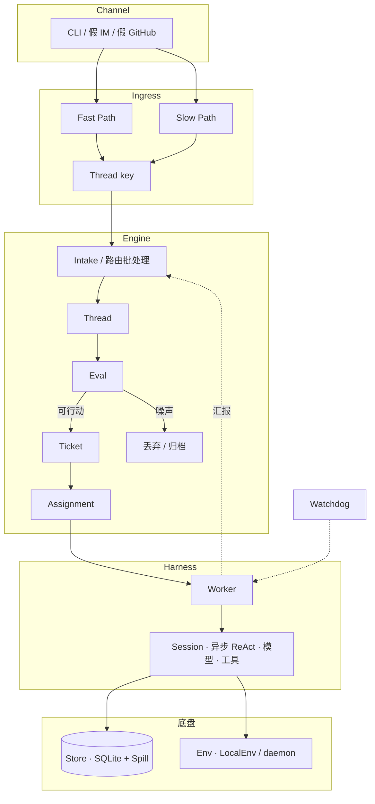

# deepseek-super-agent

[English](README.md) | 简体中文

CLI：`ds-agent` · MIT

按公开 Super-agent 文章的思路，用 TypeScript 写的薄运行时：下层是自研 Harness，上层是领域引擎。

思路来源于 DeepSeek 的公开文章和原型，由本人独立实现。不依赖 DeepSeek Harness / Cordis，也没有 `@deepseek-ai/dsh*`。

LofiSu × Grokbot（CoderBot）。

[灵感来源](#灵感来源) · [能力清单](#能力清单) · [架构](#架构) · [快速开始](#快速开始) · [Demo](#demo) · [模型配置](#模型配置) · [致谢](#致谢) · [许可](#许可)

## 这是什么

`ds-agent` 分两层：

- **Harness**：Session 事件日志、异步 ReAct 循环、OpenAI 兼容调用、按角色注册工具、daemon。
- **Engine**：Intake → Eval → Ticket → Assignment → Reply。领域状态只在这里写入。

## 灵感来源

| 来源 | 链接 | 参考什么 |
|------|------|----------|
| 微信文章 | [Super-agent 设计探索](https://mp.weixin.qq.com/s/zoS7GlReWPhfCjENGxXCdg) | §2–§6：双层 Router/Worker、Trigger、异步工具、多信道、状态与环境分离、Watchdog |
| 官方原型 | [deepseek-ai/dsh-superagent-prototype](https://github.com/deepseek-ai/dsh-superagent-prototype) | Trigger → Eval → Ticket → Assignment；Harness 自研 |

## 能力清单

对照微信文 [Super-agent 设计探索](https://mp.weixin.qq.com/s/zoS7GlReWPhfCjENGxXCdg) **逐条**落地。状态以本仓代码 + `pnpm demo` / `pnpm test` 为准；完整任务矩阵见 [PLAN.md](./PLAN.md)（T01–T51）。计划与正在跑的代码哪里不一致，见 [docs/REVIEW.md](./docs/REVIEW.md)。

图例：`[x]` 已有实现并通过 demo/测试路径验证 · `[~]` 有骨架或部分能力 · `[ ]` 未做（含 Phase-2）

### §1 四特质

- [x] **连续 Continuous** — 跨 IM / GitHub 等信道共用同一套领域状态，用户不必管 Session（Harness Session + Engine Thread/Ticket）
- [x] **高效 Efficient** — 多 Worker 并行；Router 侧批处理同 Thread 积压 Trigger（`evals` + harness inbox）
- [x] **主动 Proactive** — Trigger 驱动；投机 Assignment + deliver gate（`speculate/`）
- [x] **持久 Persistent** — SQLite 持久化；进程重启后可恢复（`store/` + demo restart 断言）

### §2 双层 Router / Worker

- [x] **连续性 vs 吞吐权衡 → 双层拆分** — Router 管交互与分派，Worker 隔离执行（`SessionRole`）
- [x] **Router = 全局序点 / 协调 / 记忆入口** — 入站经 Engine；出站经 Router/Outbox
- [x] **Router 不直接干重活** — Worker 挂执行工具；Router 工具集更窄
- [x] **Router 可用轻量模型** — `roleModels.router` / Mock；Worker 可配强模型
- [x] **Trigger 批处理（拥堵时合并进下一轮）** — 同 Thread Eval batch；demo/测试覆盖
- [ ] **Router 水平切分 / 多层过滤** — 文章 §2/§8；Phase-2（PLAN T09）
- [x] **Worker 上下文隔离 + 完整执行工具** — 独立 Worker Session
- [x] **Worker 不直接对人回复** — 经 `report` → Router 再出站。Worker 会话只持有 `WorkerPorts`，不持有 Engine，不能 `reply` / `decide`
- [x] **Worker ↔ Thread 订阅（可多对多）** — `subscribe` + fan-out
- [~] **Worker 内 Subagent / Team 对 Router 透明** — 有 async job；未做成完整 Team 拓扑（T14）
- [~] **单 UI 多话题 → 多 Worker** — 多 Ticket 可并存；产品壳未做（T15）

### §3 事件驱动

- [x] **环境半结构化事件 = Trigger** — IM / GitHub 风格 Source
- [x] **Fast Path 程序过滤** — source/噪声等确定性规则（`ingress/filter`）
- [x] **Slow Path 语义/策略过滤** — 可走模型策略；Mock 路径可跳过或规则化
- [x] **Thread = 同一话题/PR 下的事件流** — Thread key
- [x] **已订阅 → 直通 Worker（bypass Router Eval）** — 日志 `bypass=subscription` + `ticketId`
- [x] **未订阅 → Router/Eval 冷启动分派** — Intake → Eval → Ticket
- [~] **Worker 取消订阅 / 交回 Router** — 接口方向在 PLAN；demo 未强调（T21）
- [x] **Router 仍可观察全局 Trigger** — Intake 记账
- [x] **Inline：摘要进上下文** — `memory/recall`
- [x] **Spill：长内容外置 + id** — `store/spill`
- [x] **局部性：先 ID/摘要，再按需展开** — `read_object`
- [x] **链式召回 Chain of Recall** — spillId / 对象引用按需拉取（T25 最小实现）
- [x] **投机执行：后台先跑** — speculative Assignment
- [x] **有价值才交付，否则安静丢弃** — `deliver=true` gate；demo 验证

### §4 面向人的交互

- [x] **异步 ReAct：`start` 立即返回，不堵前台** — harness loop / async job
- [x] **Started 通知** — job started 日志/事件
- [x] **完成后作为新 Session 事件回来** — completion 回灌 Worker
- [x] **全双工：后台跑时仍接新输入** — 入站与 job 完成并行入队
- [x] **IM 低打扰 / 短回复规范** — `channels/norms`（含词数上限思路）
- [x] **GitHub 等异步信道结构化输出** — github channel formatter
- [x] **对外只由 Router 说话** — Worker 禁直写信道

### §5 计算 / 状态 / 环境分离

- [x] **计算可无状态，Session/领域进 DB** — SQLite Store
- [x] **执行环境留在原地（沙箱目录）** — `LocalEnv`
- [x] **端侧 daemon 不持会话状态** — `daemon.ts` 只调度 Watchdog 等
- [x] **BYOM：OpenAI 兼容 `DS_AGENT_API_*` 和厂商 Key 预设** — `resolveLiveApi`
- [~] **间歇上线设备 / 多机切换** — Store 可续；真·跨机 daemon 未做（T40 部分）

### §6 Watchdog

- [x] **外部 Control Loop Session** — `watchdog` role
- [x] **定时驱动** — daemon interval tick
- [x] **卡住任务 nudge / fail** — watchdog tools + demo tick
- [~] **基础设施故障 + 目标偏离的 NL 维护** — 有 nudge/fail；完整健康检查/改规则 YAML 未齐（T43–T44）

### §7 实验（文章评测，不挡开源）

- [x] **调度计数** — Ingress admit/drop、Eval accept、订阅 bypass fan-out、投机 deliver/discard、Watchdog nudge/fail、model latency；`ds-agent metrics` 与 `<stateDir>/metrics.json`
- [ ] **端到端对比双层 vs 单 Session** — Phase-2 / 可选 M12（T45）
- [ ] **Router 批处理压测曲线** — Phase-2（T45）

### §8 未决问题（明确不做进 M11）

- [ ] Router 扩展 / Worker 直连拓扑（§8.1）
- [ ] 长程跨月记忆（§8.1）
- [ ] 脱离 Session 的产品交互壳（§8.2）
- [ ] 中途人机协同 UX（§8.2）
- [ ] A2A 跨实例（§8.3）
- [~] **凭据值不进 bash 输出、文件读取、工具结果或 prompt** — LocalEnv 环境变量白名单 + `[redacted]`；外置 vault / seccomp 仍未做（§8.4 T51）

### 模块对照（M0–M11）

| 模块 | 文章落点 | 状态 |
|------|----------|------|
| M0 shared | 类型/端口 | [x] |
| M1 Harness | §2/§4.1/§5 | [x] |
| M2 Store | §5.1/§3.3 Spill | [x] |
| M3 Engine | §2/§3 Eval·Ticket·Assignment | [x] |
| M4 Ingress | §3.1 | [x] |
| M5 Subscribe | §3.2 | [x] |
| M6 Memory | §3.3 | [x] |
| M7 Speculate | §3.4 | [x] |
| M8 Channels | §4.2 | [x] |
| M9 Env | §5.2 | [x] |
| M10 Watchdog | §6 | [x] |
| M11 CLI demo | 验收脚本 | [x] `pnpm demo` |

## 架构

分层：外层 **Channel** 进 **Ingress**，再进 **Engine**（路由 / 批处理 → Thread → Eval → Ticket → Assignment），由 **Harness** 跑 Worker Session；底盘是 **Store**（状态 / Spill）与 **Env**（沙箱 / 进程）。**Watchdog** 挂在外侧。



事件流（文字版）：

```
Channel ──► Ingress (Fast/Slow → Thread key)
              │
              ▼
           Engine.receive
              │  路由 / 批处理
              ▼
           Thread ──► Eval ──► Ticket ──► Assignment
                         │                    │
                         └─ 丢弃              ▼
                                        Harness Worker
                                              │
                    Store ◄───────────────────┤
                    Env   ◄───────────────────┘
                              Watchdog ─► 卡住的 Worker
```

同 Thread 已订阅时走 `bypass=subscription`，跳过 Router Eval，直通已有 Worker。

| 层 | 职责 |
|----|------|
| Channel | 入站适配、出站格式 |
| Ingress | Fast / Slow Path → Thread key |
| Engine | 路由批处理、Thread、Eval、Ticket、Assignment |
| Harness | Session、异步 ReAct、模型、工具、daemon |
| Store | SQLite、Spill、`read_object` |
| Env | 沙箱目录与进程 |
| Watchdog | 检查卡住的 Worker |

## 快速开始

Node.js 22+（见 [package.json](./package.json) 的 `engines`，用到 `node:sqlite`），[pnpm](https://pnpm.io/)。

```bash
pnpm install
pnpm test
pnpm demo
```

`pnpm test` 离线，固定 MockModel。

没有 Key 时，`pnpm demo` 用 MockModel，并在日志里写明。一把厂商 Key，或者同时设置 `DS_AGENT_API_BASE` 与 `DS_AGENT_API_KEY`，会走 HttpOpenAI。只设置其中一个会报错退出。

实况 demo 用 DeepSeek V4.1 Flash。API 模型名是 `deepseek-flash`。用 `DS_AGENT_API_*` 配置：

```bash
export DS_AGENT_API_BASE=https://api.deepseek.com
export DS_AGENT_API_KEY=sk-...
export DS_AGENT_API_MODEL=deepseek-flash
pnpm demo
pnpm ds-agent chat "fix the login timeout"
```

这一对不设 `DS_AGENT_API_MODEL` 时，客户端发送 `deepseek-chat`。只设 `DEEPSEEK_API_KEY` 时，默认是 `deepseek-flash`。

`DS_AGENT_API_BASE` 可以是任意 OpenAI 兼容地址，包括本机 [Magpie](https://github.com/yetone/magpie)（`http://127.0.0.1:3425/v1`）。密钥填网关 token（本机常见是 `magpie`），不是 DeepSeek 的 Key。模型名用 `deepseek/deepseek-flash`。

```bash
export DS_AGENT_API_BASE=http://127.0.0.1:3425/v1
export DS_AGENT_API_KEY=magpie
export DS_AGENT_API_MODEL=deepseek/deepseek-flash
pnpm demo
```

[GitHub Actions](./.github/workflows/ci.yml) 在推送到 `main` 和每个 pull request 上跑 `pnpm typecheck` 与 `pnpm test`。仓库 secret 里有 `DEEPSEEK_API_KEY` 或 `DS_AGENT_API_KEY` 时才会跑 demo，并且打真模型。

状态在 `DS_AGENT_HOME`，否则在 `./.ds-agent`（SQLite）。

```bash
pnpm ds-agent tasks
pnpm ds-agent status
pnpm ds-agent metrics
pnpm ds-agent emit im --thread bug-login --text "login still 500"
pnpm ds-agent emit github --pr 42 --text "CI failed on auth test"
```

## Demo

`pnpm demo` 注入一批假 IM / GitHub 事件，验收管线：噪声过滤、Ticket → Worker、`bypass=subscription`、Spill + `read_object`、投机 gate、Watchdog、重启持久化。

没有 Key 时用 MockModel，并在日志里写明。配了真接口就走 HttpOpenAI，并跳过脚本化的 Mock 断言。

```bash
export DS_AGENT_API_BASE=https://api.deepseek.com
export DS_AGENT_API_KEY=sk-...
export DS_AGENT_API_MODEL=deepseek-flash
pnpm demo
```

环境里已经有 Key 时，`pnpm test:live` 跑同一条实况路径。

## 模型配置

`DS_AGENT_API_BASE` 和 `DS_AGENT_API_KEY` 要一起设，并且优先于下面的预设。不设 `DS_AGENT_API_MODEL` 时，这一对发送 `deepseek-chat`。要 V4.1 Flash，设成 `deepseek-flash`。

| 变量 | 作用 |
|------|------|
| `DS_AGENT_API_BASE` | OpenAI 兼容 Base。DeepSeek 为 `https://api.deepseek.com`。本机 Magpie 为 `http://127.0.0.1:3425/v1`。 |
| `DS_AGENT_API_KEY` | API Key。走 Magpie 时填网关 token，不填 DeepSeek Key。 |
| `DS_AGENT_API_MODEL` | 模型名。`deepseek-flash` 是 DeepSeek V4.1 Flash。Magpie 用 `deepseek/deepseek-flash`。 |

只设厂商 Key 时，`resolveLiveApi` 填上 Base 和默认模型。多把 Key 同时存在时按表从上到下取第一把。要指定一家，设 `DS_AGENT_PROVIDER`（`xai`/`grok`、`moonshot`/`kimi`、`zhipu`/`glm`、`gemini`/`google`、`anthropic`/`claude` 这些别名也可以）。

| 厂商 | 环境变量 | OpenAI 兼容 Base | 默认模型 |
|------|----------|------------------|----------|
| DeepSeek | `DEEPSEEK_API_KEY` | `https://api.deepseek.com` | `deepseek-flash` |
| OpenAI | `OPENAI_API_KEY` | `https://api.openai.com/v1` | `gpt-4o-mini` |
| OpenRouter | `OPENROUTER_API_KEY` | `https://openrouter.ai/api/v1` | `deepseek/deepseek-chat` |
| xAI / Grok | `XAI_API_KEY` 或 `GROK_API_KEY` | `https://api.x.ai/v1` | `grok-4.7` |
| Moonshot / Kimi | `MOONSHOT_API_KEY` 或 `KIMI_API_KEY` | `https://api.moonshot.cn/v1` | `kimi-k3.1-pro` |
| 智谱 / GLM | `ZHIPU_API_KEY` 或 `GLM_API_KEY` | `https://open.bigmodel.cn/api/paas/v4` | `glm-5.3` |
| Gemini | `GEMINI_API_KEY` 或 `GOOGLE_API_KEY` | `https://generativelanguage.googleapis.com/v1beta/openai` | `gemini-3.8-flash` |
| Anthropic | `ANTHROPIC_API_KEY` | `https://api.anthropic.com/v1` | `claude-opus-5-5` |

`HttpOpenAI` 请求 `{base}/chat/completions`，头是 `Authorization: Bearer`。Moonshot 国际站 Base 是 `https://api.moonshot.ai/v1`，智谱海外是 `https://api.z.ai/api/paas/v4`。这两处配 `DS_AGENT_API_BASE` 与 `DS_AGENT_API_KEY`。

`pnpm ds-agent chat` 走 `createModelFromEnv()`。没有 Key 时这条路径用 MockModel。没有任何配置时，`requireLiveModelFromEnv()` 抛错。

Router / Watchdog 用轻量模型，Worker 用强一点的。上表是进程级的一个模型。

## 致谢

LofiSu × Grokbot（CoderBot）。

## 许可

[MIT](./LICENSE)

- [微信文章](https://mp.weixin.qq.com/s/zoS7GlReWPhfCjENGxXCdg)
- [官方原型](https://github.com/deepseek-ai/dsh-superagent-prototype)
