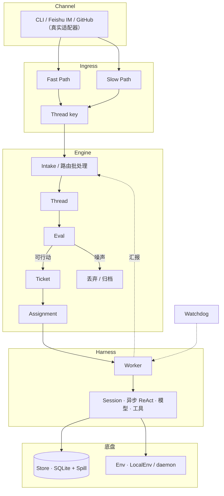

# deepseek-super-agent

[English](README.md) | 简体中文

CLI：`ds-agent` · MIT

按公开 Super-agent 文章的思路，用 TypeScript 写的薄运行时：下层是自研 Harness，上层是领域引擎。

思路来源于 DeepSeek 的公开文章和原型，由本人独立实现。不依赖 DeepSeek Harness / Cordis，也没有 `@deepseek-ai/dsh*`。

LofiSu × Grokbot（CoderBot）。

[文档](docs/zh/index.md) · [灵感来源](#灵感来源) · [能力清单](#能力清单) · [架构](#架构) · [快速开始](#快速开始) · [Demo](#demo) · [模型配置](#模型配置) · [致谢](#致谢) · [许可](#许可)

更短的几页，事实相同：[安装](docs/zh/install.md)、[架构](docs/zh/architecture.md)、[安全](docs/zh/safety.md)。[English](docs/index.md)。

## 这是什么

`ds-agent` 分两层：

- **Harness**：Session 事件日志、异步 ReAct 循环、OpenAI 兼容调用、按角色注册工具、daemon。
- **Engine**：Intake → Eval（Gate + Assessment）→ Mandate/Ticket → Assignment → Outbox。领域状态只在这里写入。

领域命名以[《从零打造 Personal Agent（三）》](https://my.feishu.cn/docx/YtDVdzfxdobjAkxKZiIcl5Emnth)为准：`router` 角色是 **Main Agent / Main Session**，`worker` 角色是 **Executor**，`Subscription` 只传上下文、不增加授权。偏差清单与修正记录见 [docs/DOMAIN_ALIGNMENT.md](./docs/DOMAIN_ALIGNMENT.md)。

## 灵感来源

| 来源 | 链接 | 参考什么 |
|------|------|----------|
| 微信文章 | [Super-agent 设计探索](https://mp.weixin.qq.com/s/zoS7GlReWPhfCjENGxXCdg) | §2–§6：双层 Router/Worker、Trigger、异步工具、多信道、状态与环境分离、Watchdog |
| 官方原型 | [deepseek-ai/dsh-superagent-prototype](https://github.com/deepseek-ai/dsh-superagent-prototype) | Trigger → Eval → Ticket → Assignment；Harness 自研 |
| Personal Agent（三） | [从 DeepSeek Super-agent 看主动服务的设计模式](https://my.feishu.cn/docx/YtDVdzfxdobjAkxKZiIcl5Emnth) | Main Agent / Executor、Subscription 只传上下文、Mandate、Panel / Execution |

## 能力清单

对照微信文 [Super-agent 设计探索](https://mp.weixin.qq.com/s/zoS7GlReWPhfCjENGxXCdg) **逐条**落地。状态以本仓代码 + `pnpm demo` / `pnpm test` 为准；完整任务矩阵见 [PLAN.md](./PLAN.md)（T01–T51）。计划与正在跑的代码哪里不一致，见 [docs/REVIEW.md](./docs/REVIEW.md)。

图例：`[x]` 已有实现并通过 demo/测试路径验证 · `[~]` 有骨架或部分能力 · `[ ]` 未做。扩展域按所属模块常驻 Runtime，不再有总开关：Router 分片、Worker mesh、长期记忆、生命周期事件、A2A 每次启动都会装配。模块对照见 [docs/MODULES.md](./docs/MODULES.md)。

### §1 四特质

- [x] **连续 Continuous** — 跨 IM / GitHub 等信道共用同一套领域状态，用户不必管 Session（Harness Session + Engine Thread/Ticket）
- [x] **高效 Efficient** — 多 Worker 并行；Router 侧批处理同 Thread 积压 Trigger（`evals` + harness inbox）
- [x] **主动 Proactive** — Trigger 驱动；投机 Assignment + deliver gate（`speculate/`）
- [x] **持久 Persistent** — SQLite 持久化；进程重启后可恢复（`store/` + demo restart 断言）

### §2 双层 Router / Worker

- [x] **连续性 vs 吞吐权衡 → 双层拆分** — Router 管交互与分派，Worker 隔离执行（`Role`）
- [x] **Router = 全局序点 / 协调 / 记忆入口** — 入站经 Engine；出站经 Router/Outbox
- [x] **Router 不直接干重活** — Worker 挂执行工具；Router 工具集更窄
- [x] **Router 可用轻量模型** — `models.router`（来自 `roleModelsFromEnv`）；Worker 可配强模型
- [x] **Trigger 批处理（拥堵时合并进下一轮）** — `batchWindowMs > 0` 时同 Thread 合并；由 `test/batching-bench.test.ts` 覆盖。真实信道 demo 用默认窗口 0，不验证合并
- [~] **Router 水平切分 / 多层过滤** — `RouterShardRegistry` 常驻 Runtime（PLAN T09/T46）；用 `DS_AGENT_SHARDS` / `RuntimeOptions.routerShards` 配置，默认 shard 始终存在
- [x] **Worker 上下文隔离 + 完整执行工具** — 独立 Worker Session
- [x] **分层 Prompt Stack** — 身份、主人声音、常驻指令、主人资料、规则、记忆指引、表达风格、角色契约按依赖顺序装配；`PERSONA.md`、`AGENTS.md`、`USER.md` 由主人编辑，`ds-agent prompt --layers` 查看每层及来源。详见 [docs/PROMPTS.md](./docs/PROMPTS.md)
- [x] **Worker 不直接对人回复** — 经 `report` → Router 再出站。Worker 会话只持有 `WorkerPorts`，不持有 Engine，不能 `reply` / `decide`
- [x] **Worker ↔ Thread 订阅（可多对多）** — `subscribe` + fan-out
- [x] **Worker 内 Subagent / Team 对 Router 透明** — async job + `spawn_team`/`team_status`/`complete_team` → member job → `TEAM_MEMBER_DONE` → 汇总报告；team 行持久化到 SQLite，`ds-agent team`/`teams` 可离线查看。Router 只见父 Assignment 报告（T14；unit + harness + live e2e）
- [x] **Worker 调用本地专家 Agent** — 主人配置后，Worker 可用 `delegate_agent` 让本机 CLI Agent（Claude Code、Codex、OpenCode、Hermes 或自定义）执行一个自包含任务。不经过 shell，cwd 为 Worker 工作区，超时/输出有界，环境变量走白名单；`ds-agent agents` 查看配置。详见 [docs/LOCAL_AGENTS.md](./docs/LOCAL_AGENTS.md)
- [x] **单 UI 多话题 → 多 Worker** — 多 Ticket 可并存；`LifecycleBus` 常驻提供读取模型，`ds-agent ui` 提供只读、必需 token 的 loopback 面板（T15/T49）

### §3 事件驱动

- [x] **环境半结构化事件 = Trigger** — IM / GitHub 风格 Source
- [x] **Fast Path 程序过滤** — source/噪声等确定性规则（`ingress/filter`）
- [x] **Slow Path 语义/策略过滤** — Fast Path 先过，之后是可选模型策略（`DS_AGENT_SLOW_PATH=model`），超时/异常/非法输出回退确定性 `ruleClassify`（`ingress/policy.ts`）。默认仅规则；真实频道循环走 `Runtime.ingestAsync`，同步 `ingest` 与 A2A 入站保持仅规则。离线测试固定回退行为并证明默认路径不访问网络
- [x] **Thread = 同一话题/PR 下的事件流** — Thread key
- [x] **已订阅 → 直通 Worker（bypass Router Eval）** — 日志 `bypass=subscription` + `ticketId`
- [x] **未订阅 → Router/Eval 冷启动分派** — Intake → Eval → Ticket
- [x] **Worker 取消订阅 / 交回 Router** — `handback` 退订并把 Trigger 交回 Eval（T21）
- [x] **Router 仍可观察全局 Trigger** — Intake 记账
- [x] **Inline：摘要进上下文** — `memory/recall`
- [x] **Spill：长内容外置 + id** — `store/spill`
- [x] **局部性：先 ID/摘要，再按需展开** — `read_object`
- [x] **链式召回 Chain of Recall** — 类型化 `kind:id` 句柄；`read_object` 返回下一跳（`memory/graph`）
- [x] **投机执行：后台先跑** — speculative Assignment
- [x] **有价值才交付，否则安静丢弃** — `deliver=true` gate；demo 验证

### §4 面向人的交互

- [x] **异步 ReAct：`start_job` 立即返回，不堵前台** — 工具返回 `{status:'started',jobId}` 后结束本轮，`Harness.launch` 再入队下一轮；由 `test/job.test.ts` 覆盖。真实信道 demo 不调用 `start_job`
- [x] **Started 通知** — job started 日志/事件
- [x] **完成后回到 Worker** — job 完成以 `JOB_DONE` prompt 触发下一轮
- [x] **全双工：后台跑时仍接新输入** — 入站与 job 完成并行入队
- [x] **IM 低打扰 / 短回复规范** — `channels/norms`（含词数上限思路）
- [x] **GitHub 等异步信道结构化输出** — github channel formatter
- [x] **对外只由 Router 说话** — Worker 禁直写信道

### §5 计算 / 状态 / 环境分离

- [x] **计算可无状态，Session/领域进 DB** — SQLite Store
- [x] **执行环境留在原地（沙箱目录）** — `LocalEnv`
- [x] **端侧 daemon 不持会话状态** — `daemon.ts` 只调度 Watchdog 等
- [x] **BYOM：OpenAI 兼容 `DS_AGENT_API_*` 和厂商 Key 预设** — `resolveLiveApi`
- [~] **间歇上线设备 / 多机切换** — `MachineRegistry` 心跳 + 过期下线（`DS_AGENT_MACHINE_STALE_MS`）+ daemon resume hook（T40）；真多机 mesh 仍可选

### §6 Watchdog

- [x] **外部 Control Loop Session** — `watchdog` role
- [x] **定时驱动** — daemon interval tick
- [x] **卡住任务 nudge / fail** — watchdog tools + demo tick
- [~] **基础设施故障 + 目标偏离的 NL 维护** — nudge/fail + rules + 只读 `ds-agent health`；更深 NL 漂移检查仍薄（T43–T44）

### §7 实验（文章评测，不挡开源）

- [x] **调度计数** — Ingress admit/drop、Eval accept、订阅 bypass fan-out、投机 deliver/discard、Watchdog nudge/fail、model latency；`ds-agent metrics` 与 `<stateDir>/metrics.json`
- [~] **延迟曲线采样** — 可选 `curveSamples` / `summarizeCurve`（T45）；完整双层 vs 单 Session 对照仍开着
- [x] **Router 批处理压测曲线** — `runBatchingStress` 压入同 Thread Triggers，记录批次大小与 Eval 计数，并把每次 Eval 延迟写入 `curveSamples`（T45 压测 harness）

### §8 未决问题（明确不做进 M11）

- [~] Router 扩展 / Worker 直连拓扑（§8.1）— `RouterShardRegistry` + `WorkerMeshRegistry` 常驻 Runtime；#130 增加 A2A HMAC 的 `RemoteMeshRegistry`/`MeshInbox`（心跳、上限、loopback 默认拒绝），但默认不监听、远端 dispatch 尚未接入本地放置队列；等待启动的 Worker 进入有界 FIFO 队列（`DS_AGENT_MESH_QUEUE`，默认 100）
- [~] 跨 Ticket / 跨月长记忆（§8.1）— `SpillBackedLongTermMemory` 常驻 Runtime：hot Ticket/Decision（1000 条 / 90 天）+ cold Thread digest（200 条 / 3650 天）；真实跨月行为有界但未按自然月测量
- [x] 脱离 Session 的产品交互壳（§8.2）— `LifecycleBus` 常驻提供读取模型；`ds-agent ui` 只读 loopback 面板（必需 token、GET-only、生命周期事件白名单、speculative 隐藏、SSE 背压）
- [x] 中途人机协同 UX（§8.2）— CLI `pause` / `intervene` / `resume` / `collab` + 持久 `Ticket.collaboration`；harness/watchdog 尊重 pause
- [~] A2A 跨实例（§8.3）— `A2ARouter` 常驻 Runtime，HMAC-SHA256 HTTP transport 已实现（`a2a-auth.ts`/`a2a-http.ts`）；默认不监听，跨主机暴露与远端 dispatch 仍需 operator 决策
- [~] **凭据值不进 bash 输出、文件读取、工具结果或 prompt** — LocalEnv 白名单 + `[redacted]` 只覆盖名字像密钥、且至少 8 个字符的环境变量（更短的值、以及其他名字，会原样留下）+ FileVault `describe()`（仅名字）。每个 Worker bash 都包沙箱：macOS 用 `sandbox-exec`，Linux 用 `bwrap`；wrapper 不存在就直接报错，不会退回普通 bash；默认拒绝网络，除非策略放行。默认沙箱只限制写入和网络，不限制读取：两个平台仍允许大范围读取；`DS_AGENT_SANDBOX_READ_ISOLATION=1|true|strict` 可启用严格读隔离（§8.4 T51，#117），未启用时进程级读隔离（包括 SQLite DB）仍要靠外部容器边界；宿主级 vault/seccomp 策略仍外置

### 模块对照（M0–M11）

| 模块 | 文章落点 | 状态 |
|------|----------|------|
| M0 shared | 类型/端口 | [x] |
| M1 Harness | §2/§4.1/§5 | [x] |
| M2 Store | §5.1/§3.3 Spill | [x] |
| M3 Engine | §2/§3 Eval·Ticket·Assignment | [x] |
| M4 Ingress | §3.1 | [x] |
| M5 Subscribe | §3.2 | [x] |
| M6 Memory | §3.3 | [x] |
| M7 Speculate | §3.4 | [x] |
| M8 Channels | §4.2 | [x] |
| M9 Env | §5.2 | [x] |
| M10 Watchdog | §6 | [x] |
| M11 CLI demo | 验收脚本 | [x] `pnpm demo` |

## 架构

分层：外层 **Channel** 进 **Ingress**，再进 **Engine**（路由 / 批处理 → Thread → Eval → Ticket → Assignment），由 **Harness** 跑 Worker Session；底盘是 **Store**（状态 / Spill）与 **Env**（沙箱 / 进程）。**Watchdog** 挂在外侧。



事件流（文字版）：

```
Channel ──► Ingress (Fast/Slow → Thread key)
              │
              ▼
           Engine.receive
              │  路由 / 批处理
              ▼
           Thread ──► Eval ──► Ticket ──► Assignment
                         │                    │
                         └─ 丢弃              ▼
                                        Harness Worker
                                              │
                    Store ◄───────────────────┤
                    Env   ◄───────────────────┘
                              Watchdog ─► 卡住的 Worker
```

同 Thread 已订阅时走 `bypass=subscription`，跳过 Router Eval，直通已有 Worker。

| 层 | 职责 |
|----|------|
| Channel | 入站适配、出站格式 |
| Ingress | Fast / Slow Path → Thread key |
| Engine | 路由批处理、Thread、Eval、Ticket、Assignment |
| Harness | Session、异步 ReAct、模型、工具、daemon |
| Store | SQLite、Spill、`read_object` |
| Env | 沙箱目录与进程 |
| Watchdog | 检查卡住的 Worker |

## 快速开始

Node.js 22+（见 [package.json](./package.json) 的 `engines`，用到 `node:sqlite`），[pnpm](https://pnpm.io/)。本仓只按源码使用：没有 npm 包、没有 `bin`、没有 `build`，在仓库里运行 `pnpm ds-agent ...`。

```bash
pnpm install
export DS_AGENT_API_BASE=https://api.deepseek.com
export DS_AGENT_API_KEY=sk-...
export DS_AGENT_API_MODEL=deepseek-flash
pnpm test
gh auth login            # 真实 GitHub Source / Outbox
export DS_AGENT_GH_REPO=your-account/your-writable-repo
pnpm demo
```

`pnpm test` 和 `pnpm demo` 都要真实模型，默认套件禁止 MockModel。跑 `pnpm test` 之前先设 `DS_AGENT_API_BASE`、`DS_AGENT_API_KEY`、`DS_AGENT_API_MODEL`。三个里缺哪个，`test` 脚本就填上本机 Magpie 的默认值（地址 `http://127.0.0.1:3425/v1`，密钥 `magpie`，模型 `workbuddy/deepseek-v4.1-flash`）。只放一把厂商 Key 换不掉这三项，因为脚本会自己写上 `DS_AGENT_API_BASE` 和 `DS_AGENT_API_KEY`。

`pnpm demo` 只走真实信道：通过 `gh api` 创建、读取真实 GitHub issue，并把回复发成真实 issue comment。没有 fake IM/GitHub 回退。`DS_AGENT_GH_REPO` 要指到你能写的仓库。不设的话是 `LofiSu/deepseek-super-agent`。关 issue 只是收尾：每个场景正事做完才关，关闭失败会被忽略，中途抛错或提前 return 也会把已经建好的 issue 留着。`DS_AGENT_GH_KEEP=1` 是故意不关。跑完看一眼还有没有带着 `ds-agent-demo` 标签、仍然开着的 issue。`pnpm demo:local` 是内存 fixture 冒烟基线，不是验收路径。Feishu 配置与 `pnpm demo:feishu` 见 [docs/REAL_CHANNELS.md](./docs/REAL_CHANNELS.md)。

`pnpm demo` 和 `pnpm ds-agent chat` 不会套用 `test` 脚本那套 Magpie 默认值。这两条要成对设置 `DS_AGENT_API_BASE` 和 `DS_AGENT_API_KEY`，或者只设一把厂商 Key。这一对只设其中一个会报错退出。

实况 demo 用 DeepSeek V4.1 Flash。API 模型名是 `deepseek-flash`。用 `DS_AGENT_API_*` 配置：

```bash
export DS_AGENT_API_BASE=https://api.deepseek.com
export DS_AGENT_API_KEY=sk-...
export DS_AGENT_API_MODEL=deepseek-flash
pnpm demo
pnpm ds-agent chat "fix the login timeout"
```

这一对不设 `DS_AGENT_API_MODEL` 时，客户端发送 `deepseek-chat`。只设 `DEEPSEEK_API_KEY` 时，默认是 `deepseek-flash`。

`DS_AGENT_API_BASE` 可以是任意 OpenAI 兼容地址，包括本机 [Magpie](https://github.com/yetone/magpie)（`http://127.0.0.1:3425/v1`）。密钥填网关 token（本机常见是 `magpie`），不是 DeepSeek 的 Key。模型名用 `deepseek/deepseek-flash`。

```bash
export DS_AGENT_API_BASE=http://127.0.0.1:3425/v1
export DS_AGENT_API_KEY=magpie
export DS_AGENT_API_MODEL=deepseek/deepseek-flash
export DS_AGENT_GH_REPO=your-account/your-writable-repo
pnpm demo
```

[GitHub Actions](./.github/workflows/ci.yml) 在推送到 `main` 和每个 pull request 上跑 `pnpm lint`、`pnpm format:check`、`pnpm typecheck`、`pnpm test` 与 `pnpm test:coverage`。仓库 secret 里有 `DEEPSEEK_API_KEY` 或 `DS_AGENT_API_KEY` 时运行 `pnpm demo:local`（内存 fixture 冒烟，不写仓库）；真实信道验收由有 `gh` 登录的运维者运行 `pnpm demo`。

状态在 `DS_AGENT_HOME`，否则在 `./.ds-agent`（SQLite）。

```bash
pnpm ds-agent tasks
pnpm ds-agent panel            # Panel · Execution
pnpm ds-agent retry <ticketId> # 同一 Ticket 上新建 Assignment
pnpm ds-agent status
pnpm ds-agent metrics
pnpm ds-agent serve [--imessage|--feishu]  # 基于持久化状态的 daemon/watchdog 定时器；可选单个入站轮询
pnpm ds-agent health
pnpm ds-agent memory --limit 10
pnpm ds-agent emit im --thread bug-login --text "login still 500"
pnpm ds-agent emit github --pr 42 --text "CI failed on auth test"
```

## Demo（真实信道）

`pnpm demo` 是验收路径，只走真实信道：

| 场景 | 真实入站 Source | 真实出站 Outbox |
|------|-----------------|-----------------|
| `01-parallel-github` | 三个真实 GitHub issue（`gh api` 拉取） | 每个 ticket 一条真实 issue comment |
| `02-spill-github` | 一个真实 issue 正文 + 两条真实 comment | Router 回复写成 issue comment |
| `03-watchdog-github` | 一个真实 GitHub issue | acknowledgement issue comment |

每次运行在 `DS_AGENT_GH_REPO`（默认 `LofiSu/deepseek-super-agent`）创建新 issue，等待真实模型，发布真实 comment，再通过 GitHub API 重新读取 comment 作为验收证据。关 issue 只是收尾：场景正事做完才关，关闭失败会被忽略，中途抛错或提前 return 会把已经建好的 issue 留着。`DS_AGENT_GH_KEEP=1` 是故意不关。跑完看一眼还有没有带着 `ds-agent-demo` 标签、仍然开着的 issue。日志与 JSON 证据在 `/tmp/ds-agent-live-e2e-logs/demos/`。

```bash
export DS_AGENT_API_BASE=http://127.0.0.1:3425/v1
export DS_AGENT_API_KEY=magpie
export DS_AGENT_API_MODEL=workbuddy/deepseek-v4.1-flash
export DS_AGENT_GH_REPO=LofiSu/deepseek-super-agent
gh auth login
pnpm demo                              # 三个场景
pnpm demo -- --only watchdog           # 单个场景
DS_AGENT_GH_KEEP=1 pnpm demo           # 保留真实 issue
```

`pnpm demo:local` 是旧的纯内存 fixture 基线，不是信道验收路径。设置 `FEISHU_APP_ID`/`FEISHU_APP_SECRET`/`FEISHU_CHAT_ID` 后，`pnpm demo:feishu` 会走真实 Feishu 消息 API。环境里已经有 Key 时，`pnpm test:live` 跑实况模型测试。

## 模型配置

`DS_AGENT_API_BASE` 和 `DS_AGENT_API_KEY` 要一起设，并且优先于下面的预设。不设 `DS_AGENT_API_MODEL` 时，这一对发送 `deepseek-chat`。要 V4.1 Flash，设成 `deepseek-flash`。

| 变量 | 作用 |
|------|------|
| `DS_AGENT_API_BASE` | OpenAI 兼容 Base。DeepSeek 为 `https://api.deepseek.com`。本机 Magpie 为 `http://127.0.0.1:3425/v1`。 |
| `DS_AGENT_API_KEY` | API Key。走 Magpie 时填网关 token，不填 DeepSeek Key。 |
| `DS_AGENT_API_MODEL` | 模型名。`deepseek-flash` 是 DeepSeek V4.1 Flash。Magpie 用 `deepseek/deepseek-flash`。 |

只设厂商 Key 时，`resolveLiveApi` 填上 Base 和默认模型。多把 Key 同时存在时按表从上到下取第一把。要指定一家，设 `DS_AGENT_PROVIDER`（`xai`/`grok`、`moonshot`/`kimi`、`zhipu`/`glm`、`gemini`/`google`、`anthropic`/`claude` 这些别名也可以）。

| 厂商 | 环境变量 | OpenAI 兼容 Base | 默认模型 |
|------|----------|------------------|----------|
| DeepSeek | `DEEPSEEK_API_KEY` | `https://api.deepseek.com` | `deepseek-flash` |
| OpenAI | `OPENAI_API_KEY` | `https://api.openai.com/v1` | `gpt-4o-mini` |
| OpenRouter | `OPENROUTER_API_KEY` | `https://openrouter.ai/api/v1` | `deepseek/deepseek-chat` |
| xAI / Grok | `XAI_API_KEY` 或 `GROK_API_KEY` | `https://api.x.ai/v1` | `grok-4.7` |
| Moonshot / Kimi | `MOONSHOT_API_KEY` 或 `KIMI_API_KEY` | `https://api.moonshot.cn/v1` | `kimi-k3.1-pro` |
| 智谱 / GLM | `ZHIPU_API_KEY` 或 `GLM_API_KEY` | `https://open.bigmodel.cn/api/paas/v4` | `glm-5.3` |
| Gemini | `GEMINI_API_KEY` 或 `GOOGLE_API_KEY` | `https://generativelanguage.googleapis.com/v1beta/openai` | `gemini-3.8-flash` |
| Anthropic | `ANTHROPIC_API_KEY` | `https://api.anthropic.com/v1` | `claude-opus-5-5` |

`HttpOpenAI` 请求 `{base}/chat/completions`，头是 `Authorization: Bearer`。Moonshot 国际站 Base 是 `https://api.moonshot.ai/v1`，智谱海外是 `https://api.z.ai/api/paas/v4`。这两处配 `DS_AGENT_API_BASE` 与 `DS_AGENT_API_KEY`。

`pnpm ds-agent chat` 走 `createModelFromEnv()`。没有 Key 时这条路径用 MockModel。没有任何配置时，`requireLiveModelFromEnv()` 抛错。

Router / Watchdog 用轻量模型，Worker 用强一点的。上表是进程级的一个模型。

`ds-agent gateway` 是本地 OpenAI 兼容代理，通过 `<stateDir>/gateway.token`（0600）签发并复用本地 bearer token；设置 `DS_AGENT_GATEWAY_URL` 时 CLI 会复用它。`gateway.token` 为零字节或只有空白字符时，网关会 fail closed 并给出明确错误；恢复是显式的运维操作，按 ADR-009 执行（确认文件确实陈旧后，才删除或替换），不会自动恢复。见 [docs/GATEWAY.md](./docs/GATEWAY.md)。

`ds-agent imessage` 是面向专用 Apple ID 的双向 iMessage 信道：入站只读 `~/Library/Messages/chat.db`（`is_from_me = 0`），出站经 Messages.app 的 `osascript`，文本从环境变量传入。`serve --imessage` 会在 daemon 旁跑同一个入站轮询（默认 `serve` 没有入站轮询）；它沿用同样的默认拒绝发送者准入、cursor 和 outbox，若 `chat.db` 无法打开则拒绝启动。见 [docs/IMESSAGE.md](./docs/IMESSAGE.md)。

iMessage 的群聊与 1:1 使用不同线程键，群聊优先级严格为 `chat:<guid>` > `group:<identifier>` > `group-rowid:<rowid>` > `group-unknown:<handle>`；1:1 会话始终是 `handle:<handle>`。`group-rowid` 是每个数据库内的 SQLite 标识，只用于线程身份，从不用于出站。

`serve --feishu` 用 `FEISHU_APP_ID`/`FEISHU_APP_SECRET` 和 `FEISHU_CHAT_ID` 或 `--chat <id>` 轮询一个 Feishu 会话，cursor 存在 SQLite；同一进程不能与 `--imessage` 同时使用。

## 致谢

LofiSu × Grokbot（CoderBot）。


## 真实模型测试

本机 Magpie（Asia/Shanghai）实测，模型 `workbuddy/deepseek-v4.1-flash`：

```bash
export DS_AGENT_API_BASE=http://127.0.0.1:3425/v1
export DS_AGENT_API_KEY=magpie
export DS_AGENT_API_MODEL=workbuddy/deepseek-v4.1-flash
export DS_AGENT_GH_REPO=LofiSu/deepseek-super-agent
gh auth login
pnpm test
pnpm demo          # 真实 GitHub issue/comment + 真实模型
```

最后一次记录的真实运行（2026-11-03，本机 Magpie）：`pnpm test:live` 22 passed、3 files（195.34 s）；`pnpm test` 384 passed、3 skipped、55 files（622.33 s）。该记录早于当前测试套件的增长，本次 README 更新没有重新运行真实测试。

`pnpm test` 会在 Vitest 启动前，把缺的 `DS_AGENT_API_*` 填成上面这套 Magpie 默认值。`test/setup-live.ts` 只在变量仍然空着时做同样的事，CI 上不做。只放一把厂商 Key 换不掉这三项。E2E 日志目录：`/tmp/ds-agent-live-e2e-logs/`；真实信道 demo 日志与证据：`/tmp/ds-agent-live-e2e-logs/demos/`。

## 许可

[MIT](./LICENSE)

- [微信文章](https://mp.weixin.qq.com/s/zoS7GlReWPhfCjENGxXCdg)
- [官方原型](https://github.com/deepseek-ai/dsh-superagent-prototype)
