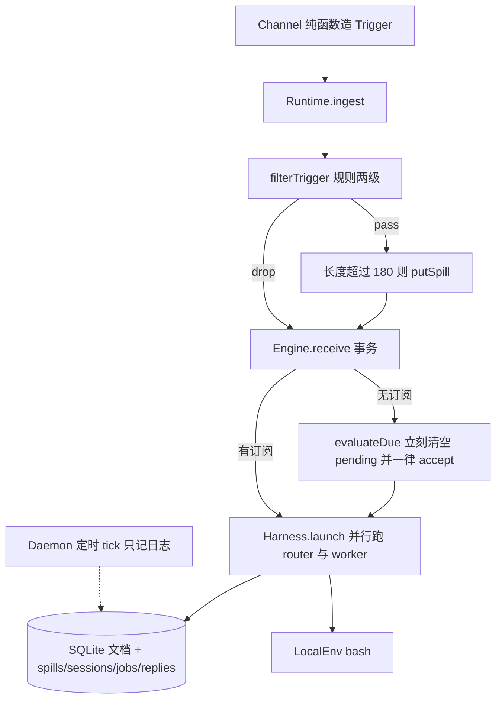

# PLAN.md 架构扎实度审查

审查对象是 [`PLAN.md`](../PLAN.md) 这份「只读契约」，对照 `src/` 与 `test/` 的实际控制流。博客 §2–§8 使用本仓自己的编号：PLAN §3 的 T01–T44，以及 README「能力清单」对同一篇文章的逐条转写（[Super-agent 设计探索](https://mp.weixin.qq.com/s/zoS7GlReWPhfCjENGxXCdg)）。本文核对的是这些转写在代码里是否成立。

结论：分层骨架和若干 demo 探针是真的。计划里多处写成已落地的控制回路没有闭合。文末「无静默遗漏」把任务编号和 README 勾选当成了覆盖。按下面的分级，**高 4、中 10、低 5**。

高风险意味着：读者会相信一条安全边界或控制回路已经在做事，代码却不会执行该动作。相关改动合入前要先改代码，或先改契约把该条标成未做。中风险意味着：骨架在，控制流或完成度和 PLAN 不一致，下一个实现者会被带偏。低风险是命名、布局，以及计划里已经写明不做的 Phase-2。

证据来自当前 `main` 上的源码和测试，不是把 `pnpm demo` 的日志子串再跑一遍。`src/cli/demo.ts` 的 `DEMO_PROOFS` 用 `String.includes` 验收，一条日志出现过就算过。

## 分级

| 级 | 含义 | 本审查里怎么用 |
|----|------|----------------|
| 高 | 安全红线或控制动作被写成已存在，调用链上没有这个动作 | H1–H4 |
| 中 | 数据或会话骨架在，决策时机、批处理、模型或接口和契约不一致 | M1–M10 |
| 低 | 栈与目录漂移；出站模板和事件名缺项；已声明的 Phase-2 | L1–L5 |

## 仍然成立的部分

这些行为有代码路径，而且多数有测试或 demo 断言，可以当后续改动的基线。

- Channel 适配器只构造 `Trigger`。`src/channels/im.ts`、`github.ts`、`cli.ts` 不写 SQLite。
- 同线程上已有工单时，后续消息走订阅旁路，不进入 `pending`，不新开第二张工单。日志形如 `bypass=subscription ticketId=`。`test/subscription.test.ts` 断言工单数为 1、`pending` 为空、`accept` 决策只有一条。
- Router 工具名单没有 `bash`。Worker 工具名单没有 `reply_user`。`ToolRegistry.invoke` 会拒绝角色不匹配的调用（`src/harness/tools.ts`）。
- IM 出站按词截断到 100（`src/channels/norms.ts` 的 `truncateWords`）。
- 长文本会写入 `spills` 表，正文不进 inline，Worker 用 `read_object` 按 id 读回。`test/spill.test.ts` 覆盖阈值和读回。
- `Engine` 的每个公开方法包在 `repo.atomic()` 里。过滤掉的 Trigger 仍入库，并带 `disposition.filtered`。重复 id 返回 `duplicate`。
- 进程重启后工单文档还在。`runDemo` 关掉库再打开，断言 ticket 数量不减。
- 未设置 `DS_AGENT_API_BASE` 与 `DS_AGENT_API_KEY` 时用 `MockModel`。设置后用 `HttpOpenAI`。Key 放在 `Authorization` 头，`systemPrompt()` 不拼接 key。
- `speculative` 工单创建时不调用 `replies.acknowledge`。
- 明显噪声走 fast path，较长的无意图文本走 semantic 规则丢弃。`test/filter.test.ts` 覆盖这两层。`package.json` 没有 `@deepseek-ai/*`，也没有 `cordis`。
- `LocalEnv` 把每个 worker 限制在 `home/workspaces/<id>` 下，拒绝绝对路径和 `..`。`spawn` 传入 `timeout`，当前 Node 会在超时后发 `SIGTERM`。
- T09，以及 §7–§8 的 T45–T50，在 PLAN §9 和 README 里标明未做。这几条不是静默缺口。

## 实际数据流

PLAN §2.1 的图是 Channel → Ingress → Engine → Harness，Store 与 Env 在两侧，Watchdog 从外面 tick。代码的组合根是 `src/runtime.ts` 的 `Runtime.ingest`，不是计划里的 `src/app/runtime.ts`。

一次 `ingest` 的顺序是：若库里还没有这条 Trigger，先 `filterTrigger`；通过则可能 `putSpill`，把正文换成摘要，并写入 `meta.admitted = true`；然后 `Engine.receive`；若结果是 `stored`，立刻 `evaluateDue`；对每条 `accept` 调用 `harness.launch`；最后按 `disposition.fanout` 把消息送进已有 Worker。`launch` 的 Promise 没有被 `ingest` await，所以入站函数本身会返回。

## 1. Channel → Ingress → Engine → Store / Env

计划要求 Ingress 过滤后调用 `Engine.receive`，领域聚合只由 Engine 写，Env 不持有会话，daemon 不持有会话。

代码里 Channel 与 Env、daemon 的边界大体守住了。Ingress 没有独立类型，过滤函数在 `src/ingress/filter.ts`，由 `Runtime` 在进 Engine 之前调用。通过过滤的 Trigger 会被改写：`text` 换成 inline 摘要，`meta` 带上 `admitted`、`strength`、`label`、可能还有 `spillId`。落库的不是 Channel 刚构造的那份对象。PLAN 把 `Trigger` 写成不可变，并把 `meta` 写成不可信、核心不解释。`Runtime` 与 `scope.admit` 会读 `meta.admitted`；`strengthOf` 读 `meta.strength`；`isSpeculative` 读 `meta.speculate`；Ticket 创建读 `meta.label` 与 `meta.spillId`。

`scope.admit` 在 `meta.admitted === true` 时直接放行（`src/runtime.ts` 装配 Host 处）。通过过滤的 `ingest` 会先盖章，Engine 里的门不再看第二遍。被 Runtime 丢弃的 Trigger 不盖章，Engine 会再跑一次 `filterTrigger`。直接调用 `Engine.receive` 且自带 `admitted: true` 的 Trigger 会跳过过滤。当前 CLI 适配器不填这个字段，信任边界仍然写在 Engine 里。

Fast path 做了来源白名单（`im` / `github` / `cli`）、提及、动作关键词、噪声词和过短文本。计划里的群组白名单、actor 白名单、丢掉 bot 自己，没有对应分支。Slow path 是 `ruleClassify` 的正则。`HttpOpenAI.classify` 同样调用 `ruleClassify`，接上真模型之后语义层仍然不请求模型。没有 `prompts/policy-filter.md`。

Eval 没有 Gate，也没有 Assessor。`Evals.evaluateDue` 对每个有 `pending` 的 Thread 调用 `tickets.create`，决策 `kind` 固定为 `'accept'`（`src/core/evals.ts`、`src/core/tickets.ts`）。类型里的 `ignore` / `stop` / `unavailable` 没有生产路径。`Engine` 上没有 `decide`、`stopTicket`、`retryTicket`。Router 会话在 `harness.launch` 里启动，发生在工单和 Assignment 已经写入之后。非投机工单的 acknowledgement 也在这次 `create` 里直接发出。Router 不是序点上的决策者，它是决策之后的说话者。这是 H1。

Store 用 `node:sqlite` 的文档表（`kind + id + JSON`）加上 spills、jobs、sessions、messages、replies、subscriptions、events。计划中的分表 `trigger` / `disposition` / `trigger_thread` 以及 `better-sqlite3`、文件名 `ds-agent.sqlite` 都没有。领域文档的写入在 Engine 事务内。Spill 由 `Runtime.ingest` 在事务外 `putSpill`。Session、job、message、artifact 由 Harness 和工具写入。计划允许 Harness 追加会话表；Spill 的事务外写入是多出来的写者。若 `receive` 在 Spill 之后抛错，会留下没有 Trigger 的 spill 行。

Env 留在本机目录，不写 Ticket。daemon 对象只持有 timer。恢复未完成会话、处理 SIGTERM，计划 M1 有，代码没有（M10）。

## 2. 双层 Router 与批处理

角色拆开了。`Role = 'router' | 'worker' | 'watchdog'`。三套 `systemPrompt`，三套工具名单。`launch` 打日志 `dual-layer RouterSession=... WorkerSession=...`，两个会话用 `Promise.all` 同时跑。Worker 报告通过 `report_to_router` 进入 `engine.report`，再 `routerTurn`。这些对应 T05、T11、T12，成立。

批处理和「轻量 Router / 强 Worker」没有落地。

`nextBatch` 返回 `pending` 的副本（`src/ingress/batch.ts`）。`ingest` 每次 `stored` 之后立刻 `evaluateDue`，而 `evaluateDue` 会把该 Thread 的 `pending` 清掉。公开路径上，下一条消息到达时上一条已经评估完，批大小是 1。Demo 只检查日志里有没有子串 `Evals.batch`。Router 的 `runTurn` 不读 `thread.pending`。计划 T08 写的「LLM 轮次中积压，turn 开始时 drain inbox」在 `src/harness/loop.ts` 里没有对应代码。这是 M1。

`HarnessOptions.model` 是一个 `Model`。`createModelFromEnv` 在有 key 时构造一个 `HttpOpenAI`，三个角色共用。仓库里没有 `roleModels`。README 仍写 `roleModels.router`。这是 M2，并直接否定 T07。

`create_worker` 只打日志并返回 `engine-assigns`。Worker 由 `Tickets.create` 预先放入 `assignments`，再由 `launch` 启动。Router 工具不能改变这个决定。

## 3. 订阅扇出

`Intake.receive` 在 Thread 的 `subscriptions` 里找工单。能投递的工单会追加一条 input，并打出 `bypass=subscription ticketId=<id> thread=<key> triggerId=<id>`。该 Trigger 不进入 `pending`，因此不会再 `evaluateDue`。同线程第二条人消息的测试把这条路径钉住了。T19 的日志探针成立。

和计划不一致的部分：

- `deliverable` 对未结束工单一律返回 true，不看 `trigger.human`。计划写的是人的消息到达 live Ticket。机器事件打到已订阅线程也会旁路。
- 已结束且 `ended.by !== 'human'` 时，人的消息会删掉 `ended` 并记 `ticket.resumed`。`contextOnly` / `followForContext` 不存在，没有「只看上下文、不恢复」的订阅。
- `Engine` 有 `subscribe` 与 `handback`。没有 `markUnrelated`、`unsubscribe`。`handback` 把 trigger id 放回 `pending`，订阅还在，并且不调用 `evaluateDue`。没有任何工具调用 `handback`。下一次别的 `ingest` 才会把队列评估掉，那时 `tickets.create` 会再开一张工单。
- 数据上一个 Thread 可以挂多个 ticket id，一张工单也可以 `subscribe` 到另一个 Thread。多对多的数组在。计划里的 `Subscription.contextOnly` 不在。没有「第二个 Worker 订阅另一条 Thread」的测试。Demo 的 `parallel workers` 来自多张工单各自 `launch`，`running.size >= 2` 时打日志。

这是 M7。T13、T20、T21 记为部分。T14 的「Worker 内子代理对 Router 不透明」只有 `start_job` 的定时器，没有 Team。T15 的多工单可以被 `ds-agent tasks` 列出来，没有产品壳。这两条和 README 的 `[~]` 一致，不升到高。

## 4. Inline / Spill

`inlineOrSpill`（`src/memory/recall.ts`）在 `text.length <= 180` 时原样保留。更长则 `putSpill` 全文，inline 为约 72 字摘要加上 `spillId=<id>`。Spill 是 SQLite `spills.body`，不是计划中的 `<stateDir>/spill/<id>` 文件。

`read_object` 只注册给 worker，按 id 返回整段正文。没有 `offset` / `limit`、没有 neighbors、没有截断后续读。没有 `graph.ts`，也没有 Trigger → Thread → Ticket → Session 的对象图。Mock 工人看到 prompt 里的 `spillId=` 就调用 `read_object`。`Runtime` 另打一行 `[memory] Inline/Spill chain-of-recall`。链式召回是这根字符串和这条日志。

T23 的「摘要 + id、正文在外」成立。T24、T25 不成立。这是 M4。

## 5. Speculate gate

`isSpeculative` 在 `meta.speculate === true` 或 `strength === 'maybe'` 时为真。创建路径会跳过 acknowledgement，并打 `[speculate] speculative silent ... until deliver`。Assignment 带 `speculative: true`。

计划中的门是：`DeliverGate.evaluate` 在 `ready` 且摘要有价值信号时 deliver，`dropped` / `failed` 则 discard，丢弃时结束工单、无出站、事件 `speculate.discarded`。公开列表在 deliver 之前看不到这些工单。

代码里的门是另一件事：

- `maySurface` 写在 `src/speculate/gate.ts`，仓库内没有调用方。
- `Assignments.report` 在投机且 `deliver !== true` 时写回报告并返回。返回发生在把 Assignment 标成 `ended` 之前。因此 `failed` / `dropped` 且未 deliver 的投机报告不会结束工单，也不会发出丢弃事件。`src/shared/events.ts` 没有 `speculate.delivered` / `speculate.discarded`。
- `deliver === true` 不清除 `ticket.speculative`。
- `list_tasks` 返回全部工单，包含 `speculative` 字段。`ds-agent tasks` 打印 `listDocs('ticket')` 的每一张。
- `MockModel` 的工人对投机工单先 `deliver: false`，下一轮工具调用再 `deliver: true`。Demo 因此同时看得到 `speculative silent` 和 `deliver=true`。丢弃路径没有被跑到。

T26 部分成立（创建时静默、不发 ack）。T27、T28 不成立。这是 H3。

## 6. 异步 ReAct

`ingest` 不 await `launch`，新的入站可以在 Worker 还在跑时进入 Runtime。这是 T01 里「入站函数不阻塞」的那一半。

同一 `sessionId` 的 turn 经 `enqueue` 串成一条链。`bash` 在 `runTurn` 里被 await，该会话的下一次 `deliver` 会排在这条链后面。跨会话可以并行：同一次 `launch` 用 `Promise.all` 跑 router 和 worker。计划里的全双工是「入站和工具结果并行入队」。代码是会话邮箱，不是同一会话上重叠的工具与新输入。T32 部分成立。

`start_job` 立刻返回 `{ status: 'started', jobId }`，并用 `setTimeout` 在稍后把 job 标完成、再入队一轮 `JOB_DONE`。当前 `runTurn` 不会因为 `started` 停下。Mock 工人在同一次 turn 里接着调用 `report_to_router`。计划写的是 `started` 之后 turn 结束。没有 `Harness.start` / `Harness.stop`。`stop_worker` 只打日志。`stop_job` 把状态写成 `stopped`，定时器回调仍执行 `completeJob(id, 'succeeded')` 并注入 `JOB_DONE`，不看当前状态。

完成回注是一条新的 user prompt，会进 JSONL 和 `messages` 表。它不是计划里 `role: 'job'` 的 `SessionEvent`。T29–T31 部分成立。这是 M5。Daemon 不在启动时恢复 job，见 M10。

## 7. Channels

`renderOutbound`：`im` 截断到 100 词；`github` 是三行（`ds-agent note`、ticket id、正文再截到 80 词）；其他来源截到 200 词。没有 `formatEmail`，没有清单、标题层级或链接模板。T33 成立。T34 部分成立（L2）。

`reply_user` 只属于 router，Worker 调不到。`Replies.send` 把渲染后的文本插入 `replies` 且 `status: 'sent'`，没有再投递到外部 Source 的适配器。

非投机工单在 `Tickets.create` 里调用 `acknowledge`，文案是 `Acknowledged “...”`，不经过 Router 会话。随后 Mock Router 看到 `TICKET_CREATED` 还会再 `reply_user` 一次。出站有两条说话路径。T35 部分成立。这是 M6。Worker 不能直写信道这一点成立，不要和 M6 混成一件事。

## 8. BYOM

`createModelFromEnv` 在 `DS_AGENT_API_BASE` 与 `DS_AGENT_API_KEY` 都存在时返回 `HttpOpenAI`，模型名来自 `DS_AGENT_API_MODEL` 或 `DS_AGENT_MODEL`，否则 `deepseek-chat`。`complete` 走 `POST {base}/chat/completions`。T39 的「OpenAI 兼容调用」成立。

同一实例服务 router、worker、watchdog 和 `classify`。`classify` 不发 HTTP。真模型配置改变不了 Slow Path（M2、M3）。

默认 prompt 不含 key。红线还要求工具结果和 prompt 装配里不出现凭据值，并有断言。`bash` 把 stdout/stderr 原样放进工具 JSON；`SessionJournal.append` 把该 JSON 写入 JSONL 和 `messages`。没有 `sanitize.ts`，测试里没有「会话文本不得包含 `DS_AGENT_API_KEY`」的断言。命令若打印环境变量，值会进入下一轮模型消息。这是 H4。T51 在 T01–T44 之外，计划却把基线写成 M11 已保证；H4 是该句和代码的差距。

T40 的跨机 hands、断线后续跑：库可以重新打开，daemon 不会接手未完成 turn。和 README 的 `[~]` 一致。

## 9. Watchdog

`Daemon.start` 立刻 `tick`，再用 `setInterval` 按 `watchdog.intervalMs` 重复。`Runtime` 默认 15 秒，计划写 5 秒。Demo 用 20 毫秒，`stuckMs` 为 60 秒，demo 里的 Worker 不会被判卡住。

`Watchdog.tick` 在库开着时做 `SELECT 1`，用 `stuckSessions` 过滤 `role === 'worker'`、`status === 'running'` 且心跳超过阈值的行，然后打日志。卡住时多打一行 `[watchdog] nudge session=...`。它不调用 `nudge_worker`，不向 Worker 会话追加事件，不 `engine.report`。`nudge_worker` 自身也只打日志。`mark_task_failed` 会 `engine.report(kind: 'failed')`，Mock 的 watchdog 回合只调用 `list_tasks` 然后返回 `[watchdog] healthy`，不会走到 fail。

`test/job.test.ts` 只测 `stuckSessions` 这个纯函数。Demo 的证明字符串是 `[watchdog] tick`，空闲 tick 也包含它。

计划 T43 的目标漂移、T44 的 `prompts/watchdog.md` 与规则 YAML 都不存在。T42 的定时器成立。T41 的独立会话只在 `watchdogTurn()` 被显式调用时出现，和定时 tick 不是一条回路。T43、T44 不成立。这是 H2。

附带：`Assignments.report` 在 `kind === 'failed'` 时把 `ended.by` 写成 `'watchdog'`，包括 Worker 自己报告的失败。名字被写进了结束原因，tick 仍然没有失败动作。

## 10. T01–T44 对照博客 §2–§8

判定只用四档：成立、部分、不成立、未做（计划已写明）。「部分」表示该任务里有一条真实路径，计划中的其余谓词没有。

| ID | 博客 | 判定 | 代码里实际有的 | 发现 |
|----|------|------|----------------|------|
| T01 | §4.1 入站不堵 | 部分 | `ingest` 不 await `launch`；同会话 turn 串行；`bash` 在 turn 内 await | M5 |
| T02 | §2 批处理与旁路 | 部分 | 旁路有；公开路径批大小为 1 | M1、M7 |
| T03 | §3.4 / §6 静默试探与 nudge | 部分 | 创建时不发 ack；deliver 是布尔；tick 不 nudge | H2、H3 |
| T04 | §5 可恢复 | 部分 | 工单与 job 行重启还在；daemon 不恢复运行中的 turn | M10 |
| T05 | §2 三角色 | 成立 | 分角色 prompt 与工具名单，分 session id | — |
| T06 | §2 Router 序点、无 bash、一轮吃下积压 | 部分 | Router 无 bash；序点与积压不在 | H1、M1 |
| T07 | §2 Router 轻模型 | 不成立 | 三角色共用一个 `Model`，无 `roleModels` | M2 |
| T08 | §2 轮次中批处理 | 不成立 | `nextBatch` 原样返回；`ingest` 立刻 `evaluateDue` | M1 |
| T09 | §2/§8 分片 | 未做 | PLAN §9 已写明 | L5 |
| T10 | §2 Worker 隔离与强模型 | 部分 | 独立会话与工作目录；模型不分开 | M2 |
| T11 | §2 Worker 不对人说话 | 成立 | `reply_user` 拒绝非 router | — |
| T12 | §2 向 Router 报告 | 成立 | `report_to_router` → `engine.report` → `routerTurn` | — |
| T13 | §3.2 订阅 | 部分 | ticket id 数组；无 `contextOnly` | M7 |
| T14 | §2 子代理对 Router 透明 | 部分 | 只有定时 job；README 已标 `[~]` | M5 |
| T15 | §2 多话题多 Worker | 部分 | 多工单可列出；无产品壳；README 已标 `[~]` | — |
| T16 | §3.1 Fast Path | 部分 | 来源、提及、关键词、噪声；无群组/actor/bot-self | — |
| T17 | §3.1 Slow Path 模型策略 | 不成立 | `ruleClassify`；真模型的 `classify` 仍走规则 | M3 |
| T18 | §3.2 Thread 事件流 | 成立 | `pending`、订阅、关联 key；文档表而非分表 | L1 |
| T19 | §3.2 订阅旁路 | 部分 | 日志与「不新开票」成立；不限于人的消息 | M7 |
| T20 | §3.2 多对多与 followForContext | 部分 | 数组可多对多；无 context-only | M7 |
| T21 | §3.2 退订 / handback | 部分 | `handback` 入队且不评估；无退订 | M7 |
| T22 | §3.2 Router 仍看见全局 | 部分 | 过滤掉的 Trigger 也入库；Router 没有读全部 Trigger 的工具 | — |
| T23 | §3.3 Inline 与 Spill | 成立 | 180 字阈值、摘要、SQLite 正文 | — |
| T24 | §3.3 局部性分页与邻居 | 不成立 | `read_object` 一次返回全文 | M4 |
| T25 | §3.3 对象图召回 | 不成立 | prompt 里的 `spillId=` 字符串 | M4 |
| T26 | §3.4 静默 Assignment | 部分 | 不发 ack；`tasks` 仍列出 | H3 |
| T27 | §3.4 有价值才交付 | 不成立 | 工人自报 `deliver`；`maySurface` 无调用；失败不结束 | H3 |
| T28 | §3.4 静默复现再交付 | 不成立 | Mock 第二份报告固定 `deliver: true` | H3 |
| T29 | §4.1 start/stop | 部分 | 无 `start`/`stop`；`stop_worker` 只打日志；`stop_job` 会被盖掉 | M5、M10 |
| T30 | §4.1 started 回执 | 部分 | 工具返回 `started` 并打日志；turn 继续 | M5 |
| T31 | §4.1 完成成为新事件 | 部分 | 新的 `JOB_DONE` user 消息；不是 `role: 'job'` | M5 |
| T32 | §4.1 全双工 | 部分 | 入站不堵；同会话排队 | M5 |
| T33 | §4.2 IM ≤100 词 | 成立 | `truncateWords(text, 100)`；无单独单测 | — |
| T34 | §4.2 GitHub/email 高密度 | 部分 | GitHub 三行短注；无 email | L2 |
| T35 | §4.2 只有 Router 出站 | 部分 | Worker 不能 `reply_user`；Engine 直接 ack | M6 |
| T36 | §5.1 计算可丢、库还在 | 部分 | 文档重启可读；内存中的 turn 链不恢复 | M10 |
| T37 | §5.2 环境留在本机 | 成立 | `LocalEnv` 工作目录 | L4 |
| T38 | §5.2 daemon 无会话状态 | 成立 | `Daemon` 只持有 timer | M10 |
| T39 | §5.2 BYOM | 成立 | `HttpOpenAI` + `DS_AGENT_API_*` | M2 |
| T40 | §5.2 间歇设备 | 部分 | 库可重开；无跨机 daemon；README 已标 `[~]` | M10 |
| T41 | §6 外部 Control Loop 会话 | 部分 | `watchdogTurn` 与定时 `tick` 是两条路 | H2 |
| T42 | §6 定时 | 成立 | `setInterval` | — |
| T43 | §6 故障、卡住、目标漂移 | 不成立 | `SELECT 1` 与心跳过滤；tick 不处置；无漂移比较 | H2 |
| T44 | §6 自然语言规则 | 不成立 | 一段 `systemPrompt`；无规则文件 | H2 |

分节rollup：

| 博客 | 任务 | 成立 | 部分 | 不成立 | 未做 |
|------|------|------|------|--------|------|
| §1 四特质（落在 §4.1/§5） | T01–T04 | — | T01 T02 T03 T04 | — | — |
| §2 双层 | T05–T15 | T05 T11 T12 | T06 T10 T13 T14 T15 | T07 T08 | T09 |
| §3 事件 | T16–T28 | T18 T23 | T16 T19 T20 T21 T22 T26 | T17 T24 T25 T27 T28 | — |
| §4 交互 | T29–T35 | T33 | T29 T30 T31 T32 T34 T35 | — | — |
| §5 存算分离 | T36–T40 | T37 T38 T39 | T36 T40 | — | — |
| §6 Watchdog | T41–T44 | T42 | T41 | T43 T44 | — |

§2 里真正撑住的是角色隔离和「Worker 经报告回到 Router」。序点、批处理、分角色模型没有。§3 里撑住的是 Thread 文档、旁路日志、Inline/Spill 的存储形态。策略模型、对象图、投机门没有。§4 里 IM 词数成立，异步循环是「返回 started 的工具 + 稍后另一轮」，不是计划中的 start/stop 状态机。§5 的库、本机目录、无状态 daemon、BYOM 调用成立；恢复与跨机不成立。§6 只有定时器成立。

### §7 与 §8（T45–T51）

T45–T50 在 PLAN §9 标明不挡 M11。README 用 `[ ]` 标出。代码里没有实验指标、分片、Worker mesh、跨工单记忆、无会话产品壳或 A2A。这些保持未做即可，不必在本审查里升格（L5）。

T51 是 §8 的安全基线，计划写「M11 已保证不进 context」，验收 D13 要求 prompt 装配断言凭据子串不出现。静态 `systemPrompt` 不含 key。断言和工具输出清洗不存在（H4）。

PLAN 文末审计表写「§2–§6 工程点均已进入 T 矩阵与 README 清单……无静默遗漏」。任务编号都在。行为覆盖不是清单覆盖。该句是 M9 的一部分。

## 11. 发现清单

### 高

**H1. Eval 在 Router 之前一律 accept。** `evaluateDue` 只调用 `tickets.create`，决策种类写死 `'accept'`。`launch` 在这之后才跑 Router。非投机工单的 ack 也在 `create` 里发出。类型里的 `ignore` / `stop` / `unavailable` 和 `Engine.decide` 没有实现。读者若按 PLAN §2.3 实现「Gate + Assessment → Decision」，会以为拒绝路径已经存在。

**H2. Watchdog 的 tick 只记日志。** `stuckSessions` 能挑出心跳过期的 Worker。`tick` 打印 `nudge`，不向会话注入事件，也不 fail Assignment。`nudge_worker` 只打日志。Mock watchdog 回合不会调用 `mark_task_failed`。Demo 把 `[watchdog] tick` 当作 §6 验收。另外，任意 `kind === 'failed'` 的报告都会把 `ended.by` 记成 `watchdog`。

**H3. 投机交付门没有闭合。** 创建时可以静默。`maySurface` 无调用方。未 deliver 的投机报告提前返回，工单不结束，没有丢弃事件。`deliver: true` 不清除投机标志。`list_tasks` 与 `ds-agent tasks` 列出这些工单。Mock 总会在第二次报告里 deliver。计划中的「无价值则安静丢弃、公开列表不可见」没有运行路径。

**H4. 凭据红线没有清洗，也没有测试。** Key 默认只出现在 HTTP `Authorization` 头。`bash` 的 stdout/stderr 原样进入工具结果、JSONL 和 `messages`，再进入下一轮 `messages`。没有 sanitize，也没有「会话文本不含环境变量值」的断言。PLAN D13 与 T51 的「已保证」目前是未执行的句子。

### 中

**M1. 公开路径不会把多条 Trigger 收成一批。** `nextBatch` 不合并策略，`ingest` 每次立刻评估并清空 `pending`。Router turn 不 drain inbox。`Evals.batch` 日志在批大小为 1 时也会出现。

**M2. 没有按角色配置模型。** 一个 `createModelFromEnv()` 结果服务全部角色。README 与 PLAN T07 仍写 `roleModels.router`。

**M3. Slow Path 不是模型策略。** 关键词规则同时服务于 Mock 与 `HttpOpenAI.classify`。没有 policy prompt 文件。

**M4. Inline/Spill 没有局部性图。** 超长文本会外置，这是真的。`read_object` 一次读完，没有邻居、分页或对象图。召回依赖 prompt 中的 `spillId=` 文本。

**M5. `started` 不结束 turn，`stop_job` 不取消完成回调。** 入站不堵这一点成立。同一次 ReAct 循环在 `start_job` 之后继续调工具。定时器把 job 标成 `succeeded` 并注入 `JOB_DONE`，覆盖 `stop_job` 写下的 `stopped`。

**M6. Acknowledgement 由 Engine 直接写 replies。** Worker 不能 `reply_user`。非投机工单仍会在 Router 会话开始之前发出 ack，Router 之后还可能再发一条。

**M7. 扇出谓词和 handback 没有按计划闭合。** 旁路日志和「同线程不新开票」成立。未结束工单接受任何 Trigger，不只是人的消息。没有 context-only 与退订。`handback` 入队、保留订阅、不评估，且没有工具调用它。

**M8. `Trigger.meta` 被核心解释，`admitted: true` 跳过 Engine 门。** 正常 `ingest` 会在自己的过滤通过后盖章。`Engine.receive` 看到该标志就不再过滤。这和 PLAN「meta 不可信、核心不解释」相反。当前 CLI 适配器不让调用方直接填 `admitted`。

**M9. 契约的接口、目录和完成度声明与仓库不一致。** PLAN §4 的 `Engine` / `Harness` / `MemoryApi` / `DeliverGate` / `SpillStore` 形状，§5 与 §10 的文件树（`roles.ts`、`jobs.ts`、`fast-path.ts`、`graph.ts`、`silent.ts`、`sanitize.ts`、`prompts/`、`src/app/runtime.ts`、`scripts/demo.ts`），以及文末「无静默遗漏」，都不能当作实现说明书。组合根是 `src/runtime.ts`。`src/shared/ports.ts` 只有 `SourceScope`、`SpillPort`、`EnvPort`。README 的 `[x]` 覆盖了 T07、T08、T17、T24、T25、T27、T43 这一类不成立项。

**M10. Daemon 不恢复会话，`stop_worker` 不停止会话。** `Daemon` 无会话字段，这一点符合 T38。启动时不读未完成 job，没有 SIGTERM 处理。`stop_worker` 返回 `{ stopped: true }` 且不调用 `Harness`。

### 低

**L1. 冻结的技术栈段落过时。** `package.json` 要求 Node `>=22`。库是 `node:sqlite`，文件名 `ds-agent.db`。计划写 Node `>=20`、`better-sqlite3` 或 `node:sqlite`、`ds-agent.sqlite`。

**L2. GitHub 出站是短注，没有 email 模板。** IM 100 词已经实现。

**L3. 领域事件名少于计划。** 已有 received、eval.started、decision.recorded、ticket.created、ticket.resumed、assignment.started、assignment.ended、thread.subscribed、trigger.requeued。没有 ticket.ended、thread.unsubscribed、speculate.delivered、speculate.discarded、watchdog.nudge、watchdog.fail。

**L4. 命令的大输出不外置。** `EnvPort.bash` 没有 `spillId`。stdout 整段进入工具结果。超时杀死进程这一点在当前 Node 上成立。

**L5. 已标明未做的项保持未做。** T09、T45–T50，以及 README 已标 `[~]` 的 T14、T15、T40。不要把它们写成新的高风险缺口。

## 12. 阅读这份计划时怎么用

把 `src/` 与 `test/` 当作行为来源。PLAN 适合用来看博客段落被编成了哪些任务号。在 H1–H4 被改掉或在 PLAN 里改成未做之前，不要按 §4 的接口或文末审计表继续加功能。Demo 日志子串可以说明 Mock 脚本走过哪些 `log()` 调用，不能单独证明批处理、投机丢弃或 Watchdog 处置。

本文件只记录差距，不改运行时代码，也不改 PLAN 契约正文。
